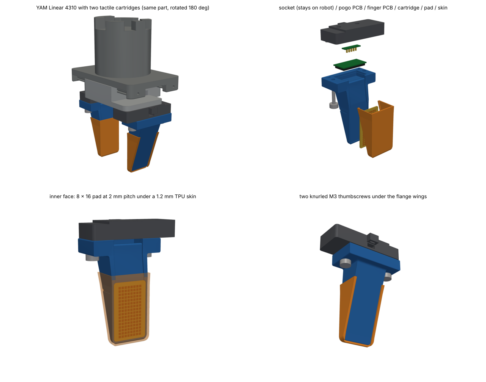

# YAM tactile cartridge (Linear 4310) — v0.2

Plug-in tactile fingers for the i2rt YAM Linear 4310 gripper. A socket stays bolted to each carriage. The finger is a cartridge that pushes straight up onto two dowels and is held by two knurled M3 thumbscrews; five pogo pins carry USB to a small MCU board inside it. The sensing face is a flat 8 × 16 bay at 2 mm pitch (a FlexiTac-style FPC / Velostat / FPC sandwich) under a snap-on TPU skin. One cartridge design fits both sides: the left finger is the right one rotated 180° about z, exactly like the stock tips.

**Status: design release.** The geometry is checked against i2rt's own YAM meshes. Nothing has been printed, fitted to a real gripper, or loaded yet.



The interface comes from the i2rt meshes (`i2rt/robot_models/gripper/linear_4310`, commit 120c3c8). Stock tips mount to the carriage face at z = -70.38 mm on two M3 points 21.0 mm apart, using knurled M3 heat-set inserts in the tip, screwed from above through the carriage. The socket copies that (same inserts, same screws). The tool point (`grasp_site`) stays at z = -144.65 mm, so existing configs and IK targets keep working.

## Webpage

`web/index.html` is a one-page overview: a pressable taxel pad that shows the data layout, a 3D viewer (WebGL, no dependencies), the sensor and electronics, the fit checks, the build steps and every file. It works offline. Serve this folder and open the page:

```sh
python3 -m http.server -d cartridge 8000     # from the repository root
# then open http://127.0.0.1:8000/web/
```

GitHub doesn't render HTML from a branch, so use the local server (or download the branch).

## Why a flat bay

The ENPIRE-style tip curves in two directions at once. Polyimide does not stretch, so no flat FPC can be folded onto it, which is why unfolding the gripper STL into a custom FPC kept failing. Here the sensing surface is one flat face, the pad is a plain rectangle, and every trace leaves through the base. The irregular shape lives in the printed core and the skin instead. See [docs/DESIGN_NOTES.md](docs/DESIGN_NOTES.md) for the reasoning and the sensor comparison.

The tip ends up about as thin as stock but wider (numbers from `cad/measure.py`):

| from the tip | thickness at the centre / over the skin lips | stock thickness | width | stock width |
|---|---|---|---|---|
| 1.7 mm | 3.25 / 4.53 mm | 3.83 mm | 24.1 mm | 15.4 mm |
| 5 mm | 4.34 / 5.43 mm | 4.41 mm | 26.0 mm | 18.0 mm |

A 6-column pad would narrow it to about 22 mm but needs a parameter pass on the tail and notch layout.

## Layout

| path | what |
|---|---|
| `cad/yam_tactile_finger.py` | parametric CadQuery model: every dimension is in `P` |
| `cad/fpc_pcb_layout.py` | FPC artwork (DXF), finger and socket PCB outlines, `pinmap.json`, `taxel_map.json` |
| `cad/check_fit.py`, `cad/measure.py` | interference and clearance sweep against the YAM meshes; every number quoted here |
| `cad/make_sim_model.py` | MuJoCo gripper with the cartridges and 256 touch sensors, plus a self-test |
| `cad/render_views.py`, `cad/render_vtk.py` | section views (`out/check/`) and renders (`out/renders/`) |
| `cad/export_web.py` | `web/data.js` and `web/index.html` from the outputs above |
| `host/tactile_tools.py` | frame-stream parser, taxel → 3D points, FlexiTac bring-up adapter, auto-zero |
| `tools/verify_web.py` | checks the page in headless Chromium at desktop and phone width |
| `out/` | generated design files: STEP, STL, DXF, JSON, sim model, renders, checks |
| `docs/DESIGN_NOTES.md` | design reasoning, sensor choice, fleet considerations |

The parts are exported in the i2rt gripper body frame (right finger, gripper closed): x lateral, y the closing axis, z toward the wrist, millimetres.

## Rebuild

```sh
cd cartridge
pip install -r requirements.txt
make i2rt     # clones i2rt at the commit the meshes were measured at (or set I2RT_ROOT)
make all      # CAD, FPC, checks, sim, renders, webpage  (about a minute)
make verify   # page check in headless Chromium + host-tool self-test
```

## Verify on a real gripper before printing a batch

1. Confirm that the stock tip screws go in from above, through the carriage, into the tip's inserts (that is what the meshes show). The socket has the same knurled M3 inserts (Ø4.0 hole, 6 mm deep) at the same points, with 2.5 mm of blind screw-tip clearance, so the stock screws carry over.
2. Measure a laminated pad. The bay pocket is 0.8 mm (`PAD_T`); the pad should sit flush or at most 0.05 mm proud. Shim with Kapton or change `PAD_T`.
3. Check the ZIF keep-outs (12.5 / 8.5 mm wide, 5.5 mm deep, FH12-type back-flip) and the FPC entry height against the parts you buy. The notch floor is 2.8 mm below the docking face (`NOTCH_FLOOR`).
4. Print one socket and one cartridge. Check the dowel fit, the 0.25 mm skin squeeze at full close (`CONTACT_Y`), and that the skin ribs snap into the side grooves.

## Fit checks

These run automatically (`out/check/interference.json`, `out/check/measurements.json`):

- Across the full 0–47.5 mm stroke, every part clears the opposite carriage by at least 1.3 mm and the housing by at least 6 mm. The opposite carriage's rack slides over the socket's outer wing whenever the gripper is less than about 23 mm open, so that wing is dropped 1.5 mm, as on the stock tip.
- Nothing overlaps the opposite finger at full close except the skins.
- The only overlaps are intended ones: the skins squeeze 0.25 mm each at full close, the pogo pins compress 0.7 mm, and the dowels are a press fit in the socket.
- Walls are at least 1.8 mm behind the pad, 2.0–2.5 mm around every insert and screw hole, and about 2.0 mm around the cartridge dowel holes (1.4 mm only at the top lip of the lead-in chamfer).

## Parts for one finger

| item | qty | notes |
|---|---|---|
| socket, PETG or PA-CF | 1 | 12.1 cm³ |
| cartridge, PETG or PA-CF | 1 | 20.1 cm³ |
| skin, TPU 85A | 1 | 2.3 cm³; wear part |
| knurled M3 heat-set insert, Ø4.0 hole, ≤5.7 mm long | 4 | 2 for the carriage screws (as stock), 2 for the thumbscrews |
| stock M3 tip screws | 2 | reused, from above through the carriage |
| Ø3 × 8 mm dowel pin (h6) | 2 | pressed into the socket |
| M3 × 14 knurled thumbscrew, head ≤ Ø8 × 3.5 | 2 | or an M3 × 14 SHCS with a printed knob; a small O-ring keeps it captive |
| FPC, 0.2 mm, ENIG, PI stiffener to 0.3 mm at the contacts | 2 | `out/fpc_pcb/fpc_rows_bottom_fab.dxf`, `fpc_cols_top_fab.dxf` |
| Velostat/Linqstat 4 mil (Adafruit 1361), laminating sheets, Kapton tape | – | FlexiTac process |
| thin PSA (e.g. 3M 467MP) | – | pad to pocket floor |
| finger PCB 27.0 × 13.8 × 0.8 mm, 4-layer, ENIG, bottom-side assembly | 1 | see Electronics |
| socket PCB 17.7 × 4.7 × 0.8 mm + 5 SMT pogo pins (2.54 mm pitch) | 1 | pins on the bottom side; the two GND pins ~0.4 mm longer |
| 4-core + shield high-flex cable (USB 2.0) | ~0.3 m | service loop for the 47.5 mm stroke |

## Printing

Print the cartridge with the docking face on the bed and the finger pointing up, with no supports; only the 13.8 mm PCB seat bridges. Use 0.2 mm layers, 4–5 walls and at least 40 % infill. The layer lines run across the bending stress, which is about 2 MPa at the beam root at the force limit below. Ream the dowel holes to 3.05 mm if your printer prints holes undersized. Print the socket on its carriage face, and the skin on its contact face in TPU 85A, slowly.

## Assembly

1. Socket: melt the four inserts into the top face (two, for the carriage) and the bottom face (two, for the thumbscrews), and press the dowels in so they stand 2 mm proud. Glue the socket PCB into its pocket, solder the cable, route it through the channel and zip-tie it to the tab. Fit the socket to the carriage and tighten the stock screws from above.
2. Pad: laminate the FPC / Velostat / FPC stack (FlexiTac process; seal the border with Kapton) and stick it into the bay pocket with PSA. Lay the tails up the groove, which is flush with the pocket floor so there is no kink, and through the notch into the cavity. Cover the exposed groove between the skin and the flange with a Kapton strip.
3. Finger PCB: with the board tilted up, insert both tails into the ZIFs and close the latches. Lower the board into its seat with a dot of epoxy at each corner; the pogo targets face up.
4. Skin: press the TPU cap onto the face. The ribs on its side walls snap into the grooves on the core's sides and lock it along the finger, and the back lips hold it against the face. To remove it, peel the side walls outward.
5. Dock: push the cartridge straight up onto the dowels and tighten both thumbscrews by hand.

## Electronics

The cartridge digitises inside the finger, so the moving connection is only five pogo pins: GND, D−, D+, VBUS, GND (x = −5.08 … +5.08 mm). The GND pins are longer so ground mates first when you swap a cartridge with the robot powered; pick a series with at least 1.5 mm travel (the standard pins compress 0.7 mm). Each finger enumerates as a USB-CDC device with iSerial set to its MCU's 96-bit UID, so a udev rule can name the ports and every episode can log which physical pad produced it. With two fingers per gripper, use a small USB 2.0 hub on the gripper or one cable per finger.

For the finger PCB, an MCU with crystal-less USB FS and at least 8 ADC channels (STM32G0B1 or STM32C071 class) fits; check the pin budget, or drive the 16 rows through two 74HC595s as FlexiTac does. Add a 3.3 V LDO, a USB ESD array and two 0.5 mm ZIFs (16-pin rows, 8-pin columns). To read out, drive one row high with the others grounded and read the 8 columns through pull-downs or, better, virtual-ground transimpedance stages; HiPi reports large fidelity gains from that low-crosstalk approach. A full 16 × 8 scan takes well under 1 ms, so 200 Hz streaming is easy.

The tails are standard 0.5 mm FFC widths (8.50 / 4.50 mm). Pin maps and contact sides are in `out/fpc_pcb/pinmap.json`: the rows-tail copper faces the PCB; the columns tail faces away, or use dual-contact ZIFs. The proximal half of the rows tail arrives reversed (pins 9–16 carry ROW15…ROW08), so `rows_readout_order` is `[0..7, 15..8]`.

Stream protocol v1, little endian, 268 bytes per frame: `AA 55 | ver u8 | flags u8 | seq u16 | t_us u32 | 128 × u16 (row-major, row 0 = distal) | crc u16`. The CRC is CRC-16/CCITT-FALSE (poly 0x1021, init 0xFFFF; check("123456789") = 0x29B1). `host/tactile_tools.py` has the parser and a reference encoder for the firmware.

Before the finger PCB exists, you can bring a pad up on a FlexiTac 32 × 16 readout board: wire tail pin i to readout line i (rows on 16 lines, columns on 8, through FFC breakouts) and call `tactile_tools.flexitac_subblock()`, which applies the row order above.

## Operating limits and QA

Forces here are per jaw, the convention in i2rt's force map (τ = 0.0146 m × F, so about 68 N of grip per N·m of motor torque). Keep the gripper force limit at about 80 N or below: by a moment-balance estimate the thumbscrew joint starts to open somewhere around 130–220 N depending on how tight the screws are, and the pad lasts longer well below that. Auto-zero every episode with the gripper open (`tactile_tools.Baseline`), since piezoresistive baselines drift. Log the gripper motor current next to the pads as a free total-grip-force channel, and check each cartridge on a known-weight press jig before it goes on a robot, recording its UID.

## Data and simulation

`out/taxel_map.json` gives each taxel's centre in the i2rt gripper body frame at q = 0, plus the slide direction of each finger, so `tactile_tools.lift()` turns frames into 3D tactile points without per-rig calibration (every cartridge has the same CAD geometry). For LeRobot, store e.g. `observation.tactile.left` / `.right` as 16 × 8 float32 at the control rate, and keep the raw 200 Hz stream with MCU timestamps.

`out/sim/linear_4310_tactile.xml` keeps the i2rt names (`gripper`, `tip_left/joint7`, `tip_right/joint8`, `tcp_site`, `grasp_site`). Each taxel gets a collision box and a `touch` sensor, and the fingers collide through boxes that stay inside the real parts (within 0.02 mm) rather than through the cartridge's convex hull. In the self-test, a 24 mm block held at a 15 N grip reads 15.0 N on each finger over 88 taxels. The tip inertials are the stock values.

## Changes in v0.2 (after an independent review of v0.1)

- The socket's outer wing is dropped 1.5 mm; in v0.1 it sat 0.003 mm under the opposite carriage's rack. `check_fit.py` now reports clearance over the full stroke, not just overlap volume.
- The mount uses the stock arrangement (inserts in the socket, screws from above).
- The dowels moved to (±17.5, 22) mm, 35 mm apart, for 2 mm walls; the dock is 0.5 mm wider per side for 2.2 mm walls around the thumbscrew inserts.
- The skin has retention ribs, and the tail groove is flush with the pocket floor (v0.1 had a 0.35 mm step under the rows tail).
- The FPC tails are standard FFC widths, with 0.2 mm slots 0.2 mm clear of copper and one gang coverlay opening; the ZIF keep-outs are sized for real connectors.
- Bring-up row order, the sim's collision geometry and the grip-force wording are fixed.

## Licences

The pad follows the FlexiTac V2 process (Huang and Li, Columbia), whose hardware files are CC BY-NC 4.0; the FPC artwork here is new, but check that licence before any commercial or TRI-side use. Meshes derived from i2rt are MIT-licensed (`out/sim/NOTICE.txt`). The page's typeface, Archivo, is SIL OFL 1.1 (`web/fonts/OFL.txt`).

## Next steps

1. Finger-PCB schematic and layout.
2. Firmware: scan plus USB-CDC per the protocol above.
3. Gerbers from the FPC DXFs.
4. A two-cartridge pilot (100+ demos) to check drift, skin wear and swap consistency.
