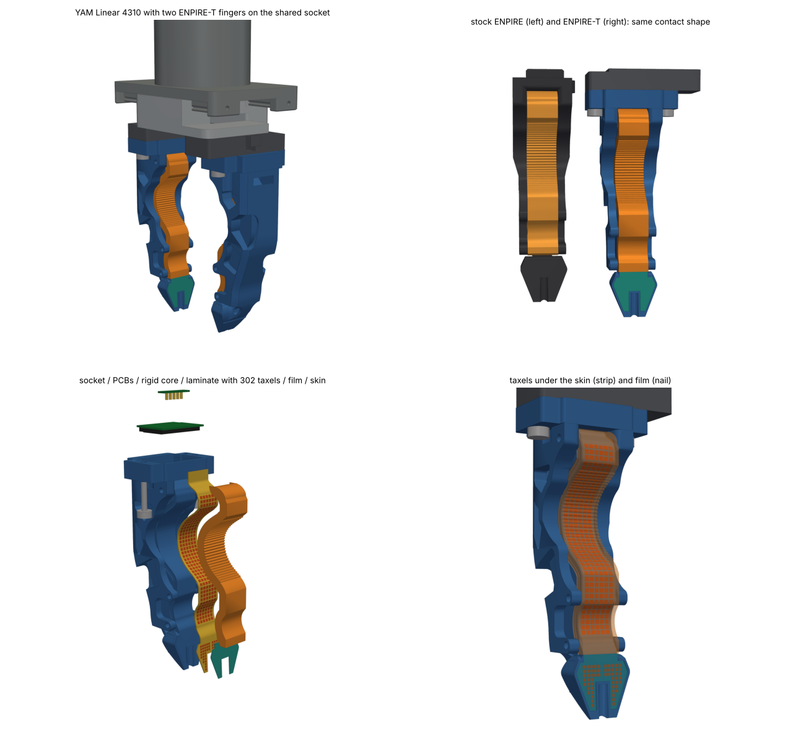
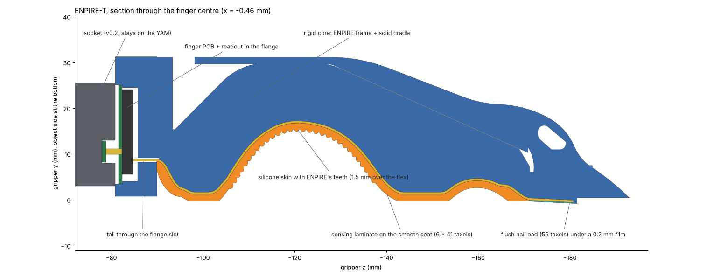

# ENPIRE-T: the ENPIRE finger as a tactile cartridge

ENPIRE-T keeps the outside of the ENPIRE gripper finger (Wenli Xiao, NVIDIA GEAR, CC BY 4.0) and makes it a plug-in tactile cartridge for the YAM Linear 4310. It docks on the same socket as the v0.2 flat cartridge, so one socket per carriage takes either finger. The thin grooved nail keeps its shape and gets a flush 56-taxel pad. The serrated cradle becomes rigid, carries a 246-taxel strip under a molded skin with ENPIRE's teeth, and keeps its outer shape.

**Status: design release.** The geometry is checked digitally against the i2rt YAM meshes and the original ENPIRE meshes, and the sensing is checked in MuJoCo. The readout electronics, the laminate, the skin and its mold, and the print settings are untested: nothing has been printed, laminated or loaded yet.

## What stays and what changes

| | ENPIRE | ENPIRE-T |
|---|---|---|
| nail | hard PETG wedge, flat face, Ø3.5 mm centre groove, 1.4 mm face plate over a cross-slot | same outside; slot filled; 56 taxels at 1.5 mm in a 0.70 mm pocket under a 0.20 mm film, flush with the original face; the pad stops about 3 mm short of the tip |
| cradle | compliant TPU lattice with ~1 mm teeth | part of one rigid core; smooth seat 2.0 mm under the original surface; 6 × 41 taxels at 2.0 mm; molded silicone skin restores the teeth |
| between cradle and nail | a V-notch about 3 mm tall and 2 mm deep, with a slit at its root | filled flush; the laminate passes through here on its way to the nail |
| root | screw-on block with two M3 inserts | flange that docks on the v0.2 socket (dowels, thumbscrews, pogo pins), with its own finger PCB |
| sensing | none | 302 taxels, one laminate, USB over five pogo pins |

The cradle loses the lattice's give; only the 1.5 mm skin over it is soft. In return the laminate never flexes in use, and every taxel's position comes from the CAD, so a finger needs no position calibration. It still needs zeroing every episode and a gain check on a press jig, like any piezoresistive pad.

## Numbers

Measured by `cad/enpire_measure.py` (`out/enpire/check/measurements.json`):

| from the tip | thickness | stock ENPIRE | width | stock ENPIRE |
|---|---|---|---|---|
| 0.5 mm | 1.59 mm | 1.59 mm | 10.9 mm | 10.9 mm |
| 1.7 mm | 2.72 mm | 2.72 mm | 11.9 mm | 11.9 mm |
| 5 mm | 5.44 mm | 5.44 mm | 14.5 mm | 14.5 mm |
| 10 mm | 8.84 mm | 8.84 mm | 18.5 mm | 18.5 mm |

The fingertip sits 123.4 mm below the carriage face, 8.5 mm lower than a stock ENPIRE whose top rib bears on the carriage. If your carriage has a slot for that rib, the stock finger sits 5 mm higher still, and the difference is 13.5 mm. The 19.5 mm socket and flange replace the stock 11 mm root; that's the price of the shared, tool-free dock. Update the TCP in your IK config: the tip is at z = −193.76 mm in the gripper frame.

On the contact side the shape is the original, with one exception. From the object's side, the surface of the cradle matches ENPIRE's TPU front to 0.005 mm at the 95th percentile, and the nail film lies exactly on the original nail plane. Away from the cradle, nail pocket and flange, the frame is unchanged, back included. The exception is the V-notch where ENPIRE's TPU insert meets the nail. It is about 3 mm tall and 2 mm deep, and ENPIRE-T fills it flush because the laminate runs through it. Both fingers still meet nail tip to nail tip when the gripper closes on nothing, at 1.443 mm per jaw; the same calculation for stock ENPIRE also gives 1.443 mm.

The core is 44.6 cm³: 57 g in solid PETG, 45 g in PA12. The skin is 2.7 cm³, about 3 g of silicone. Printed solid, a stock ENPIRE would come to about 43 g by the same estimate.

## What the sensors can't see

The nail faces are tilted 2.9° so that the tips meet first, as on stock ENPIRE. A rigid flat part held at the tips therefore touches only the bare tip. The first taxel row is centred 4.9 mm from the tip, where the faces are already 0.25 mm per side behind the tip line. In MuJoCo, a flat plate pinched at the tips at 15 N puts nothing on the nail taxels. Round and soft objects, and anything held further up the nail, do reach them. For flat rigid parts, read the grip from the gripper motor current instead.

Three more gaps follow from the layout. The last 12 mm or so between the strip and the nail has no taxels: the end of the lower lobe, the ramp and the neck. A pin seated in the centre groove presses on the groove walls, not on the pad. And the side margins of the cradle, outside the six strip columns, don't sense.

The cradles grip round handles: with the nails touching, the two arches hold a rod of up to 30.4 mm, and larger ones sit in the cradles with the nails apart. Smaller parts belong to the nail.

## Why it unfolds

Both ENPIRE contact faces are developable. The nail face is exactly planar, and the TPU insert is an exact extrusion across its 15 mm width. What made unfolding the STL fail was everything around them: the ~1 mm serration teeth (far too tight a bend for polyimide), the lattice that bends in use, and the small nail with its groove and thin face plate.

ENPIRE-T removes those problems. The seat is the TPU outline with the teeth stripped (a morphological opening), offset 2.0 mm inward and smoothed, so that no bend under a taxel is tighter than 2.6 mm. The teeth move into the skin. The flex path runs from the flange, down that seat, up a ramp, and along the nail plane, tangent all the way. Every surface the laminate touches is either an extrusion across the finger or the nail plane, so the flat pattern is exact in (u, s). Here u is the gripper x and s is the arc length from the flange face. The tightest bend anywhere on the laminate, 1.8 mm, is where it leaves the flange slot, away from the taxels.

## Parts for one finger

| item | qty | notes |
|---|---|---|
| core, MJF/SLS PA12 or tough SLA resin (PETG by FDM is possible, see below) | 1 | `out/enpire/core.stl` |
| skin, silicone Shore 20–30A (cast) or TPU 85A (printed) | 1 | `skin.stl` / `skin.step`; mold: `skin_mold_core.stl`, `skin_mold_shell.stl` |
| laminate: rows sheet + cols sheet (2-layer flex), Velostat 4 mil, thin PSA | 1 | `fpc_pcb/rows_sheet_fab.dxf`, `cols_sheet_fab.dxf` |
| polyurethane protective tape, 0.20 mm total (3M 8562), cut to the nail pocket | 1 | wear part; `film.stl` gives the outline; the pocket depth assumes 0.20 mm, so measure your tape |
| finger PCB 28.8 × 21.5 × 0.8 mm, 4-layer, ENIG, bottom-side parts ≤ 2.2 mm | 1 | new board, not the v0.2 one; `fpc_pcb/finger_pcb_outline.dxf` |
| 0.3 mm FPC connectors: 60-contact (rows, B) and 18-contact (columns, A) | 1 + 1 | e.g. Hirose FH26W series; check the contact counts you can buy |
| v0.2 socket, socket PCB, 5 pogo pins, 2 dowels, 4 inserts, 2 thumbscrews | 1 set | unchanged from v0.2 (see `../README.md`) |

## Printing and casting

Order the core in MJF or SLS PA12, or print it in a tough SLA resin with supports on the back of the finger only. These processes form the two skin-wall slots beside the cradle (0.9 mm wide, 2.6 mm deep) and the 0.3 mm hook grooves inside them without supports in the slots. Check the seat with a straight edge across the width, and remove any ridge over 0.05 mm, since the laminate reads bumps as pressure.

FDM in PETG is possible but harder. Lying on its −x side keeps the seat smooth, because the seat is then built from perimeters. But the flange is wider than the body, so the body needs tree supports along its whole length. Each slot's ceiling is also a 2.6 mm flat overhang that sags. Clear the slots with a 0.8 mm blade, and check that the hook grooves are open, before fitting a skin.

To cast the skin, spray release on the mold, push the core plug into the shell from the back, and lay the mold front face up. Inject degassed silicone with a syringe through the 3 mm port at the bottom of the arch, the lowest point, until it comes out of all four 2 mm vents at the two lobes and the two ends. Then degas the filled mold for a minute and top up. A printed TPU 85A skin also fits; print it on its side, slowly.

## Assembly

1. Build the laminate on the core, not flat. Around the top lobe the outer sheet runs about 0.5 mm further than the inner one, and a stack laminated flat would wrinkle there. Bond the rows sheet to the core with a thin PSA, starting at the nail pocket and working toward the flange. Its pad sits in the pocket, its strip follows the seat, and its tail goes up through the flange slot.
2. Lay the Velostat pieces on the strip and the nail pad, then lay the cols sheet over them with its tail in front of the rows tail. Bond the two sheets to each other only at the nail end and in the flange slot, so they can slide over the strip, where the skin holds them down. Keep them apart where they leave the flange, which is a 1.8 mm bend.
3. In the cavity, take the cols tail (front) up to connector A, the near one. Take the rows tail (rear) along the cavity floor, under A, and up into connector B. Close the latches and seat the finger PCB, pogo targets up.
4. Press the PU tape over the nail pad and the short neck behind it.
5. Wet the cradle with soapy water or IPA and press the skin on. Its side walls go into the slots beside the cradle and flex outward while their hook ribs pass the lip, then click into the grooves. Bond the last 3 mm of the feather edge, at the nail end, with silicone transfer tape.
6. Dock it on the socket like the v0.2 cartridge: straight up onto the dowels, then hand-tighten both thumbscrews.

## Electronics

The laminate has 58 row lines (41 on the strip, 17 on the nail, where the groove splits the rows) and 16 column lines (6 strip, 10 nail). That gives 302 real crossings out of a 58 × 16 scan.

The rows sheet carries its leads on its second layer. Strip-row vias sit in the left margin, and nail-row vias sit on their electrodes. Every lead has its own lane, so none of them cross. The vias are 0.1 mm laser microvias, filled and capped, because some sit under a taxel. Lines and spaces are 0.1 mm.

The DRC in `cad/enpire_fpc.py` checks copper spacing, edge clearance and via clearance on both sheets, and it is clean. The tails end in 0.3 mm-pitch fingers: 60 contacts on the rows sheet (18.3 mm) and 18 on the cols sheet (5.7 mm), with ground fingers at both ends. The same script checks each tail's route in the cavity. The cols tail has 0.4 mm of straight run between its bend and the stiffener in front of A. The rows tail has 0.4 mm to spare for its S-bend between A and B.

The readout needs 58 row drivers and 16 sense channels. Eight 74HC595-class shift registers can drive the rows, each row high or held at ground as FlexiTac does. The 16 columns go to ADC inputs through virtual-ground transimpedance stages (four quad op-amps), as in HiPi, under a USB FS MCU such as an STM32G4. That's roughly 200 mm² of parts. Once the connectors and the tail corridor are kept clear, the bottom of the board has 254 mm² free, so the layout is tight. It's the next step (`fpc_pcb/pcb_preview.png` shows the free area). If it doesn't fit, sharing row lines between segments of the strip can bring the scan down to about 40 lines. At about 30 µs per row, a full scan takes about 2 ms, which is fine for 200 Hz.

The stream uses protocol v2, which `host/tactile_tools.py` parses on the same port as v1:

`AA 55 | ver 2 | flags | seq u16 | t_us u32 | layout u8 (2) | 0 | n u16 (302) | n × u16 | crc u16`

That makes 620 bytes per frame. The values come in taxel-map order. `tactile_tools.scan_table(2)` gives the (row line, column line) of each taxel, which is the table the firmware needs.

## Checks

| check | result |
|---|---|
| clearance over the 0–47.5 mm stroke | socket 1.3 mm to the opposite carriage (as v0.2); core and skin at least 6 mm, thumbscrews 5 mm, from the housing and carriages; no overlaps |
| parts of one finger | no overlaps except the designed 0.7 mm pogo stroke |
| first finger-to-finger contact | nail tips, at 1.443 mm per jaw; stock ENPIRE, computed the same way: 1.443 mm |
| contact shape vs ENPIRE | cradle p95 0.005 mm, nail film 0.000 mm off the original plane, rest of the frame (back included) unchanged; the cradle-to-nail notch (2.0 mm deep) is filled |
| walls | 3.3 mm behind the nail pocket; lips of 0.85 mm along the groove and 0.70 mm at the face edge; at least 1.45 mm around the dowels, 2.1 mm around the thumbscrews; 4.1 mm cavity floor |
| skin | 1.5 mm over the laminate (1.3 mm minimum); the wall slots leave 0.2 mm more room than a hook rib needs to pass the lip |
| laminate | no bend under a taxel tighter than 2.6 mm; 1.8 mm at the flange exit; flex DRC clean, 0.1 mm minimum spacing |
| tail routes | 0.4 mm of spare straight run in front of each connector |
| MuJoCo, 3 mm pin pinched by the nails at 15 N | 12.8 N on each nail pad, 85% of the contact force (the rest lands beside the groove), 8 taxels each |
| MuJoCo, 32 mm rod in the cradles at 15 N | 73–77% of the contact force on the strips (the rest on the side margins), 24 taxels each |
| MuJoCo, flat plate held at the tips at 15 N | 0 N on the nail taxels: the blind spot described above |

The sim's test objects are frictionless, so each finger's contact forces carry exactly the grip and the sensed share is well defined. Each touch sensor counts each contact once.

## Check before a batch

1. Print one core, then check the slots, the hook grooves and the seat before ordering more.
2. Trial-fit a skin on that core: the walls should slide in, the ribs click into the grooves, and the skin sit down on the seat without lifting at the lobes.
3. Dry-fit both tails with paper cut-outs, stiffeners included, before ordering flex. The rows tail has to pass under connector A.
4. Laminate one finger on its core and look for wrinkling on the arch, and on the strip rows that sit on 2.6–3 mm bends near the lobes. The bend radius under each row is listed in `taxel_map.json`. Expect higher baselines on those rows and zero every episode.
5. Measure the PU tape. The pocket assumes 0.20 mm, and a thicker tape makes the nail pad stand proud, so the pads preload at full close.
6. Cast one skin and look for bubbles at the lobes and in the side walls.
7. Check the real carriage seat. The i2rt meshes show no slot for ENPIRE's top rib, so the stock finger is taken to bear on that rib. ENPIRE-T doesn't depend on it, because it docks on the socket, but the length comparison above does.
8. Watch for wear. The film and the skin are the wear parts; replace them before the laminate shows through.
9. Look for tasks that used the filled notch between the cradle and the nail, to hook a thin edge for example. ENPIRE-T no longer has it.

## Files

| path | what |
|---|---|
| `cad/enpire_source.py` | fetches the ENPIRE STLs and checks them against pinned SHA-256 hashes; native → gripper placement |
| `cad/enpire_finger.py` | profile, seat, flex path; core, skin, laminate, film, mold; `params.json`, `profile.json` |
| `cad/enpire_fpc.py` | flat pattern, electrodes, routing, DRC, tail routes, `pinmap.json`, `taxel_map.json`, finger PCB |
| `cad/enpire_check.py`, `cad/enpire_measure.py` | fit, contact, shape, walls; the numbers above |
| `cad/enpire_sim.py` | MuJoCo model with 2 × 302 touch sensors and the three self-tests |
| `cad/enpire_render.py` | renders and the annotated section |
| `out/enpire/` | all generated files |

Rebuild with `make enpire` (a few minutes, after `make i2rt`). `make verify` includes the ENPIRE-T consistency checks.

## Licence and attribution

ENPIRE-T's core, skin, film and their meshes are a modified version of the ENPIRE gripper finger by Wenli Xiao (MakerWorld model 2984746), licensed CC BY 4.0. The changes are listed above and in `out/enpire/NOTICE.txt`. The original STLs are not redistributed: `make enpire-src` downloads them from github.com/pgeedh/Open-ENPIRE-Gripper at commit 72cc833 and checks them against the SHA-256 hashes pinned in `cad/enpire_source.py`. The laminate artwork is new; the FlexiTac process notes in `../README.md` apply.
