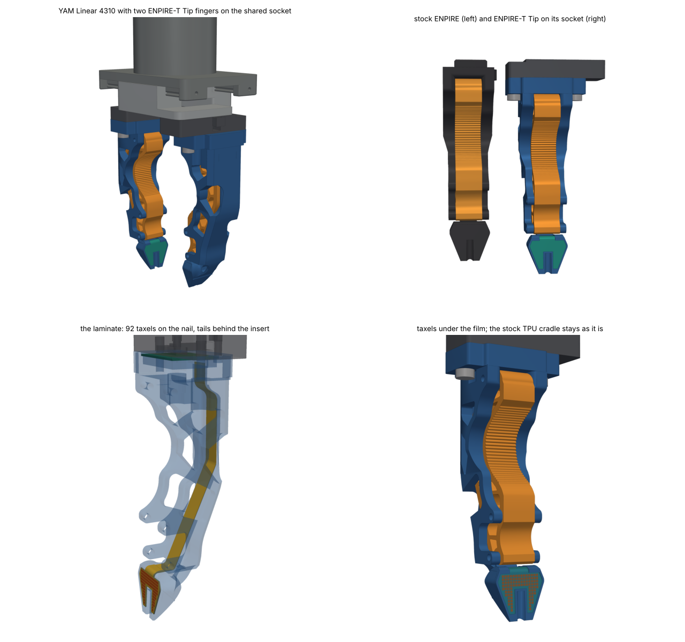
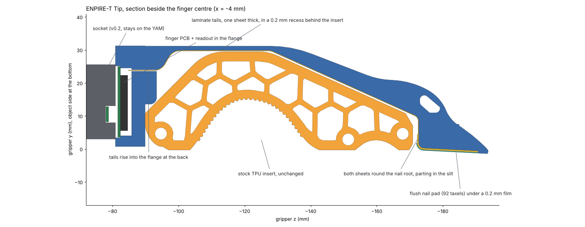

# ENPIRE-T Tip: ENPIRE with a sensing nail

ENPIRE-T Tip is the ENPIRE gripper finger (Wenli Xiao, NVIDIA GEAR, CC BY 4.0) with tactile sensing on the nail only. The compliant TPU cradle is ENPIRE's own insert, printed from the original file and fitted unchanged. The nail gets a flush pad of 92 taxels at 1.25 mm. The finger docks on the same socket as the v0.2 flat cartridge and ENPIRE-T, so one socket per carriage takes any of the three.

Compared with [ENPIRE-T](ENPIRE_T.md), it gives up sensing in the cradle and keeps the lattice's give. It has no skin and no mold, and its laminate is one small pad with two narrow tails. The nail pitch is finer (1.25 mm instead of 1.5 mm), and the scan is 20 × 14 lines instead of 58 × 16.

This is a design release. The geometry is checked digitally against the i2rt YAM meshes and the original ENPIRE meshes, and the sensing is checked in MuJoCo. The readout electronics, the laminate and the print settings are untested: nothing has been printed, laminated or loaded yet.

## What stays and what changes

| | ENPIRE | ENPIRE-T Tip |
|---|---|---|
| nail | hard PETG wedge, flat face, Ø3.5 mm centre groove, 1.4 mm face plate over a cross-slot | same outside; slot filled; 92 taxels at 1.25 mm in a 0.70 mm pocket under a 0.20 mm film, flush with the original face; the taxels stop about 4 mm short of the tip |
| cradle | compliant TPU insert | the same insert, unchanged |
| nail root | a sharp corner beside a slit, between the insert's lower end and the root | over the laminate's 8.8 mm width, the corner is rounded off and the laminate wraps round it under the film, then runs up the slit, which is wider there |
| back spine | open frame behind the insert, with windows | a 0.2 mm recess along the spine's inner face carries the laminate's tails; a 1 mm ledge backs them where the frame has windows; the open gap between the root block and the spine bar, behind the insert's top corner, is closed |
| root block | screw-on block with two M3 inserts | flange that docks on the v0.2 socket (dowels, thumbscrews, pogo pins), with its own finger PCB |
| sensing | none | 92 taxels on the nail, USB over five pogo pins |

On the contact side only two things differ from stock. The nail pad is flush under its film. At the nail root, over the laminate's width, the film-covered laminate wraps round a rounded-off corner: it lies up to 0.4 mm inside the stock surface and nowhere outside it, and the slit beside the insert is wider there. Each taxel's position comes from the CAD, so a finger needs no position calibration. It still needs zeroing every episode and a gain check on a press jig, like any piezoresistive pad.

## Numbers

Measured by `cad/enpire_tip_check.py` (`out/enpire_tip/check/measurements.json`). The fingertip is the stock one:

| from the tip | thickness | stock ENPIRE | width | stock ENPIRE |
|---|---|---|---|---|
| 0.5 mm | 1.59 mm | 1.59 mm | 10.9 mm | 10.9 mm |
| 1.7 mm | 2.72 mm | 2.72 mm | 11.9 mm | 11.9 mm |
| 5 mm | 5.44 mm | 5.44 mm | 14.5 mm | 14.5 mm |
| 10 mm | 8.84 mm | 8.84 mm | 18.5 mm | 18.5 mm |

As on ENPIRE-T, the shared socket puts the fingertip 123.4 mm below the carriage face. That is 8.5 mm lower than a stock ENPIRE whose top rib bears on the carriage, or 13.5 mm if your carriage takes that rib in a slot. Update the TCP in your IK config: the tip is at z = −193.76 mm in the gripper frame.

Seen from the object, the cradle and the sides match the original exactly and the nail film lies on the original nail plane. The frame is unchanged except at the flange, the nail pocket, along the laminate's route, and in the closed gap behind the insert's top corner. Both fingers meet nail tip to nail tip when the gripper closes on nothing, at 1.443 mm per jaw, the same as stock ENPIRE.

The core is 26.8 cm³: 27 g in PA12, 34 g in solid PETG. With the stock insert (about 14 g) a finger is about 41 g in PA12; a stock ENPIRE printed solid in PETG is about 43 g.

## What the sensors can't see

The cradle has no taxels, so a power grasp in the arches registers nothing. Read the grip from the gripper motor current there, or use ENPIRE-T.

The nail faces are tilted 2.9° so that the tips meet first, as on stock ENPIRE and ENPIRE-T. A rigid flat part held at the tips touches only the bare tip: the distal taxel edge is 4.0 mm from the tip, where the face is already 0.2 mm behind the tip line. In MuJoCo, a flat plate pinched at the tips at 15 N puts nothing on the taxels. Round and soft objects, and anything held further up the nail, do reach them.

The taxels stop about 4 mm short of the tip: the pad leaves the last 3 mm of the nail bare, and beside the groove the narrowing prongs leave no room for another row before that. A 2 mm bare tip would add one taxel, 3 mm from the tip. A pin seated in the centre groove presses on the groove walls, not on the pad.

## The laminate's route

The pad sits in a 0.70 mm pocket in the nail, as on ENPIRE-T. From its proximal end the two sheets wrap round the nail root together, over a 1.6 mm bend, and turn up the slit between the root and the insert's lower end. They part at the foot of the slit, just above the bend. From there their tails run side by side, rows sheet on the −x side and cols sheet on the +x side, so the route behind the insert is one sheet thick. That matters, because the insert's back is only 0.2 mm from the spine at the top.

Over the laminate's width the root's corner is cut back to take the bend, and its face in the slit is cut back to the laminate's bonding face, so the film-covered bend lies inside the stock corner and the slit is wider than on stock ENPIRE there. The tails lie in a 0.2 mm recess cut into the spine's inner face, 9.2 mm wide, as wide as the spine is at the slit. Where the frame has windows behind the spine, a 1 mm ledge backs them. They pass behind the insert's top corner in an S-curve and rise into the flange through a slot at the back of the cavity. The gap there between the root block and the spine bar is closed to carry them.

Every surface on the way is an extrusion across the finger or the nail plane, so the flat pattern is exact in (u, s), as on ENPIRE-T. Here u is the gripper x and s the arc length along the laminate's bonding face from the flange face. Round the nail root the cols sheet runs outside the rows sheet, one sheet further out, so its flat pattern is 0.21 mm longer between the pad and the parting point. Measured at the laminate's inner face, the tightest single-tail bend is 1.8 mm, where the route turns from the spine into the slit, and the stacked bend round the nail root is 1.6 mm, more than ten times a sheet's thickness.

The PU film follows the laminate round the nail root to the foot of the slit, about 2.2 mm behind the nail face. Above that the laminate's own coverlay lines the root side of the slit, behind a gap of at least 1.0 mm to the insert; looking straight at the nail, you first see it 10 mm up the slit. The laminate is at least 0.22 mm from the insert along the top of the spine and 0.48 mm along the diagonal, and 1.0 mm in the slit and round the bend, where the stock root face comes within 0.72 mm of the insert. The tails sit 0.03 mm below the surface of the spine's inner face. Under a hard grasp the insert can reach the spine, as on stock ENPIRE, and then at most presses lightly on the tails. Nothing there senses, but watch their coverlay for wear.

## Parts for one finger

| item | qty | notes |
|---|---|---|
| core, MJF/SLS PA12 or tough SLA resin | 1 | `out/enpire_tip/core.stl` |
| ENPIRE's TPU insert, printed and fastened as ENPIRE specifies | 1 | `I2RT_UCG_Soft.stl`; `make enpire-src` fetches it |
| laminate: rows sheet + cols sheet (2-layer flex, rolled-annealed copper), Velostat 4 mil, thin PSA | 1 | `fpc_pcb/rows_sheet_fab.dxf`, `cols_sheet_fab.dxf` |
| polyurethane protective tape, 0.20 mm total (3M 8562) | 1 | wear part; cut it to `fpc_pcb/film_cut.dxf`, which covers the nail pocket and wraps round the nail root; `film.stl` shows it in place; the pocket depth assumes 0.20 mm, so measure your tape |
| finger PCB 28.8 × 21.5 × 0.8 mm, 4-layer, ENIG, bottom-side parts ≤ 2.2 mm | 1 | ENPIRE-T's outline and pogo targets, connectors at the back; `fpc_pcb/finger_pcb_outline.dxf` |
| 0.3 mm FPC connectors: 16-contact with contacts away from the board (A, columns; top contact, e.g. Hirose FH35) and 22-contact with contacts on the board side (B, rows; bottom contact, e.g. Hirose FH26W) | 1 + 1 | check the contact side, contact count and height (≤ 2.2 mm) of what you can buy |
| v0.2 socket, socket PCB, 5 pogo pins, 2 dowels, 4 inserts, 2 thumbscrews | 1 set | unchanged from v0.2 (see `../README.md`) |

## Printing

Order the core in MJF or SLS PA12, or print it in a tough SLA resin with supports on the back of the finger only. Check the recess along the spine's inner face: it should be 0.2 mm deep and smooth, with no ridge over 0.05 mm where a tail lies, and the ledge should be whole where it crosses the frame's windows. Check that the slot at the back of the flange is open into the cavity, that the nail root's corner is rounded off across the recess and runs smoothly into the pocket floor, and that the floor is flat.

## Assembly

The connectors sit under the finger PCB, inside the closed cavity, so their latches can only be reached with the board held clear of the flange. Latch the tails first, while the laminate is still loose, and bond it to the core after the board is seated.

1. Laminate the pad first: the two sheets with the Velostat between them, bonded to each other round the pad only. From the pad to where they part they lie on each other unbonded; the cols sheet's neck is drawn 0.21 mm longer, for the bend round the nail root, where it runs outside.
2. With the insert out, feed the stiffened tail ends up through the flange slot from below: the rows tail first, then the cols tail on its +x side. Pull them on up through the cavity, far enough to reach the board held above the flange. The pad hangs free below the nail.
3. Hold the finger PCB above the flange, its underside toward you, and latch the cols tail into connector A and the rows tail into connector B.
4. Lower the board into its seat, pogo targets up, feeding the tails back down through the slot as it goes. In the cavity the cols tail rises straight to A, near the back wall, and the rows tail runs along the cavity floor, under A, and up into B.
5. Wrap the stacked neck round the nail root and bond the pad into its pocket, rows sheet down.
6. Lay each tail into its half of the recess, rows on −x and cols on +x, and bond it with a thin PSA, working up from the slit to the S-curve. Push any spare length up through the slot into the cavity, where each tail has 0.3 mm of slack in front of its connector.
7. Press the PU tape over the nail pad and on round the nail root, over the laminate's bend, to the foot of the slit.
8. Fit the stock insert as on stock ENPIRE. Its back should clear the tails all along the recess.
9. Dock it on the socket like the v0.2 cartridge: straight up onto the dowels, then hand-tighten both thumbscrews.

## Electronics

The pad has 12 rows of taxels. The groove splits the 8 distal rows into left and right halves, so the rows sheet has 20 row lines; the cols sheet has 14 column lines. That gives 92 real crossings out of a 20 × 14 scan.

Leads run on each sheet's second layer, under the other electrodes. On the cols sheet the vias sit in the first row gap, and the columns outside the neck take their leads out over the inner vias and back between them. On the rows sheet the halves' leads come down the prongs and step in below the groove's closed end, beside the full rows' vias. Each bus then steps into its tail band before the sheets part; the lowest of those steps lie in the stacked bend round the nail root. Lines and spaces are 0.1 mm. Most row vias sit under a taxel, so the 0.1 mm laser microvias must be filled and capped flat. The DRC in `cad/enpire_tip_fpc.py` checks copper spacing and edge clearance on both sheets, and it is clean. Where each sheet narrows from the shared neck to its own tail, the step has 0.5 mm fillets, so the step doesn't start a tear.

The tails end in 0.3 mm-pitch fingers with ground fingers at both ends: 22 contacts on the rows sheet (6.9 mm) and 16 on the cols sheet (5.1 mm). Their lengths come from each tail's centreline in the cavity, plus 0.3 mm of slack. Each tail keeps its band width until it is clear of the other; the cols tail's fan-out is placed to clear the rows tail. Both tails carry their fingers on their second layer. After their bends in the cavity the rows fingers face the board and the cols fingers face away from it, hence the two connector types in the parts list. In the cavity each tail bends round 0.9 mm at its centreline (0.8 mm at its inner face), as on ENPIRE-T, about six times a sheet's thickness, which suits a one-time bend with rolled-annealed copper. The cols tail has 1.1 mm of straight run in front of connector A's stiffener, the rows tail 0.3 mm in front of B's, and the rows tail passes 1.4 mm under A.

The readout needs 20 row drivers and 14 sense channels: three 74HC595-class shift registers, 14 virtual-ground transimpedance stages (four quad op-amps) into ADC inputs, and a USB FS MCU such as an STM32G4. The board has 322 mm² free once the connectors and the tail corridor are kept clear, which is comfortable (`fpc_pcb/pcb_preview.png`). At about 30 µs per row, a full scan takes under 1 ms.

The stream uses protocol v2, layout 3, which `host/tactile_tools.py` parses on the same port as the other layouts:

`AA 55 | ver u8 = 2 | flags u8 | seq u16 | t_us u32 | layout u8 = 3 | reserved u8 = 0 | n u16 = 92 | n × u16 | crc u16`

That makes 16 + 2 × 92 = 200 bytes per frame. The values come in taxel-map order, and `tactile_tools.scan_table(3)` gives the (row line, column line) of each taxel.

## Checks

| check | result |
|---|---|
| clearance over the 0–47.5 mm stroke | socket 1.3 mm to the opposite carriage (as v0.2); core and insert at least 6 mm, thumbscrews 5 mm, from the housing and carriages; no overlaps |
| parts of one finger | no overlaps except the designed 0.7 mm pogo stroke; laminate at least 0.22 mm from the insert |
| first finger-to-finger contact | nail tips, at 1.443 mm per jaw; stock ENPIRE, computed the same way: 1.443 mm |
| contact side vs ENPIRE | cradle and sides exact; nail film 0.000 mm off the original plane; at the nail root the laminate and film nowhere outside the stock frame, the corner up to 0.4 mm inside it, and the slit's mouth nowhere narrower; the laminate's coverlay shows only inside the slit, at least 2.1 mm behind the nail face; away from the changed zones the core matches the stock frame both ways (no material removed, none added) |
| walls | 3.2 mm behind the nail pocket; lips of at least 0.85 mm along the groove and at the face edge; at least 0.97 mm behind the laminate all along its route, and no core material within 2 mm in front of it; at least 1.45 mm around the dowels, 2.1 mm around the thumbscrews; 4.0 mm cavity floor |
| laminate | at the inner face, 1.8 mm tightest single-tail bend and 1.6 mm where both sheets go round the nail root; flex DRC clean, 0.1 mm minimum spacing |
| tails in the cavity | 1.1 mm and 0.3 mm of spare straight run in front of the connectors; the rows tail 1.4 mm under connector A |
| MuJoCo, 3 mm pin, rod and square bar (edge first) pinched across the nails at 15 N | each lies across the full rows near the nail root; on a row (centred and 0.3 mm off centre) and in the gap between rows (0.6 and 0.625 mm off), all of the contact force lands on the taxels, which read 15.02 N per nail (the grip divided by the cosine of the nail's tilt) to within 0.7% |
| MuJoCo, 32 mm rod in the cradles at 15 N | nothing sensed: the stock insert takes it, as designed |
| MuJoCo, flat plate held at the tips at 15 N | 0 N on the taxels: the blind spot described above |

The sim's test objects are frictionless, so every contact force is a normal force and the share that lands on taxels is well defined. They are as stiff as the fingers' contacts. On inclined faces the normal forces add up to more than the grip, as with the 32 mm rod in the cradle (25 N on each finger against a 15 N grip). Each taxel in the sim is a flat ellipsoid in its own body whose top touches the film's outer face at the taxel's centre, so the pad has no edges for an object to catch on, and its touch sensor counts only its own contacts. A tiling of boxes reads a cylinder or a bar's edge lying across a row gap far too high, because contacts on the boxes' edges get inclined normals. The cradle in the sim is a row of plain contact boxes along the insert's front.

## Check before a batch

1. Print one core and check the recess and its ledge, the slit and the rounded corner at the nail root, and the flange slot before ordering more.
2. Fit a stock insert to that core: it should seat as on stock ENPIRE, with its back clear of the recess.
3. Dry-fit both tails with paper cut-outs, stiffeners included, before ordering flex. Thread the rows tail through the slot first, check that both reach their connectors with the board held above the flange, and that the rows tail passes under connector A once the board is seated.
4. Laminate one finger on its core and look at the stacked bend round the nail root and at the parting at the foot of the slit. Then load the cradle's lower lobe hard and check that the insert doesn't pinch the laminate in the slit.
5. Measure the PU tape. The pocket assumes 0.20 mm, and a thicker tape makes the pad stand proud, so the pads preload at full close.
6. Watch for wear on the film, over the pad and round the nail root, and on the tails' coverlay behind the insert.

## Files

| path | what |
|---|---|
| `cad/enpire_tip.py` | route, core (ENPIRE frame with the recess, ledge, closed back, nail pocket and flange), laminate and film; `params.json`, `profile.json` |
| `cad/enpire_tip_fpc.py` | flat pattern, electrodes, routing, DRC, tails, the film's cut outline, `pinmap.json`, `taxel_map.json`, finger PCB |
| `cad/enpire_tip_check.py` | fit, contact, shape, walls, the laminate's gap to the insert; the numbers above |
| `cad/enpire_tip_sim.py` | MuJoCo model with 2 × 92 touch sensors and the three self-tests |
| `cad/enpire_tip_render.py` | renders and the annotated section |
| `out/enpire_tip/` | all generated files |

Rebuild with `make enpire-tip` (a few minutes, after `make i2rt`); it uses ENPIRE-T's source fetch, `make enpire-src`. `make verify` includes its consistency checks.

## Licence and attribution

ENPIRE-T Tip's core, film and their meshes are a modified version of the ENPIRE gripper finger by Wenli Xiao (MakerWorld model 2984746), licensed CC BY 4.0. The changes are listed above and in `out/enpire_tip/NOTICE.txt`. The cradle is ENPIRE's TPU insert, unchanged: print it from the original file, which `make enpire-src` downloads from github.com/pgeedh/Open-ENPIRE-Gripper at commit 72cc833 and checks against the SHA-256 hash pinned in `cad/enpire_source.py`. The sim model and the web viewer carry copies of it placed on the finger, under the same licence. The laminate artwork is new; the FlexiTac process notes in `../README.md` apply.
