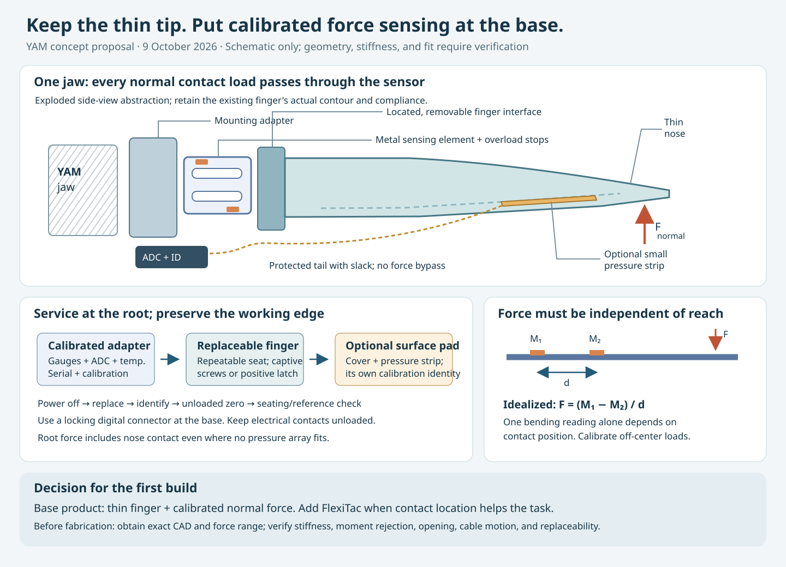

**A thin, replaceable tactile finger for YAM**

Design review · 2026-10-09 · Concept proposal, not fabrication-ready CAD

**Recommendation: retain the working fingertip shape, measure normal force at the finger mount, and make a small surface pressure array optional.** The user confirmed that the linked MakerWorld finger is the current finger, that the UMI gripper was less suitable for dexterous tasks, and that reliable contact and grip-force feedback are the first priority. Thin access geometry and precise manipulation therefore take precedence over covering the whole finger with sensing material.

The proposed product is a calibrated force-sensing adapter carrying a replaceable finger. The expensive sensing electronics remain at the wider base. A worn contact surface or damaged printed finger can be replaced independently. FlexiTac remains a useful candidate for an additional thin contact-location strip; it need not carry the responsibility for the only calibrated force measurement.

This is an engineering recommendation, not a measured comparison on this YAM. No dimensioned model of the user's exact finger, physical force range, prototype, fatigue result, or supplier quote was available during this review. Dimensions below are worked examples or proposed requirements, never measurements of the linked model.

**Daotan found a real limitation of one fabrication route.** Flattening a whole irregular STL is not a necessary first step in adding touch. An irregular outline can still be planar. A surface curved in one direction can often accept a bent flex circuit. A surface with compound curvature generally needs distortion, seams, or separate patches; the mesh being triangulated does not make a continuous copper circuit stretchable. This is a geometric explanation, not a diagnosis of the unseen CAD.

For a pressure array, use this workflow:

1. Mark where objects actually contact the finger: the leading edge, the adjacent inner face, and any side used for manipulation.
2. Identify a small planar or nearly cylindrical region. Project its perimeter onto a local plane or design a shallow seat with a controlled radius.
3. Design the electrodes, border, and cable exit in that local coordinate system. Let the compliant cover accommodate small shape differences, and check whether that cover spreads pressure too much.
4. If more than one face matters, use separate small patches or a deliberately designed branched flex circuit. Leave bend regions outside the sensing islands and connector stiffeners.
5. Keep the narrow leading edge mechanically connected to the force-sensing mount even when it cannot accommodate an array. Such edge contact remains visible in total force, but has no spatial pressure map.

Do not arbitrarily cut a finished FlexiTac FPC to the STL outline. Its traces, return paths, perimeter, and connectors must survive. Do not put a sharp fold or a repeatedly strained copper trace on the working edge. A flex supplier must review the actual stack, copper, bend radius, and dynamic flex region; a generic bend-radius multiplier is not a substitute for that review. [S1, S11]

FlexiTac V2 is a credible pressure-pad candidate: the project lists a 2 mm grid, while the paper shows smaller layouts and integration with a soft fin-shaped finger. Those examples support trying a local pad; they do not establish fit on this finger. The project’s quoted $2.50 is per sensor piece, not a calibrated, enclosed, wired, serviced YAM fingertip. [S1, S2]

**The force path is the essential hardware change.** Use one sensor adapter per jaw:

`object → thin finger/contact surface → instrumented metal flexure → YAM jaw`

All ordinary finger loads must pass through the sensing flexure. A protective shell, fastener, taut cable, or engaged stop that bypasses the flexure will corrupt the measurement. Keep the original distal shape and compliance for the first prototype. Redesign the mounting foot to accommodate the sensor at the root; verify the resulting opening, closed gap, swept volume, and tool center point rather than assuming a bolt-on extension preserves them.

The proposed adapter has a fixed mounting half, an instrumented metal element, and a moving finger interface. A positively located tongue or shoulder carries transverse load; captive screws or a positive latch retain the finger. Use a defined seating face and hard locating features for repeatable position. A latch must not rely on electrical contacts for mechanical retention. Printed polymer can form the housing and replaceable finger; it is not the proposed calibrated spring element.

Add mechanical overload stops with clearance beyond the normal measurement travel. Their gap and stiffness must be designed against the actual worst-case jaw load and shock energy. When a stop engages, mark force as outside the calibrated range. Protect the flexure and gauges from rubbing, debris, and contact without introducing a parallel load path.

For thin-tip precision, sensor compliance needs an explicit budget. If an illustrative normal-force range is 20 N per jaw and allowable additional tip deflection is 0.05 mm, the complete sensor adapter needs at least `20 / 0.05 = 400 N/mm` effective stiffness in that direction. This arithmetic is a design tradeoff, not a selected specification. It excludes the intended compliance of the current finger, which must be measured separately.

**Avoid the single bending-gauge trap.** A gauge at the root of a cantilever usually responds to moment as well as force. The same force at two positions on a long finger can produce different readings. Dividing that signal by a fixed assumed lever arm is unsuitable when the contact point moves.

The initial purchase/build specification should instead request a normal-force element with characterized off-center loading and moment rejection: for example, a suitable shear-sensing or compensated flexure. One possible custom implementation uses two calibrated bending-moment measurements on an unloaded proximal beam segment:

`M1 = Fx × (L − z1) + My`

`M2 = Fx × (L − z2) + My`

`Fx = (M1 − M2) / (z2 − z1)`

Here `z` runs along the finger, `x` is the jaw-closing direction, and the external contacts lie beyond both stations. Subtracting the moments removes dependence on the unknown distal contact distance and applied end moment in this idealized static model. It also subtracts two noisy signals: gauge matching, station spacing, thermal behavior, cross-axis loads, and calibration conditioning matter. This is an implementation candidate, not a finished load-cell design.

Calibrate with loads at the nose, middle, and both sides of the contact face. Test shear and torsion as interference inputs even if only normal force is reported. Compensate or bound finger weight and motion-induced loads using the robot pose and acceleration; a root sensor does not automatically separate those from object contact.

Normal force alone can miss a nearly pure lateral touch. If side pushing, edge following, or insertion requires detecting that contact, specify additional force axes at the root or an appropriate local sensor. Leave electrical and mechanical room for that extension. A normal-force-only first version must not be described as sensing every contact direction.

Industrial precedent exists for this architecture: WEISS offers strain-gauge sensor fingers with exchangeable contact inserts and integrated electronics. That supports the architecture, not direct compatibility with YAM or a promise about a custom design's performance. [S4]

**Sensor choice follows the measurement that is needed.**

| Candidate | Measurement and useful evidence | Decision for this gripper |
| --- | --- | --- |
| Calibrated force-sensing root adapter | Total per-jaw normal force; exchangeable sensor-finger architectures exist commercially. [S4] | Preferred base product for the confirmed priority. No contact-position map or direct slip measurement. Requires mechanical design and qualification. |
| FlexiTac V2 | Thin piezoresistive pressure array; 2 mm grid; relevant soft-finger examples. [S1, S2] | Preferred first optional surface-array experiment. Use a small defined seat and protected tail. Qualify force calibration, drift, crosstalk, and replacement repeatability. |
| AnySkin / ReSkin-style magnetic skin | AnySkin separates replaceable magnetic elastomer from electronics and studies replacement/generalization. [S5] | Strong alternative when compliant contact patterns or shear cues matter. Check the actual PCB and skin envelope; arbitrary skin shape does not make the electronics arbitrarily narrow. Test nearby steel and motor-field effects, and calibrate to newtons if force is required. |
| XELA uSkin | Commercial three-axis arrays; the manufacturer lists compact 1×1 and 2×1 variants. [S6] | A useful vendor-supported benchmark if its complete package, force range, pricing, and lifecycle meet the task. Obtain drawings and application-specific calibration details before selecting it. |
| DIGIT / GelSlim-style optical touch | Detailed image-based surface deformation. DIGIT is designed around an elastomer, illumination, camera, and housing. [S7] | Defer for the first thin generalist finger. Reconsider if fine contact geometry or insertion benefits justify the optical package and surface maintenance. |
| Small discrete force transducer or thin single-area pad | A component such as Honeywell FMA provides compensated normal-force output in a small package. [S8] | A packaging fallback behind a guided load-transfer feature. It needs protection from side loads and overload; the bare chip is not a finished fingertip. |

These are role assignments, not an unsupported ranking of lifetime or accuracy. Neither magnetic nor optical sensing is inherently maintenance-free. Neither a raw Hall-vector change nor an 8-bit pressure heatmap is automatically a calibrated force measurement.

A relevant update for dense arrays is HiPi: its authors compare against the FlexiTac readout and report better preservation of structured contact patterns through reduced crosstalk. Its claimed 220 Hz result concerns their four-array system, not this proposed YAM. Treat it as a candidate readout reference if array fidelity is limiting; it does not remove the need to qualify the sensing material, cover, or force calibration. [S9]

There is also evidence that tactile arrays can support force regulation: the October 6 revision of TF-Gripper reports a 0.45–45 N effective range for its own complete gripper. That is a useful control and calibration reference, not a transferable force specification for a cropped FlexiTac pad or this actuator. [S10]

The FlexiTac hardware repository currently states CC BY-NC 4.0. Resolve the permissions appropriate to the intended commercial rollout before incorporating that design into a product; the website's “open-source” description alone is not a commercial licensing decision. [S3]

**A narrow pressure strip can be designed without unfolding the finger.** Size it from the actual usable face, not from nominal taxel pitch alone. For early envelope budgeting:

`usable width = local face width − 2 × border allowance`

`column count ≤ floor(usable width / cell pitch)`

`row count ≤ floor(usable length / cell pitch)`

This allocates one pitch-wide envelope per cell. The final electrode outline, laminate edges, attachment, fanout, and cover require their own CAD and fabrication rules.

| Illustrative option | Nominal active-cell envelope at 2 mm pitch | Envelope with an assumed 1 mm border on each side |
| --- | --- | --- |
| 1×8 cells | 2×16 mm | 4×18 mm |
| 2×8 cells | 4×16 mm | 6×18 mm |
| 3×10 cells | 6×20 mm | 8×22 mm |

These are custom-layout concepts, not catalog FlexiTac sizes or confirmed manufacturable footprints. A practical starting point is a 1- or 2-column strip on the inner face behind the leading edge. For a face that cannot fit even that package, keep the force-only tip and move any array proximally; document the unsensed spatial region.

A 2×8 crossbar needs 10 electrode nets before shielding or other connections, rather than one wire per cell. Two layers may use separate tails. Even 10 contacts at an assumed 0.5 mm pitch span 4.5 mm between the outer contact centers before housing and margins. Put the connector and fanout at the root. The paper explicitly supports smaller arrays on the 32×16 readout board by using a subset of channels, so reuse that board for the first coupon where possible. Confirm connector routing, inactive channels, firmware dimensions, host mapping, and calibration for the new layout. [S2, S3]

Propose a thin, repeatable wear layer and edge capture outside the active area. Select its thickness by friction, wear, and signal tests rather than assuming a thick soft cap is harmless. Avoid a rigid perimeter that contacts the object before the pad or carries load around it. If the array adds thickness `t` and the seat recess is `r`, symmetric pads reduce usable jaw opening by approximately `2 × (t − r)` when `t > r`. Check the narrowest usable grasp, not just the maximum opening.

On a compliant finger, test the full bending range. Lamination can stiffen the finger, prestrain the film, wrinkle, or peel the adhesive. Locate the tail in a protected route with a controlled service loop and separate strain relief. A segmented pad is preferable to forcing a broad sheet across an actively deforming hinge.

**Make replacement an interface, not a soldering task.**

| Replaceable item | Proposed interface | What stays calibrated |
| --- | --- | --- |
| Contact surface or inexpensive whole printed finger | Repeatable seat plus captive fastener; keep the delicate leading edge free of a bulky latch | Root sensor calibration is retained, followed by zero, seating, and reference-load checks. Finger mass/compliance identity can change. |
| Optional pressure-pad cassette | Indexed recess; factory-assembled tail; connector protected at the root | Each cassette carries its own map, dead-cell mask, and calibration identity. Do not blindly reuse the previous pad's calibration. |
| Force adapter | Keyed mechanical datum and locking electrical connector | Adapter serial number, calibration matrix, temperature model, rated loads, and firmware version travel together. |
| Readout/hub | Serviceable enclosure near the gripper base | Configuration records bind the two adapter serial numbers to left/right jaw. |

For an early build, captive screws are a reasonable service mechanism; “pluggable” need not mean tool-free at the expense of rigidity. Define a replacement-time target and measure it. Factory-assemble the FPC termination so routine wear replacement does not repeatedly exercise a delicate ZIF connector.

Use short analog paths from the gauge bridges to their ADC. Put digitization and temperature measurement in or beside the adapter. Carry digital data along the moving jaw harness with strain relief. A separate USB-connected hub is a straightforward prototype interface. An internal differential link such as CAN or RS-485 is a production option after electrical and bandwidth design; do not assume direct compatibility with the motor bus or attach a dense tactile stream to it without an integration review.

Store at least sensor serial, finger type, calibration version, frame orientation, timestamp, sequence number, temperature, raw readings, calibrated normal force, and validity flags. Flags should distinguish stale data, saturation, overload, disconnected sensors, and invalid calibration. For arrays, also store the physical taxel map and dead-cell mask.

Choose power-off replacement for the initial product. Specify hot-swap only if power sequencing, contact sequencing, bus recovery, and detection are implemented and tested. A keyed plug by itself does not provide hot-swap behavior.

**The controller needs to use the signal at the right timescale.** The current repository's YAM documentation describes vision/state observations and gripper action output, not an already implemented tactile controller. Add tactile acquisition and recording as explicit new work. Log both jaws and synchronize with robot state and images. For each side define force in the local inward closing direction; do not silently add both jaw readings and call the sum “per-jaw grip force.”

During slow symmetric pinching, per-jaw force can be summarized by approximately `(FL + FR) / 2`; the sum and the imbalance have different meanings. Dynamic motion, gravity, external contacts, and asymmetric geometry can violate that simplified interpretation.

Use a bounded local force loop or contact reflex below the policy loop. Begin with guarded position closure, contact detection, and a transition to force regulation, with actuator saturation and anti-windup. On stale or invalid sensing, execute a task-appropriate bounded fallback; blindly increasing force or instantly opening a loaded gripper are not universally appropriate responses. Validate the available YAM actuator interface before selecting a controller rate or promising a minimum controllable force.

I2RT documents motor-effort-based gripper force limiting. Keep it as an independent actuator constraint; it is not evidence that the current finger contact force is directly measured. Proposed sensor sampling and end-to-end latency targets below remain subject to the actual actuator bandwidth and communication path. [S12]

**Qualify the assembled finger, including service operations.** Start with one gripper and a reference force instrument. Manufacture several sensor adapters or pads before claiming reproducibility. The following numbers are proposed development gates to negotiate against the actual objects; none are reported test results.

| Question | Proposed experiment and gate |
| --- | --- |
| Does it still reach the same places? | Compare original and instrumented fingers on representative thin-object pickup, narrow access, alignment, and insertion tasks. Measure distal envelope, closed gap, TCP, seating repeatability, and force-displacement curves. No material regression versus the current finger on the selected tasks. |
| Is force accurate where contact occurs? | Reference loads across the intended range at nose, center, edges, and different finger orientations; include shear and torsion. Initial target: error within the greater of 0.2 N or 5% of reading over the agreed useful range. Establish noise and detection limits separately. |
| Does it drift or change after use? | Warm-up and temperature sweeps, repeated ramps, ten-minute holds, recovery after unloading, and changes of contact location. Report hysteresis and creep; use unloaded zeroing without erasing real sustained contact. |
| Is replacement predictable? | At least 10 independently assembled units from multiple build batches; repeat removal/refitting, then zero and reference-load checks. Initial service target: under 2 minutes using the intended procedure, with no wire repair or manual parameter editing. This is pilot evidence, not statistical proof of fleet reliability. |
| Does a pressure map represent contact? | Point, line, broad-area, and separated simultaneous loads; repeat under the final cover. Check crosstalk, spatial spreading, cell saturation, and integrated-force error against the reference sensor. |
| Does it survive work? | Start with 10,000 representative loaded cycles, then a separate 100,000-cycle qualification stage with abrasion, cable motion, cleaning, and service swaps. Select loads from real use. Record degradation and failures; do not translate the count directly into “years.” |
| Does control react in time? | Initial force-channel acquisition target of at least 200 Hz and measured sensor-to-controller latency below 10 ms, including filtering and transport. Measure missed frames, timestamp jitter, force step response, overshoot, and sensor-disconnect behavior. The optional array and policy can run at separate, lower rates. |
| Does it help the task? | Compare the original position-controlled gripper, the force adapter, and the adapter plus pressure strip on the same object set. Measure dropped/damaged objects, grasp success, dexterity, and service burden. Keep the array only if it adds useful information. |

Size force capacity from measured gripping loads and required resolution. For illustration only, static vertical support of a 0.5 kg object with two symmetric contacts and friction coefficient 0.3 needs at least `mg / (2μ) ≈ 8.2 N` per jaw before acceleration or margin. Real friction depends on the object and final wear layer. A low-range sensor selected for delicate contact can therefore be unsuitable for generalist payloads.

The FlexiTac paper reports a 100 Hz serial stream. That is not evidence of meeting the proposed 200 Hz force-channel target; qualify an updated readout separately if that array must participate in the faster loop. [S2]

Factory work includes mechanical inspection, gauge/PCB assembly, cable strain relief, load calibration, temperature characterization, serialization, and a final assembled force check. Batch-controlled elastomer or film thickness, surface preparation, adhesive application, and cure conditions matter for a pressure cassette. Track total installed cost and service cost; no defensible production BOM total is available before choosing force range, packaging, production quantity, and suppliers.

**Build in this order.** First, obtain the exact dimensioned model and record the current thin-tip envelope, mounting geometry, force-displacement behavior, and worst-case gripping force. Design the force adapter at the root while retaining the current finger. Use a characterized commercial force element for the first mechanical prototype if its envelope fits; develop a custom flexure only when packaging or volume economics justify it. Test force accuracy and precision-task access before changing the distal shape. A small flat FlexiTac coupon can be evaluated on the bench during that work, before ordering a custom FPC; add it to the finger only if contact location improves the target tasks. Finally, freeze the mechanical/electrical service interface and qualify multiple assembled units.

An optional later finger variant can have a stiffer precision nose and a compliant inner gripping region on the same calibrated mount. Its stiffness, friction, and geometry must be identified separately in software. The first prototype should preserve the user's successful geometry so that sensing benefit is not confounded with a wholesale finger change.

The outstanding inputs for dimensioned CAD are the current STL/STEP or manufacturing drawing, mount dimensions, local face width/length, smallest acceptable tip thickness, allowable opening/TCP changes, per-jaw useful and peak force, object/environment set, and intended production volume. These block fabrication release, not the architecture recommendation.

**Evidence and scope.** The repository was inspected only for relevant instructions, YAM integration documentation, and existing tactile design files. The root `AGENTS.md` applies; no tactile design artifact was found in the scoped search. Existing steering experiments and runtime configuration were not part of this work. The linked MakerWorld page could not be reliably retrieved in this research session; its exact geometry was not inspected. The user’s confirmation is the authority for which finger is currently in use. All CAD compatibility and hardware performance claims remain explicitly unverified.

Primary references used below were checked on 2026-10-09. General concept calculations and proposed qualification targets above are this review's engineering reasoning.

| ID | Primary reference | What it supports |
| --- | --- | --- |
| S1 | [FlexiTac project](https://flexitac.github.io/) | V2 grid, sensor-piece cost, available hardware resources |
| S2 | [FlexiTac paper](https://arxiv.org/abs/2604.28156) | Sensor architecture, smaller geometries, fin-shaped-finger example |
| S3 | [FlexiTac hardware repository](https://github.com/FlexiTac/FlexiTac_Hardware_Repo) | Scanner example and stated CC BY-NC 4.0 license |
| S4 | [WEISS sensor fingers](https://weiss-robotics.com/sensor-fingers/) | Strain-gauge sensor-finger architecture with exchangeable contact inserts |
| S5 | [AnySkin project](https://any-skin.github.io/) | Replaceable magnetic skin and study scope |
| S6 | [XELA uSkin products](https://xelarobotics.com/products/) | Available compact three-axis sensor family |
| S7 | [DIGIT paper](https://arxiv.org/abs/2005.14679) | Optical sensor construction and intended capabilities |
| S8 | [Honeywell FMA datasheet](https://prod-edam.honeywell.com/content/dam/honeywell-edam/sps/siot/fr-ca/products/sensors/force-sensors/microforce-fma-series/documents/hon-ia-hss-force-fma-series-datasheet-32347833-ciid-181799.pdf) | Compensated discrete normal-force component |
| S9 | [HiPi paper](https://arxiv.org/abs/2606.11372) | Array readout, reproducibility, and crosstalk comparison |
| S10 | [TF-Gripper, revision 2](https://arxiv.org/abs/2602.10013v2) | Tactile force regulation in a separately developed gripper |
| S11 | [Sierra Circuits flex-design guidelines](https://protoexpress.com/blog/flex-pcb-design-guidelines) | Flex routing, stackup, and bend-design considerations |
| S12 | [I2RT YAM documentation](https://doc.i2rt.com/products/yam) | Gripper variants, interfaces, and motor-effort force limiting |
| S13 | [Current finger specified by the user](https://makerworld.com/en/models/2984746-gripper-finger-for-robot-arm#profileId-3349177) | Baseline identity only; dimensioned geometry not verified |
| L1 | [YAM integration context](YAM_CONTEXT.md) | Context preserved from the original workspace's integration documentation |
