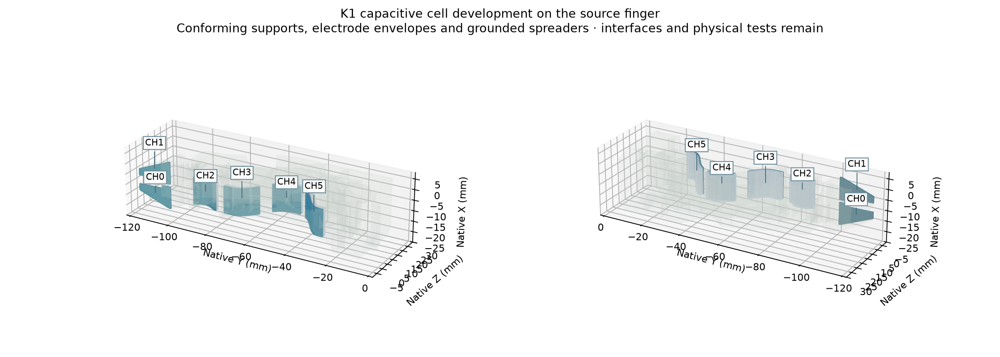
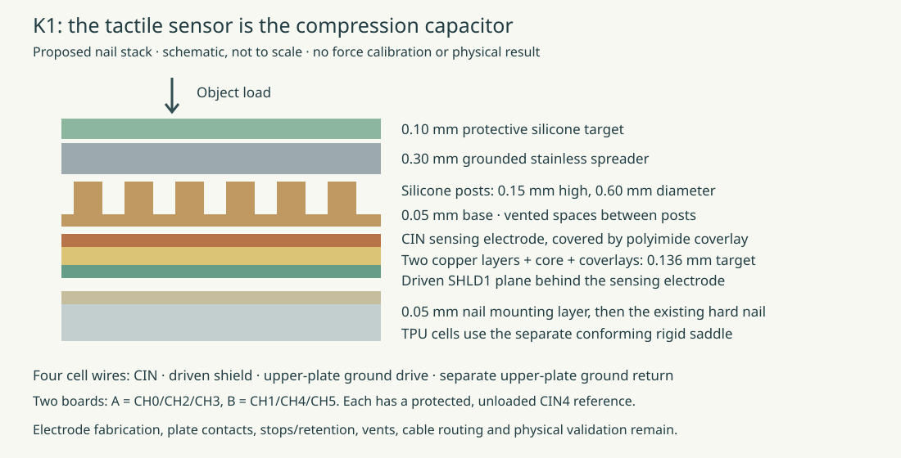
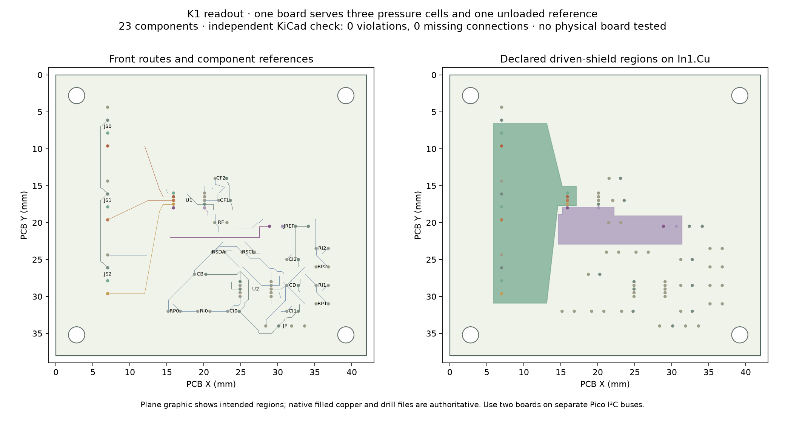

# K1 capacitive cell tooling and readout

This is a **development module**, not a completed tactile finger or a measured
20 N result. The complete all-design campaign remains in progress.

The tactile element is a capacitor under each of the two nail prongs and
four TPU contact regions. A patterned silicone sheet separates its sensing
electrode from a grounded steel spreader. Two FDC1004DGSR boards each read
three cells against one protected, unloaded reference capacitor.
An ADS1115IDGSR on each board monitors supply and three plate-ground loops.



## Current files

- 49 current checked STEP/STL parts: silicone casting masters, metal stencils,
  backing spacers, formed spreaders, conforming supports, tools and layer references.
- Six additional formed-post-sheet STL references. Flat casting masters remain
  authoritative for manufacturing; physical forming is unqualified.
- The four earlier slab-only supports in `history/`; use the conforming supports.
- One 42 × 38 mm, four-layer PCB design, used twice. It has 23 components,
  72 electrical pads, 357 routed segments, 34 vias and zero native KiCad
  violations or missing connections.
- Corresponding Gerbers/drills, embedded footprints, pins, component list,
  raw Pico firmware, decoder and USB recorder.

The layer-reference files are not functional 3D-printed capacitors.
Electrode copper, grounded plate joints, stops, retention, vent/seal details,
cable routes and the enclosure still require integration work.



## Mechanics and model limits

The first rigid slabs did not include the fitting base below the R1 smoothed
surface. The current supports incorporate that retained witness geometry and
reserve a 0.05 mm flex bond. Eighteen declared source/peer/flex comparisons
passed; actual printing, adhesive filling, stiffness and motion remain untested.

The nominal nail addition is 0.786 mm. The 1.736 mm TPU stack figure is above
the **R1 smoothed-saddle datum**, with the retained variable fitting geometry
below it. It is not the total addition to the bare TPU. This thickness is a
comparison concern for precision tasks.

SYLGARD 184 is the selected prototype dielectric material. The proposed sheet
has a 0.05 mm base and 0.15 mm high, 0.60 mm diameter posts. Use the material
manufacturer's 10:1 process. The 100 °C/35 minute cure is a candidate process
after the part reaches temperature; tool compatibility and actual cure need
inspection.

The saved capacitance/modulus sweep is a sensitivity study. It does not model
finite plate bending, contact-area loading, friction, viscoelasticity or measured
post compression. The revised shield estimates are about 336 and 373 pF;
the PCB and installed cable values still need measurement.

## Readout and raw code



Use two identical boards on separate Pico I²C buses:

| Board | SDA / SCL | JS0 | JS1 | JS2 |
| --- | --- | --- | --- | --- |
| A | GP0 / GP1 | CH0 | CH2 | CH3 |
| B | GP2 / GP3 | CH1 | CH4 | CH5 |

Both boards use FDC1004 address 0x50 and ADS1115 address 0x48. JP pins are
3V3, GND, SDA, SCL. Each JS port is CIN, driven SHLD1, plate-ground drive,
and a separate plate-ground return. JREF is CIN4, SHLD2, GND, GND.
The driven shields are separate from ground.

The PCB uses 0.20 mm routing clearance, the native MSOP package's explicitly
declared 0.15 mm adjacent-pad clearance, and 0.25 mm via drills. Neither
copper shorts nor missing connections are waived.

Firmware reads three differences against CIN4 and then the reference itself.
It uses paired register reads, explicit single-shot triggers and configuration
checks. Timeouts require restarting the affected converter. Raw values,
timestamps and unavailable readings are retained. The coarse capacitance
plausibility checks do not guarantee detection of every cable fault.
No contact or force value is inferred.

From the complete repository, prepare an isolated recorder environment:

```sh
/usr/bin/python3 -m venv build/engineering/tools/k1-capture-venv
build/engineering/tools/k1-capture-venv/bin/python -m pip install pyserial==3.5
build/engineering/tools/k1-capture-venv/bin/python engineering/software/capacitive_record.py --port PORT --specimen ID --condition CONDITION --seconds 30 --output NEW_FILE.jsonl
```

Complete manufacturing/interfaces and physical calibration before force
feedback. Compare independent specimens for contact misses, false contacts,
force error through 20 N, hysteresis, drift, cable/temperature effects,
loaded motion, wear and precision-task access. No measured winner is claimed.
