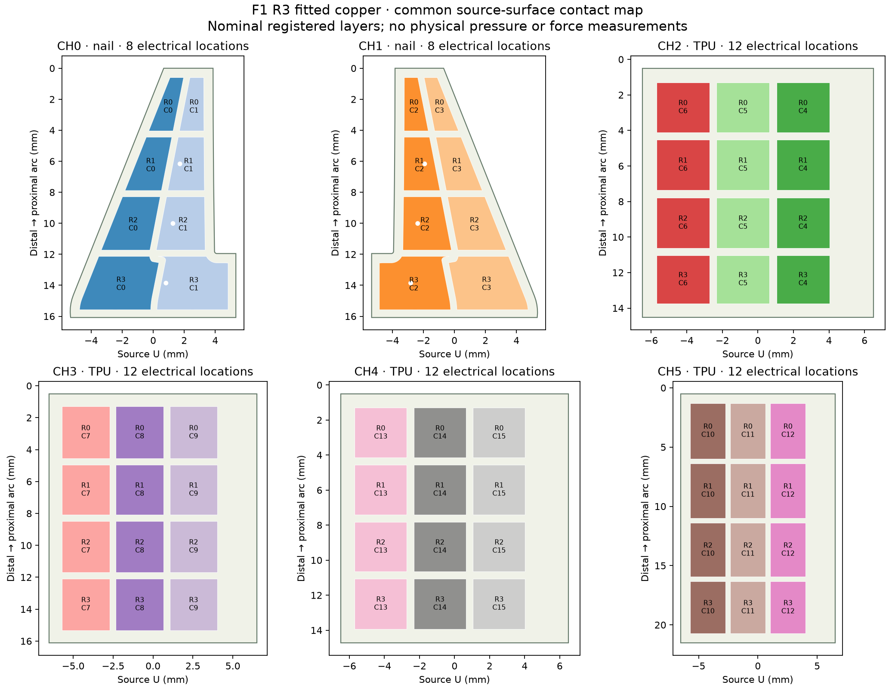

# F1 R3 fitted electrode foils

This module contains twelve routed sensing foils on the nominal R3 fit shapes.
**It is development artwork, not a qualified complete tactile finger.**
The matching R3 interface/carrier packet and wrist electronics remain separate.
No physical foil, finger or 20 N force/contact result has been measured.

## What is included

- Twelve native KiCad boards, editable conductor metadata, footprints and drawings.
- Ten single-copper foils and two double-copper nail-row foils.
- Corresponding development Gerbers, coverlay layers, outline and drills.
- All independent copper/connectivity checks and both coverlay-report versions.
- A 64-location contact map and forty individual trace-resistance estimates.
- Captured generation inputs, the exact connector maps and each failed-run history in the workspace.



The map uses the actual routed copper after separately unrolling the row and
column surfaces. CH0/CH1 have eight electrical locations each; CH2–CH5 have
twelve each. CH2 exits distally: its column order is reversed in source U.
CH4 uses global columns 13–15; CH5 uses 10–12. Use `review/taxels.csv`
and the per-foil pin maps instead of assuming sequential physical columns.
This map establishes nominal geometry, not independent pressure pixels or
freedom from lateral film conduction.

## Copper checks

All twelve boards pass the independent copper/connectivity checks with zero
unreviewed findings and zero missing connections. The unsuppressed reports
retain 286 shared-coverlay findings. These windows intentionally expose
separate unsoldered sensing electrodes and connector fingers; only that mask
rule is allowed. No copper short or missing connection is waived.

The R3 fit references are preserved. The fitted cuts record 10 nm coordinate
quantization to close numerical seams, with a bounded symmetric difference.
The traces include 0.29 mm necks, 0.44 mm long routes, short 0.225 mm
relief regions and 0.15 mm connector fanouts. Four row traces fit inside
the declared tail envelope. The two nail foils keep their plated transitions
in the supported body/tab regions, including a stagger at pin 1.

## Resistance result and limits

The largest nominal one-dimensional trace estimate is **0.1642 Ω** at
20 °C with 35 µm copper. The stated 50 °C scenario, 31.5 µm minimum copper
and 20% negative width tolerance gives **0.2549 Ω**.

These numbers exclude electrode spreading, plated barrels, current crowding,
finish, connector contacts, PCBs, the cable and bending-induced changes.
They are not upper bounds or a completed branch-resistance budget.
The earlier 0.25 Ω branch/path assumptions must be reviewed using the
whole circuit; a passing copper check does not establish that budget.

## Reproduce and assemble

Use the complete source repository with its documented CAD/Python environment:

```sh
build/engineering/tools/cad-venv/bin/python engineering/scripts/develop_f1_fitted_artwork.py
/usr/bin/python3 engineering/scripts/check_f1_flex.py ARTWORK_RUN --export
build/engineering/tools/cad-venv/bin/python engineering/scripts/review_f1_fitted_artwork.py ARTWORK_RUN
/usr/bin/python3 engineering/scripts/verify_f1_checkpoint.py engineering/development/f1/fitted-foils-r3
```

Use the F1 build guide for the six film islands, their surfaces, the R3
carrier, electrical mapping and raw recorder. The intended sensing material
is 0.10 mm conductive pressure film, with Adafruit 1361 as the documented
prototype material reference. Record supplier, lot and actual thickness.

Finish the connector mating datum, complete stiffener/adhesive/finish drawing
and 0.30 mm mating thickness before ordering finished foils. The plotted
stiffener rectangles are target regions, not a completed lamination process.
Complete sealing, object access, inextensible slack, loaded bending, wear,
the full resistance/reference/array checks, and physical calibration through
20 N before using F1 for force feedback or recommending it over the other designs.
