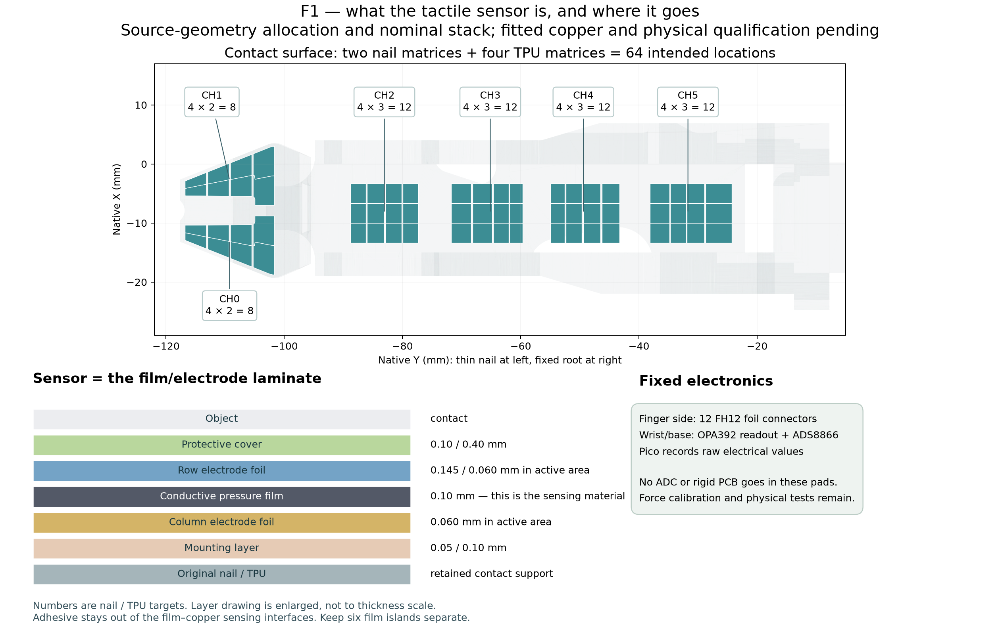
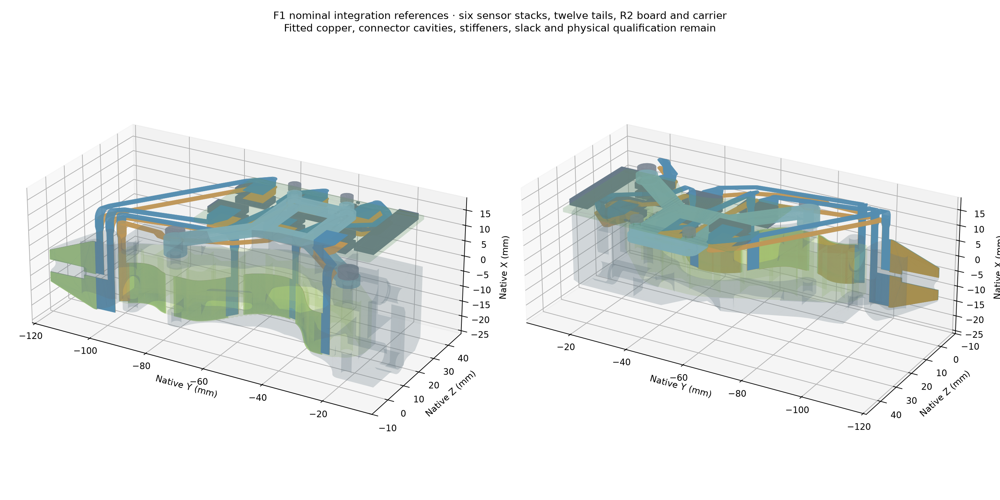

# F1 mechanics — fit development module

This module contains **44 checked CAD solids and twelve actual-size
fit patterns**. It is a reproducible mechanical fit experiment, not a
completed tactile finger or a functional flex fabrication release.
There are zero physical specimens and no measured 20 N result.

The sensor is a separate pressure-film island between row and column
electrodes at each of two nail and four TPU sites. The rigid electronics
stay on the fixed finger side and at the wrist.

- `cad/`: six forming mandrels, one carrier, and separately labeled material,
  PCB and tail reference solids. Print the tools/carrier; reference foils
  do not become sensors when printed.
- `patterns/`: twelve SVG/PDF patterns. Print at 100% and measure the 50 mm bar.
  Cut paper or approximately 0.1 mm polyester for the fit trial.
- `placement/`: R2 component/connector locations and their placement check.
  This is not routed PCB artwork.
- `surface-data/`: each conductor reference's developed length and the
  proposed contact allocation.
- `checks/`: source, stack, carrier, route and final 3D checks, plus the
  preserved earlier crossing failure.
- `configuration/`: candidate dimensions used in this module.
- `fit_observations.csv`: blank student observations; it contains no measurements.

The final static comparison checks 654 pairs against the
source frame/TPU, carrier, PCB, other tails and closed component/head
envelopes. The declared checks pass. **Twelve connector cavity/mating
interfaces remain explicitly unqualified.** The earlier 0.03376 mm³
CH2-column/CH3-row crossing is retained in `checks/previous_crossing_failure.json`.

The two back M2 fasteners retain the removable R2 board; the unused front
holes have been removed. The two original frame side-fastener axes locate
the carrier. Actual screw engagement, nut fit, printed shrinkage, board
bending and installed drive clearance remain.

The nominal conductor bend radius is 2.5 mm. Its inner material surface is
smaller by the relevant layer offset. These are geometric references, not
fatigue limits. Do not crease the marked bends. A static fitted shape does
not establish an inextensible 3 mm motion solution.

Row and column lengths differ on the curved surfaces. The largest nominal
body cut-length difference in the archived surface study is about 0.130 mm.
The paper pattern also includes a new body-end extension. Seal retention,
own-layer joins, contact preload and loaded behavior require physical work.

Read `engineering/docs/BUILD_F1.md` in the complete source for the student
procedure and `engineering/docs/F1_WRIST_CAPTURE.md` for electronics/code.
The preserved original fanout has different upper connector orientations;
do not combine that PCB with these R2 patterns.

Fitted electrode copper, connector stiffeners and verified mating datums,
full resistance/coupled-array checks, sealing and tail slack remain before
an integrated F1 build. Then perform physical contact, held-out force,
bending, wear and precision-task comparisons across independent specimens.
