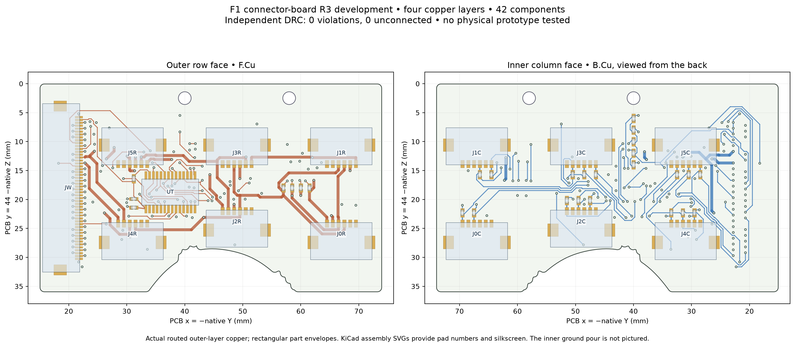
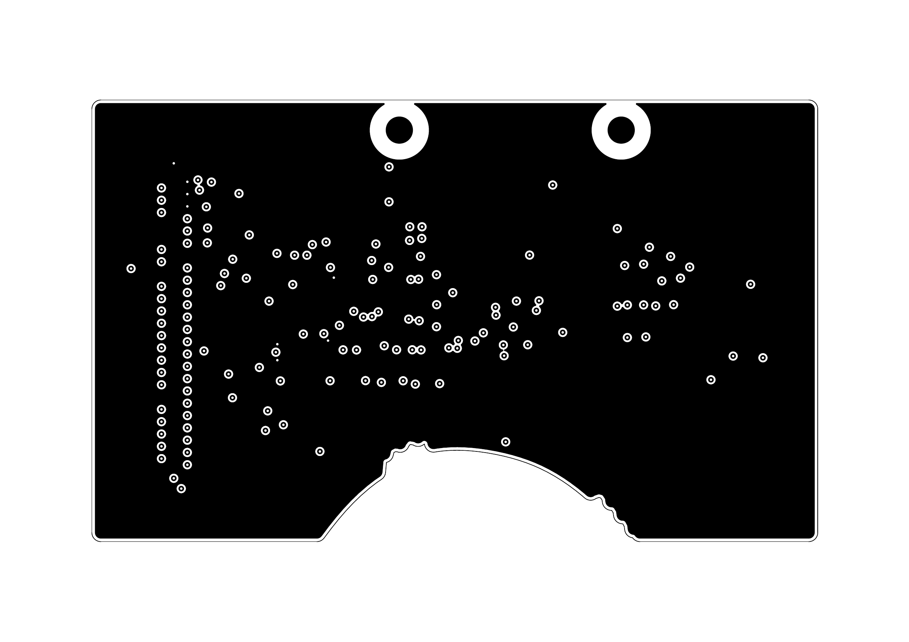
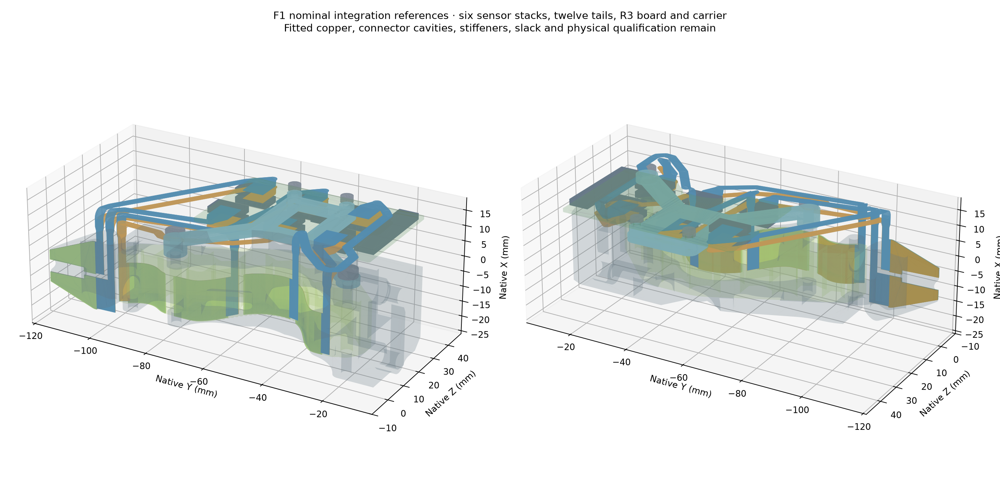

# F1 R3 interface board and nominal fit packet

**R3 has a checked, routed PCB. It is still one module of an unfinished F1
tactile finger. No physical board, complete finger or measured 20 N result
is claimed.**

The board has 42 components, 232 pads,
959 track segments and 155 vias. Independent
KiCad checking reports zero violations and zero missing connections.
`artwork/` contains the corresponding four copper layers, both assembly faces
and drills. Use the supplied manufacturing targets and a fabricator's stack,
copper and outline review before ordering.

R3 moves the test mux and its two bypass capacitors together, checks the
actual library courtyards, fixes the microscopic edge segment and labels,
and prohibits unfilled vias inside the solder-paste lands. The final copper
retains all sixteen direct sensor pickoffs, both short VDD paths and both
nearby bypass-ground paths. The nominal minimum via-to-paste gap is 0.115 mm.

The inner In1.Cu layer is reserved for ground: no signal tracks cross it.
The earlier clean-copper candidate's 581.25 mm of ground-layer signal routing
is preserved in its generated review. Ground continuity and the drawing do
not establish analog return impedance or EMC performance.

## Matching mechanical files

This packet also contains 44 STEP/STL reference/tooling solids and
twelve SVG/PDF fit patterns matched to R3. The 654 declared static pair
comparisons pass. These are nominal hardware-to-hardware checks; they do
not qualify swept object/contact envelopes or loaded TPU deformation.
Twelve connector cavity/mating interfaces remain
unqualified. Label cut patterns **R3** when preparing the fit trial; do not
mix them with the older R2 packet.

Print the carrier and six forming mandrels. The electrode-body, tail and
PCB solids are references, not functional printed sensors. Paper/polyester
patterns contain no electrode copper. Fitted copper, finished stiffeners,
verified mating datums, sealing, own-layer joins and inextensible motion
slack remain before the complete sensor can be fabricated.

## Exact interfaces

The twelve sensing-foil connectors are Hirose FH12-6S-1SH(1)(98).
Rows are on the outer face; columns are on the inner face. Each upper pair
faces toward the back. The source nail and TPU sensing locations are retained.

| Site | Connector pair | Global column nets |
| --- | --- | --- |
| CH0, left nail | J0R / J0C | C0, C1 |
| CH1, right nail | J1R / J1C | C2, C3 |
| CH2, distal TPU | J2R / J2C | C4, C5, C6 |
| CH3 | J3R / J3C | C7, C8, C9 |
| CH4 | J5R / J5C | C13, C14, C15 |
| CH5, proximal TPU | J4R / J4C | C10, C11, C12 |

Every row connector has pins 1–4 = R3, R2, R1, R0; pins 5–6 are unused.
Column pins 1, 3, 5 carry the site's columns in descending numerical order,
using only pins 1 and 3 for the nail pairs. The native pin CSV is authoritative.
Fitted electrode artwork and its spatial column direction remain to be completed.

JW connects to the preserved checked wrist module. The stated cable mating
pose gives fanout pin n to wrist pin 51−n. The fifty native correspondences
pass; `cable/continuity_checklist.csv` is blank for the student's unpowered
physical check. Installed cable routing and actual YAM housing fit remain.

Use `engineering/firmware/f1/` and `engineering/software/f1_record.py` from the
complete source. These record raw matrix/test observations, not calibrated
force. The switched 10 kΩ electrical test can pass with the sensing foils
unplugged; it is not a whole-sensor or contact-reliability test.

## Files and scope

- `pcb/`, `artwork/`, `checks/`: native board, fabrication exports and full evidence.
- `cad/`, `patterns/`, `parts.csv`: matching geometry and fit-only cut sheets.
- `components.csv`: active ordering codes and passive values/packages.
- `configuration/`, `provenance/`: reproduction inputs and final route.
- `visuals/`, `models.json`: board/ground/fit drawings and the actual viewer meshes.

The rejected R2 route remains in `engineering/development/f1/r2-routing-study/`.
No R2 findings were suppressed to make R3 pass. The full F1 coupled-array,
reference, copper/contact resistance, bending, wear, calibration and held-out
contact/force comparison remain unfinished. No measured winner is available.
