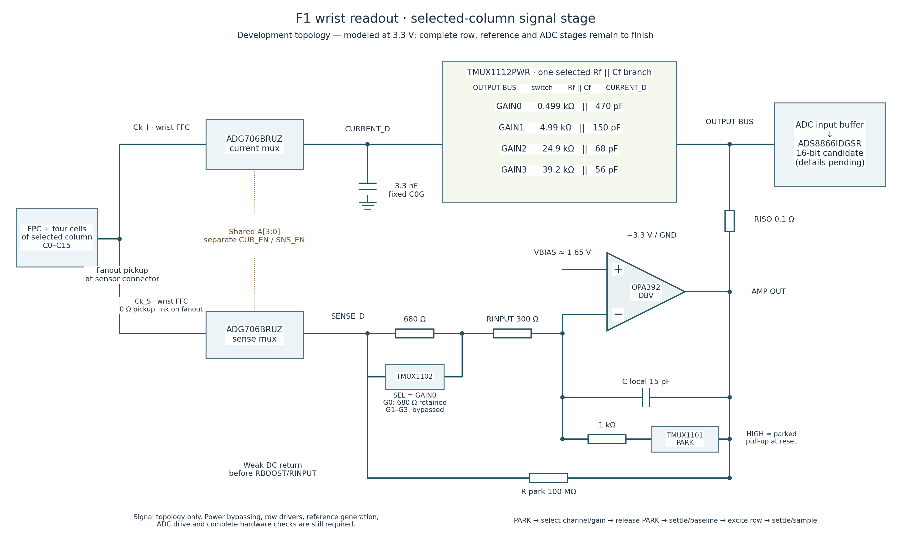
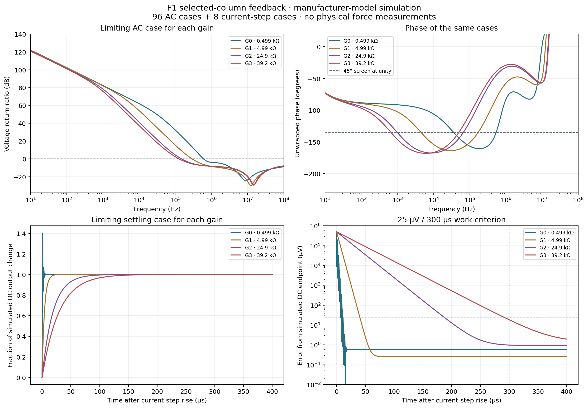
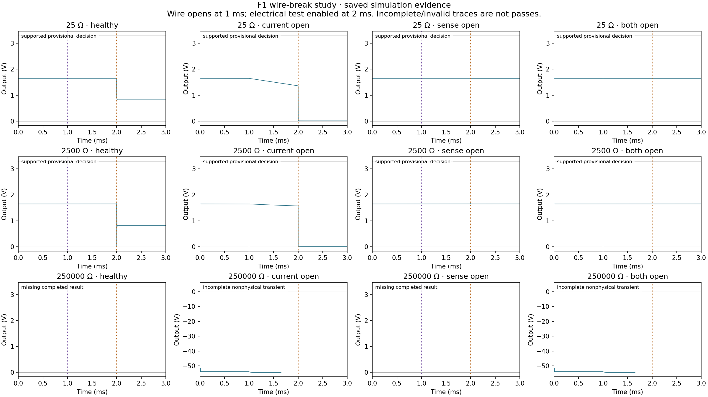

# F1 selected-column readout study

This package contains a concrete circuit candidate, component values,
replayable netlists and the complete saved simulation evidence. **F1 remains
an unfinished design.** No physical specimen has been built or tested, and
this is not a finished wrist PCB or a 20 N sensor rating.

The scope is the wrist amplifier that measures one of F1's sixteen columns.
The tactile surfaces remain two thin nail patches and four TPU patches.
Each patch has separate row and column electrodes around resistive film.
Four rows intersect sixteen columns to give 64 sensing locations. The
connector board carries the foil connections to this proposed wrist readout.

## Circuit and placement



Use **OPA392DBVR**, the single amplifier in the five-pin DBV package.
Two ADG706BRUZ multiplexers select the same column: one carries its current,
and one senses its voltage at the connector board. Their four address bits
are shared; their enables remain separate. The sense path closes the
amplifier loop. It cannot remove resistance inside the flexible electrodes.

All parts in this drawing belong on the wrist board. No rigid amplifier or
ADC package is placed in the flexible contact pad. The finger's existing
fanout module has a switched 10 kΩ electrical-test path and twenty zero-ohm
links defining the row/column sense pickups.

The amplifier operates from 3.3 V with a nominal 1.65 V bias. A TMUX1112PWR
selects one parallel resistor/capacitor feedback branch:

| Gain selection | Resistor | Parallel capacitor |
|---|---:|---:|
| G0 | 499 Ω | 470 pF |
| G1 | 4.99 kΩ | 150 pF |
| G2 | 24.9 kΩ | 68 pF |
| G3 | 39.2 kΩ | 56 pF |

The remaining explicit values are 3.3 nF at the current-mux drain, 0.1 Ω
between amplifier output and output bus, 300 Ω in the sense input and
another 680 Ω that is retained for G0. An active-low TMUX1102DBVR bypasses
the 680 Ω in G1–G3. A 15 pF local feedback capacitor returns to the amplifier
input. The weak 100 MΩ DC feedback returns before the input resistors.

An active-high TMUX1101DBVR and 1 kΩ resistor provide a local **PARK** path.
A hardware pull-up must keep PARK closed during controller reset. The
intended sequence is park, select column/gain, release park, settle, acquire
baseline, excite one row, settle and acquire signal. The complete switching
sequence, gain transitions and overload recovery still need validation.

The main ADC candidate is ADS8866IDGSR, 16 bits. At 3.3 V reference and
39.2 kΩ, nominal code spacing corresponds to 1.28 nA. That number is neither
achieved resolution nor force accuracy. The ADC driver, reference, row
buffers, firmware and PCB are outside this checkpoint.

## What the saved checks establish

| Check | Result | Interpretation |
|---|---|---|
| Nominal AC grid | 96 / 96 pass the declared screen | A model of one selected column |
| Nominal current steps | 8 / 8 pass | Maximum settling 290.55 µs at a 25 µV error criterion |
| Independent time-domain probes | 83 / 96 completed and passed | 12 solver failures and one timeout remain unresolved |
| Wire breaks after startup | 8 / 12 provisional decisions supported | Two missing completed results and two incomplete, nonphysical traces |
| Simulator failure handling | Completed and aborted controls pass | An aborted run no longer becomes a completed result |
| Physical contact/force tests | None | No physical winner or 20 N qualification |



The nominal grid uses four gains, four aggregate column loads
(25, 100, 2500 and 250000 Ω), three sensor capacitances (0.1, 1 and 3 nF),
and two multiplexer-capacitance scales. Minimum voltage-return margin is
53.89°. The current-step tests cover both load extremes at 3 nF and twice
the assumed switch capacitance. Each has a nominal 0.5 V output change.
No resistance or current step is assigned a force.

The manufacturer's typical OPAx392 macromodel can produce bad numerical
solutions when initialized directly in some single-supply circuits.
AC calculations use a centered numerical voltage reference. Current-step
and independent sine checks use actual 0 V ground and start with PARK
closed. The physical circuit still uses 0 V / 3.3 V rails. The complete
case files record the coordinate choice and startup sequence.

The separate time-domain probes are required evidence, not a substitute
for the failures. Among the 83 completed probes, maximum magnitude error
is 0.024% and maximum phase error is 0.012°. The thirteen unfinished probes
prevent claiming complete agreement across the grid.



The proposed cable check parks every row at bias, uses G1 and enables the
fanout's 10 kΩ test path. A healthy provisional decision requires settled
baseline/test windows and an output drop of **0.70–0.95 V**, the evaluated
development window in the saved evidence.
Valid complete healthy traces have a drop of about 0.826 V.
The final software window must be set using component limits and measurements.
An unstable or out-of-window response is rejected; an incomplete or
nonphysical simulation supplies no fault-coverage evidence.

The original collector required steady windows even for a rejected faulty
case and stopped on an empty window in a partial simulation. The recovery
review preserves those original files and separates numerical validity from
the proposed healthy/rejected decision. This is development analysis of the
same cases, not a held-out validation. The checker covers only the selected
column's current/sense conductors. It does not qualify row wires, foil
continuity beyond the pickup, shorts, swaps or arbitrary faults.

## Files and reproduction

- `candidate.json`: current values and exact candidate ordering codes.
- `simulated_configuration.json`: unchanged configuration used for the nominal run.
- `circuits/`: one complete saved two-netlist current-step case.
- `active_components.csv`: circuit candidates; this is not a complete purchasing BOM.
- `evidence/`: numerical summaries, all sine-probe outcomes and recovered wire-break findings.
- `runs/`: compressed complete runs, including each netlist, source snapshot, log and saved vector.
- `visuals/`: diagrams and plots as PNG, SVG and PDF.
- `checkpoint.json` and `runs/contents.json`: file and archive-member hashes.

The original saved configuration misspelled the amplifier ordering code as
`OPA392IDBVR`; the actual part is **OPA392DBVR**. Only the ordering label and
its source note were corrected. The model and circuit values are unchanged.
The authoritative [TI ordering page](https://www.ti.com/product/OPA392/part-details/OPA392DBVR)
identifies the single DBV device.

From the repository root:

```sh
/usr/bin/python3 engineering/scripts/verify_f1_readout_study.py --extract
/usr/bin/python3 engineering/scripts/prepare_b1_eda.py --extract
/usr/bin/python3 engineering/scripts/fetch_f1_models.py opa392_pspice
```

The verifier prints a fresh extraction directory under `build/`; the model
fetcher prints its separate model-cache directory. Replay a selected case
with the model from that directory:

```sh
/usr/bin/python3 engineering/scripts/run_f1_spice_case.py EXTRACTED_RUN/nominal/case_102/case.json --model MODEL_CACHE/opa392_pspice/OPAx392.LIB --output NEW_BUILD_RESULT_DIRECTORY
```

Use the actual printed paths. Output must be a new directory under `build/`.
The worker checks the original vendor-model hash before running. The
complete TI model is obtained directly from TI and is not redistributed.
Recorded model: OPAx392 PSpice Final 1.1, August 2022, SHA-256
`eddf2b4031b0c86535fcacf636bee5d113afa2706f4e381ccd3f072b12eadce0`.
The prepared tool uses ngspice 45.2, including its analog, table,
spice2poly and xtradev code models.

To generate a fresh nominal grid:

```sh
/usr/bin/python3 engineering/scripts/screen_f1_feedback.py --model MODEL_CACHE/opa392_pspice/OPAx392.LIB
```

Use `crosscheck_f1_feedback_time.py` for the separate time-domain grid and
`review_f1_readout_evidence.py` to recover/summarize saved runs. A failed
simulation remains failed; changing initial conditions or tolerances must
create a new run and retain the previous evidence.

## Work still required

Finish row-driver feedback, the complete coupled array, routed resistance
budgets, reference and ADC drive, power/reset behavior, firmware and the
wrist PCB. Complete installed flex unrolls and tails, connector mapping,
carrier, strain relief and actual YAM-drive fit. Fabricate specimens and
measure contact errors, held-out force accuracy, hysteresis, drift, tip
motion, wear and replacement time using the common campaign.

Manufacturer references:
[OPA392](https://www.ti.com/lit/ds/symlink/opa392.pdf),
[ADG706](https://www.analog.com/media/en/technical-documentation/data-sheets/adg706_707.pdf),
[TMUX1112](https://www.ti.com/lit/ds/symlink/tmux1112.pdf),
[TMUX1101/1102](https://www.ti.com/lit/ds/symlink/tmux1101.pdf),
[ADS8866](https://www.ti.com/lit/ds/symlink/ads8866.pdf).
