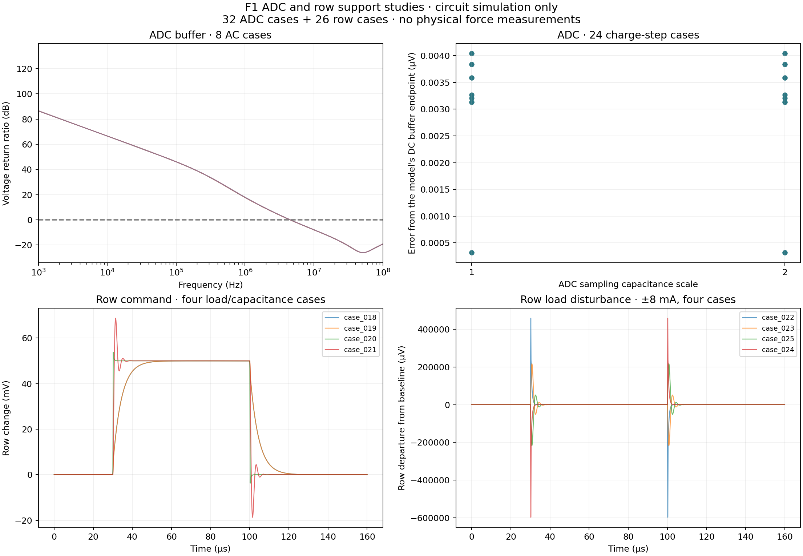

# F1 ADC and row-driver development studies

These are circuit studies for the wrist board, not a finished F1 finger or a hardware qualification.



`evidence/summary.json` records 32 ADC and 26 row cases, their declared limits, the numerical comparison, and the unsuccessful predecessor runs. `runs/` preserves complete case files, input snapshots, raw vectors and logs, including failures. Vendor model libraries are not redistributed.

The ADC driver uses OPA320AQDBVRQ1, two 22-ohm resistors, a 2.2 nF differential capacitor and 2.2 nF from each ADC input to ground. The row driver uses OPA392DBVR, 47-ohm output isolation, 4.7-kohm sense input, 100 pF local feedback and 100 Mohm weak DC feedback.

Read `engineering/docs/F1_WRIST_CAPTURE.md` for the complete candidate part identities and the separate raw-capture contract. The reference, complete coupled array, layout, fitted sensor foils, carrier and physical contact/force experiments remain.

From the repository root, the existing archive verifier can verify and extract this checkpoint:

```sh
/usr/bin/python3 engineering/scripts/verify_f1_readout_study.py --checkpoint engineering/development/f1/support-studies --extract
```

Use `fetch_f1_models.py opa392_pspice opa320_pspice` to obtain the reviewed manufacturer models directly, then replay selected extracted cases with `run_f1_spice_case.py --model ...`. A different model hash requires a new review; do not overwrite these results.
