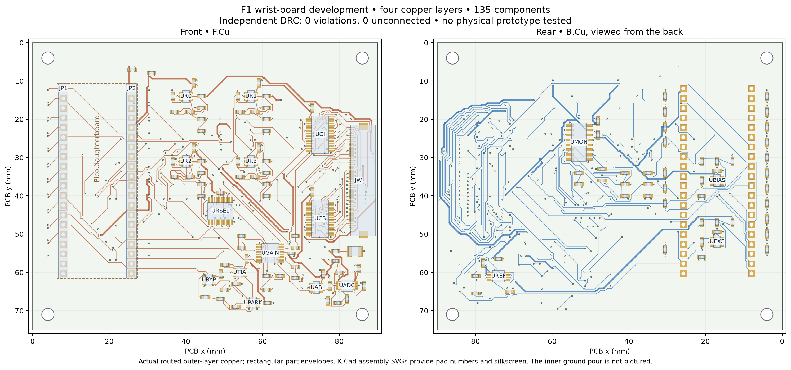

# F1 wrist readout — development module

**This is one board of an unfinished F1 tactile finger. No physical board or sensor has been tested.**

The checked layout has 135 components, 498 pads, 2561 track segments and 412 vias. Independent KiCad checking reports zero rule violations and zero missing connections.



The [inner-plane drawing](visuals/inner_ground.png) and its crossover inventory are retained. The ground layer also carries the explicitly recorded short signal crossings; analog return behavior remains unmeasured.

The sensor film and flexible electrodes remain on the two nail and four TPU patches. This wrist board contains the row drivers, separate column current/sense multiplexers, gain/parking circuit, ADC, reference and Pico sockets. No rigid ADC package goes in a flexible contact pad.

- `pcb/`: editable native board, library, exact pin table and placement specification.
- `artwork/`: four copper layers, both populated faces and drill exports.
- `checks/`: complete DRC report, hashes and checked board.
- `visuals/`: board-face, assembly and inner-ground drawings.
- `cable/`: native fifty-pin correspondence and blank unpowered continuity checklist.
- `code/`: four-file experimental Pico firmware and capture instructions.
- `configuration/`: current candidate circuit and manufacturing targets.
- `components.csv`: exact active parts plus passive values/packages; passive purchasing choices remain.

The selected cable contract gives wrist pin n to fanout pin 51−n. It does not establish actual continuity, seating, strain relief or installed geometry. The column electrical test can pass with the sensor foils unplugged; it is not a tactile or whole-wiring qualification.

From the repository root, recheck without changing this checkpoint:

```sh
/usr/bin/python3 engineering/scripts/verify_f1_checkpoint.py engineering/development/f1/wrist
/usr/bin/python3 engineering/scripts/check_f1_wrist.py engineering/development/f1/wrist/pcb --export
```

Prepare the isolated KiCad tool with `engineering/scripts/prepare_b1_eda.py --extract` if needed. Fresh check/export results go under `build/`. Read `engineering/docs/F1_WRIST_CAPTURE.md` for GPIO, ADC sequencing and raw capture. The main source also includes the recorder, protocol validator and tests; firmware emits no calibrated force.

Complete the full-array/reference/layout review, formed flex, carrier, actual YAM fit, passive component/derating review and physical experiments before treating F1 as an integrated result. Retain the earlier readout and ADC/row studies with their failed attempts and model limits. These files establish no contact-error probability, force accuracy, bending life or 20 N rating.
