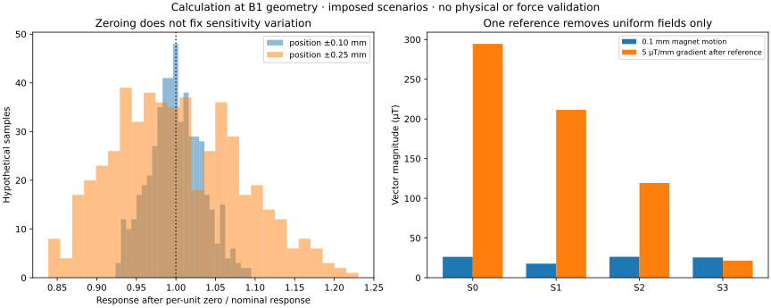
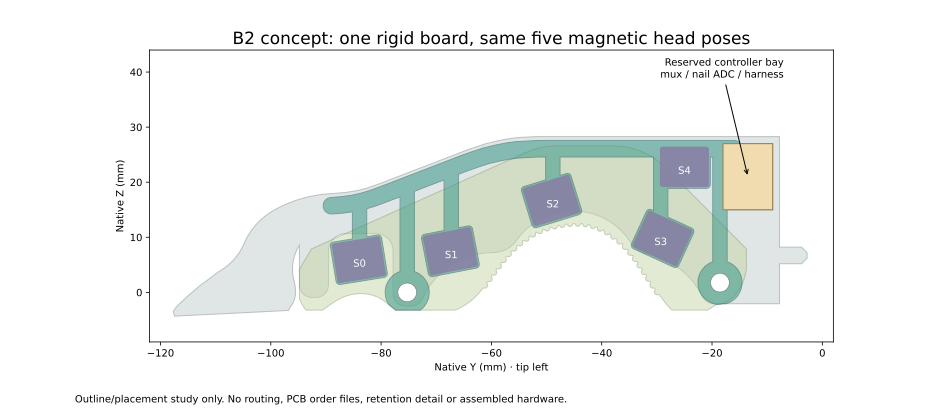
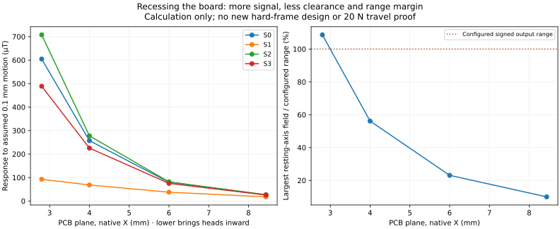
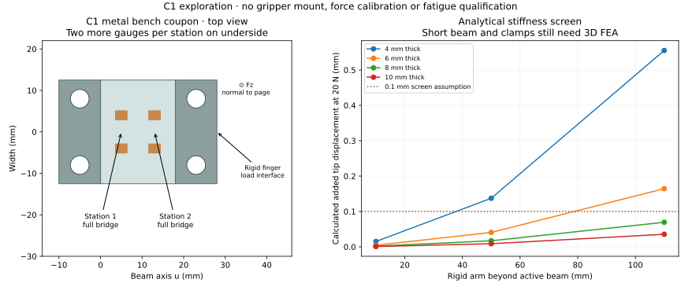

# Is magnetic touch the easiest scalable choice?

**Each design now has its own page.** Start at [the design directory](https://geyan21.github.io/yam-tactile-kit/designs.html), or open [B2](https://geyan21.github.io/yam-tactile-kit/b2.html), [C1](https://geyan21.github.io/yam-tactile-kit/c1.html), [rigid-nail sensing](https://geyan21.github.io/yam-tactile-kit/rigid-nail.html), or [the recessed magnetic frame](https://geyan21.github.io/yam-tactile-kit/recessed-magnetic.html). This page keeps the shared evidence and comparison.

**Magnetic sensing is a good prototype direction for this compliant finger. B1's present packaging is not yet what we should copy into a production batch.** For repeated builds, the strongest immediate improvement is one rigid magnetic PCB with a located, replaceable skin. For dependable aggregate grip force around steel or motors, a separate strain-sensing load path is worth testing in parallel.

The recommendation is based on primary literature, an audit of our actual B1 parts, and the new calculations below. **No B1, B2 or C1 hardware has been qualified.** “Better” here means a promising design change with a stated benefit and a test that could reject it.

**Build status:** [B2.1 has a separate prototype package](BUILD_B2.md) with a routed PCB, clean independent DRC, checked mounting CAD and raw acquisition. [C1.1 supplies a metal root adapter and readout](BUILD_C1.md), while [N1.1 supplies a bare sensing nail and four TPU cells](BUILD_NAIL.md). All need physical assembly and tests. The earlier B2/C1 figures below are retained concept studies. The [all-twelve-design campaign](BUILD_ALL.md) tracks the current work and common evaluation targets.

## What the magnetic evidence actually supports

[eFlesh](https://arxiv.org/html/2506.09994v1) demonstrates printed structures with commodity magnets. Its normal-force experiment spans **0–30 N**, reporting **0.27 N validation RMSE**, using a **40 × 40 mm instance and a plate indenter**. That supports the modality's potential through our requested range; it does not establish 20 N performance at this narrow ENPIRE finger's small contact patches.

[AnySkin](https://arxiv.org/html/2409.08276v3) demonstrates replaceable, self-aligning magnetic skins and cross-instance policy transfer. It reports roughly 12 seconds average replacement time. Its process uses magnetic powder, casting and pulse magnetization, so it is a different manufacturing route from B1's printed insert and four purchased magnets. Its limitations include magnetic/ferromagnetic interference. Successful policy transfer is not the same as a newton-calibrated sensor that needs no calibration.

[XELA's commercial uSkin systems](https://xelarobotics.com/technology/) show that magnetic tactile sensing can be productized. The vendor offers calibration, integration and field compensation. Those capabilities do not automatically transfer to our five-head prototype. A commercial module is useful as a benchmark if its size, cost and interface fit the application.

There is a particularly relevant commercial benchmark: [uSCu ALHA-N](https://xelarobotics.com/products/uscu-alha-n/) combines a six-axis force-sensitive nail with 30 three-axis pulp sensing points, according to XELA. It is designed for the Allegro Hand, so this is evidence for the architecture, not a drop-in ENPIRE part. The [uSPr 2F](https://xelarobotics.com/products/uspr-2f/) is a different, 17 mm-thick Robotiq-specific fingertip. Check the exact product's dimensions, nail/point-load range and quote; generic uSkin specifications do not establish compatibility with this finger.

For the student, separate magnets avoid the specialized powder-magnetization process. For a larger batch, manufacturing consistency, mechanical registration, sealing, replacement and calibration dominate the decision—not the price of four magnets.

## Why the current B1 is a pilot

The current [B1 BOM](../b1_bom.csv) calls for five small sensor boards, twenty conductors to those boards, a wrist multiplexer, an optional nail ADC, four separately retained magnets, and two handmade N0 nail pads for the complete precision-task configuration. Each head must be positioned and bonded, and the wire bundle needs strain relief.

This is reasonable for learning what works on the existing finger. It leaves avoidable assembly steps, calibration variation and repair work at ten or a hundred fingers. The hand-cut tip pads remain a separate repeatability problem even if we simplify the magnetic electronics.

| Question | Current answer |
|---|---|
| Easy to obtain basic materials? | Yes: printed TPU, small magnets, ordinary PCBs and sensor ICs |
| Easy to assemble many identical B1 units? | Not demonstrated; five individual head placements and the harness add manual work |
| Can a worn soft part be replaced? | Mechanically plausible; retention and signal transfer still need measurement |
| Does a zero remove all unit variation? | No; it removes an offset, not changes in sensitivity or mechanics |
| Is the reference head enough around motors and steel? | Not for arbitrary spatial field changes |
| Does the magnetic soft part cover rigid-nail contacts? | No guaranteed coverage; keep the two nail pads in the B1 pilot |
| Is 20 N force accuracy established here? | No |

## A quantitative check on calibration and interference



The [reproducible scenario calculation](../concepts/magnetic_scaling.json) uses B1's actual magnet/sensor positions and a finite-cylinder field model. It imposes independent position errors, small magnet tilts and remanence variation. The imposed ±0.10 and ±0.25 mm cases are **assumptions**, not measured printer or assembly tolerances.

After removing a separate unloaded zero for each simulated unit, the ±0.25 mm case still produces roughly **0.87–1.16 times the nominal response** across the shown 5th/95th percentile ranges for a 0.1 mm magnet motion. This is sensitivity variation after zeroing. It cannot be labeled a force-error percentage because we have no force-to-deformation model.

A perfectly matched reference removes the imposed uniform field in the ideal calculation. It does not remove the imposed 5 µT/mm spatial gradient: residuals are about **22–295 µT** at the four heads, versus about **18–26 µT** from the modeled 0.1 mm local motion. Neither the gradient nor that displacement is a measurement on your robot. The example shows why one reference is not a universal cure.

Test the installed motor, both jaws, the complete opening range, steel parts approaching without contact, and temperature before committing to a magnetic production design. Record false-contact behavior as well as loaded force error.

## B2: the simpler magnetic packaging design

[Open the separate B2 page: sensors, placement, files and remaining work](https://geyan21.github.io/yam-tactile-kit/b2.html).

**B2 keeps the sensing principle and sensor positions, but consolidates the electronics.** The B2.1 package completes the first PCB and removable support design. The original allocation study below explains its starting geometry.



The proposed board contains the five MLX90393 heads, TCA9548A and nail ADC. The main connection to the external Pico becomes a **four-conductor bus**, replacing the specified twenty-conductor head harness. This count excludes the two nail-pad lead pairs and USB. It is an architecture target, not a measurement of a built harness.

Use one mechanically registered PCB and a reviewed clamp/backer instead of separately bonding five boards. Keep the B1 cartridge, magnets and sensor centers unchanged for the first comparison so that the effect of packaging can be tested. A later molded/overmolded cartridge may improve process consistency, but changing material and geometry also changes calibration.

| Item | B1 pilot | B2 target |
|---|---|---|
| Local magnetic head boards | Five separate boards | One rigid shaped board |
| Head positioning | Five manual placements | Positions defined in PCB artwork |
| Main head harness | Twenty conductors specified | Four upstream conductors |
| Magnet insertions and polarity checks | Four | Still four |
| Nail pads and their leads | Two handmade pads | Still present in the first B2 comparison |
| Calibration and field testing | Required | Still required |
| Repair | Individual head can be replaced | Whole-board replacement may cost more |
| PCB manufacture | Small repeated two-layer heads | Larger irregular board; four layers proposed |

The preserved [early B2 layout JSON](../concepts/b2_layout.json) and [STEP](../concepts/cad/b2_pcb_fit_witness.step) / [STL](../concepts/cad/b2_pcb_fit_witness.stl) describe the **898 mm² unrouted concept**, with a reserved controller bay. They are historical fit-study files. **Use [B2.1's current page and files](https://geyan21.github.io/yam-tactile-kit/b2.html) for a build.** B2.1 widens the connecting band inside the outer side profile, completes the copper, and adds locating spacers and a removable backer. Actual drive clearance and hardware performance still need physical checks.

Do not equate fewer pieces with lower finished-unit cost: panel utilization, four-layer fabrication, board replacement, calibration and rejected builds can offset the labor saving. Obtain actual assembled-board quotes at 1, 10 and 100 fingers.

### N1: measure a bare nail at its base

[Open N1's separate page: sensors, placement, parts and code](https://geyan21.github.io/yam-tactile-kit/rigid-nail.html).

N1 now supplies a steel fork with two vertical shear webs, a revised PETG frame and two fixed carriers. Two OMEGA SGT-2DD/350-SY41 bridges sit on the outer web faces. Four retained R1 cells cover the TPU. The leading nail is bare, with a 1.35 mm leading thickness in the design.

The [N1 engineering review](NAIL_ANALYSIS.md) reports the checked geometry and metal-model motion near 0.0094 mm at 20 N, with real joints and printed-frame compliance excluded. Its supplied calibration baseline covers normal force; pose effects, contact reliability, wear and precision tasks still need physical tests. N1 adds machining, bonding and wiring work. Keep the original B2 configuration with its two N0 pads as a separate comparison.

### A further mechanical option: recess the board into a revised hard frame

[Open the separate recessed-board study page](https://geyan21.github.io/yam-tactile-kit/recessed-magnetic.html).



The current B1 head-to-magnet center distances are roughly 10–12 mm. Moving the board inward can increase signal, and could reduce side bulk. The supplied field sweep explores several PCB planes while holding the magnet and head Y/Z positions fixed.

This is a larger redesign than B2's initial consolidation. The inward positions fail the existing frame's conservative clearance screen, reduce free space beside the bending TPU, and can consume or exceed the present readout's magnetic range even before loading. A revised frame would need structural analysis, motion clearance and a new range/gain choice. Stronger signals alone are not a reason to cut the current frame or install the heads closer.

Keep the original B1 plane for the first B2 packaging comparison. Investigate a recessed frame only if measured signal quality or bulk justifies it. No recessed-frame STL is supplied or claimed as verified.

## C1: a magnet-free way to measure whole-finger force

[Open the separate C1 page: selected gauges, installed adapter, readout and build files](https://geyan21.github.io/yam-tactile-kit/c1.html).

**C1 puts force sensing in a stiff metal root element, while leaving the thin nail and compliant contact surface passive.** All nail and TPU loads must pass through that element. It could avoid magnetic field artifacts and the need to place a pressure laminate on the nail for normal-force measurement.

**Current C1.1:** eight CEA-13-062UWA-350 gauges sit at two stations on a
33 × 22 × 14 mm active transverse beam. Machined fixed/floating carriers attach
it to the source-matched root. A dual-ADS1232 readout supplies raw measurements
for physical calibration. The [digital engineering review](C1_ANALYSIS.md)
reports the bonded-joint model's 0.094 mm added tip motion at 20 N and its
limits. Use [BUILD_C1.md](BUILD_C1.md) and [C1_TESTING.md](C1_TESTING.md) for the
current build. **The longitudinal coupon discussion below is historical; its
dimensions and calculated signals are not C1.1's manufacturing specification.**



A single bending gauge confuses force with contact lever arm. C1 therefore uses **two full strain bridges at two stations** on a constant-section beam. In the ideal linear model, the difference in calibrated bending moments gives the transmitted normal force:

```text
M(u) = M_end + F_normal × (L − u)
strain(u) = 6 × M(u) / (E × width × thickness²)
F_normal = E × width × thickness² × (strain_1 − strain_2) / (6 × station_spacing)
```

This also handles multiple distal contacts by summing their normal forces, provided every load enters beyond both stations and there is no parallel mechanical load path. It does not supply a contact-location map. Pure shear or insertion-axis contact is not covered by this normal-only concept.

The [metal coupon STEP](../concepts/cad/c1_strain_beam_coupon.step) / [STL](../concepts/cad/c1_strain_beam_coupon.stl) explores a 25 mm-wide, 8 mm-thick, 18 mm-long active aluminum section with two 10 mm clamp ends. Gauge stations are 5 and 13 mm from the assumed fixed boundary. The four holes are 4.5 mm diameter for a bench fixture. This is **a coupon, not a YAM gripper adapter**; final mount geometry and reach are not established.

Gauge rectangles in the figure mark sensing locations. They are not manufacturer backing/terminal footprints or machining pockets.

Use two 350 Ω full bridges, requiring eight foil gauges, with a suitable aluminum compensation/bonding process. The [Micro-Measurements 062UW family](https://docs.micro-measurements.com/?id=2512) is a candidate; exact part, footprint, compensation and adhesive must be selected before assembly. Two [ADS1232 converters](https://www.ti.com/lit/ds/symlink/ads1232.pdf), one per bridge, are a candidate readout. Continuous per-bridge conversion avoids treating a multiplexed converter's nominal rate as the rate of both channels.

The [analytical screen](../concepts/c1_screen.json) calculates about **0.069 mm added tip displacement at 20 N** for a rigid 110 mm distal arm and the stated 8 mm beam. It excludes the finger's own bending, clamp compliance and real joints. The assumed gauge factor is 2.0, modulus 69 GPa and excitation 5 V. The active length/thickness ratio is only **2.25**: this short element needs **3D FEA and gauge-area measurements** to check end/clamp effects. Treat beam theory as an initial screen, not a completed structural validation.

At 0.2 N, the ideal differential bridge signal is about **0.87 µV**. Using the ADS1232's **44 nV typical shorted-input RMS noise** at gain 128, 5 V and 80 SPS gives an ADC-only force-equivalent RMS near **0.014 N**. That is **not** a sensor accuracy or contact threshold. In the same model, only **0.1% residual relative gain error** between stations causes about **0.31 N force error** at the longest 20 N lever.

This makes C1 worth investigating for force stability, but it is not automatically easier than magnets. Gauge bonding, bridge matching, warm-up, cross-axis response, waterproofing, overload behavior and factory calibration are substantial work. A specialist-supplied strain element may be preferable if its quote and load/moment rating fit.

A root element also measures finger weight and inertial loads. Test unloaded poses and no-contact motions, use an explicit pose-aware reference/compensation model, and never silently zero away a loaded grasp. Static coupon results do not establish contact reliability on a moving robot.

## Other alternatives worth considering

Each alternative also has a separate page: [flexible resistive matrix](https://geyan21.github.io/yam-tactile-kit/flexible-matrix.html), [capacitive skin](https://geyan21.github.io/yam-tactile-kit/capacitive.html), [pneumatic finger](https://geyan21.github.io/yam-tactile-kit/pneumatic.html), [optical finger](https://geyan21.github.io/yam-tactile-kit/optical.html), and [packaged force button](https://geyan21.github.io/yam-tactile-kit/force-button.html).

| Approach | Why it could be better | What prevents an immediate switch here |
|---|---|---|
| Shielded capacitive cells on rigid islands, with compliant interconnects | Thin shaped arrays; no permanent magnets; suitable for PCB/FPC processes | Gap, dielectric creep, moisture, parasitics and bending artifacts need control; custom stack and sealing |
| Pneumatic channels in the soft finger | Passive soft interface; sensing electronics can stay at the wrist | Leaks, tubing, volume/temperature effects and limited demonstrated force range in the referenced design |
| Camera-based compliant tactile finger | Dense contact geometry and texture | Optical path, gel, illumination, processing and finger geometry must be redesigned |
| Packaged MEMS force button | Factory digital interface and defined range; FB1.1 now supplies a guided root mechanism | Preload, stops, actual joints and calibration need measurements; force range and digital resolution do not guarantee low-force accuracy |
| Printed resistive film / R1 | Thin, shapeable, inexpensive prototype materials | Hysteresis, contact-area dependence, creep and handmade stack variability remain |

[TI's FDC1004](https://www.ti.com/lit/ds/symlink/fdc1004.pdf) provides four capacitance channels and active shielding, but its capacitance resolution does not specify the performance of a tactile stack. A capacitive fork-shaped skin is a plausible longer-term alternative if electrical shielding and FPC fatigue can be engineered.

[FORTE](https://merge-lab.github.io/FORTE/) demonstrates pneumatic force/slip sensing on compliant fingers over **0–8 N**, reporting **0.2 N average error**. Its [published hardware BOM](https://merge-lab.github.io/FORTE-Finger/) uses six pressure transducers per finger pair, tubing and flexible 80A resin. Obtain current quotes for that complete assembly; a passive-looking finger still requires the external sensing hardware. It is a good delicate-grasping benchmark, but a 20 N version needs a new mechanical/range evaluation.

[P1.0](BUILD_PNEUMATIC.md) now supplies a separate ENPIRE bench design: four
front/back channel pairs, four remote ELVR differential transducers, two
thin N0 nail cells, checked CAD/PCB and raw/static-force tools. Its ideal-gas
study retains range failures and shows a common-compression mode that can
cancel in the measured difference. Physical sealing, bending, contact and
20 N force performance still determine whether this approach is useful here.

[Baby Fin Ray](https://arxiv.org/html/2303.14883v1) is a relevant optical redesign. It is more compelling when dense contact shape is essential than when the first priority is a narrow finger with reliable low-dimensional force feedback.

[Honeywell's FMA](https://prod-edam.honeywell.com/content/dam/honeywell-edam/sps/siot/en-us/products/sensors/force-sensors/microforce-fma-series/documents/sps-siot-force-fma-series-datasheet-32347833-ciid-181799.pdf) offers a 25 N digital force sensor. Its maximum ±8% full-scale total error band corresponds to ±2 N under the specified conditions, including 5 V and 20–80% of force range. It does not establish a 0.2 N contact threshold or performance outside those conditions. The [FB1.1 build guide](BUILD_FORCE_BUTTON.md) now supplies a selected ordering code, guided load path, PCB and raw code. Its 50 mm reach extension and force/contact performance still need comparison with L1 and C1.

## Build and compare the full set

The active request is to build all twelve designs and find which are good for
the actual tasks. Follow [the common campaign](BUILD_ALL.md). R1, L1, B1,
B2.1, C1.1, N1.1, B3.1, FB1.1, K1.2, F1.1 R4 and P1.0 have prototype files;
optical integration remains in development. Each keeps its own design page, build package and
physical evidence.

Use the actual motor, steel objects, jaw openings and task contacts. Keep an
unmodified control, time assembly and calibration, and preserve failed tests.
C1's moment-difference principle and the alternative material stacks require
their own coupon and installed-finger validation. A design earns a
recommendation from the measured contact, force, precision and task results.

For 1–3 student prototypes, the existing magnetic kit is a reasonable learning tool. For ten repeatable lab fingers, a single registered board and a documented replacement/calibration process become important. At a hundred fingers, require quotes, yield, calibration labor, repair cost and measured transfer across units. “Four cheap magnets” is not a costed manufacturing process.

Compare those costs with a quote for commercial/custom integration as well. Building our own is valuable only if the resulting geometry, data access, performance or total cost is better for the intended work.

Use [the scale-validation plan](../research/scale_validation.json) and [quote template](../research/quote_template.json). They retain the existing 0.2 N contact and 20 N force targets, separate pilot testing from confirmation, and distinguish end-of-line checks from design qualification.

```sh
/usr/bin/python3 engineering/software/architecture_cost.py \
  --input my_filled_quotes.json --output results/architecture_costs.json
```

The calculator refuses blank prices or timing assumptions and includes rejects and calibration labor. No supplier has been contacted and no production cost has been asserted.

## Reproduce and review this exploration

[Evidence and source index](../research/architecture_evidence.json) · [Concept drawings PDF](../concepts/concept_review.pdf) · [Concept status manifest](../concepts/concept_manifest.json)

```sh
build/engineering/tools/cad-venv/bin/python engineering/scripts/screen_magnetic_scaling.py
build/engineering/tools/cad-venv/bin/python engineering/scripts/build_design_concepts.py
/usr/bin/python3 -m unittest discover -s engineering/tests -p test_architecture_math.py -v
```

These tools preserve the released R1, L1 and B1 geometry. Concept snapshots are separate. CAD validity and analytical checks do not establish manufacturing yield, physical accuracy, durability or robot success.
