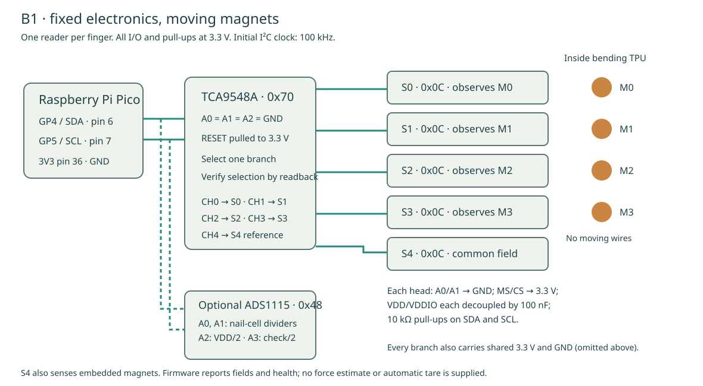
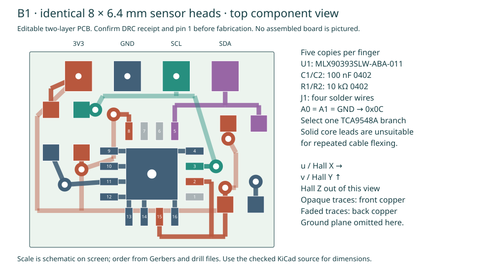

# B1 electronics and raw acquisition

Build **five identical sensor heads per finger**. Each head is an 8 × 6.4 × 0.8 mm two-layer PCB carrying a QFN-16 MLX90393SLW-ABA-011, two 100 nF decoupling capacitors and two 10 kΩ pull-ups. A TCA9548A at the wrist selects one head at a time. Every head uses address 0x0C.



## Manufacturing and assembly

- [Fabrication ZIP](../release/b1/pcb/b1_head_fabrication.zip): copper, mask, paste, outline and Excellon drills.
- [KiCad board after zone fill and checking](../release/b1/pcb/b1_head.kicad_pcb).
- [PCB verification receipt](../release/b1/pcb/pcb_checks.json).
- Editable generator, local footprints, component positions and pin/net CSV: `engineering/electronics/b1` in the complete source download.



The board passed KiCad 10.0.7 DRC with zero violations and zero unconnected items. This is a copper/clearance check, **not a powered board test or independent schematic-parity check**. The pin-to-net CSV is supplied for electrical review. Confirm it against Melexis datasheet 3901090393 revision 012, especially package and orientation.

Request 0.8 mm FR-4, two 1 oz copper layers, ENIG, and panel rails outside the 8 × 6.4 mm outline. The routing uses 0.15 mm minimum copper spacing and tracks, 0.45/0.20 mm vias, and 0.15 mm copper-to-edge clearance. Confirm those capabilities with the fabricator. The exposed-pad via is conventional: ask for underside tenting and inspect solder wicking/EP fill. Four reduced paste apertures are supplied. Hand-solder wire pads include plated vias; tin carefully. Do not substitute a smaller-outline sensor package.

The top-view pin-one dot is beside the lowest pad on the chip's right edge in the placement diagram. This footprint rotates the manufacturer's pinout to match the model's sensor axes. Each installed board has its own pose; the recorder uses the release rotation matrices.

| Sensor pins | Connection |
|---|---|
| 2 MS/CS, 8 VDD_IO, 15 VDD | 3.3 V |
| 3 SCL | Branch clock, 10 kΩ pull-up |
| 5 SDA | Branch data, 10 kΩ pull-up |
| 11 A1, 12 A0, 13 VSS, exposed pad | GND |
| 4, 9, 10, 14, 16 NC | GND, per manufacturer recommendation |
| 1 INT, 6 MISO, 7 INT/TRIG | Unused |

These are IC pin numbers. J1 solder-pad order, left to right in the PCB diagram, is **3V3, GND, SCL, SDA**.

## Wrist wiring

Connect Pico GP4/SDA (physical pin 6) and GP5/SCL (pin 7) to the upstream I²C bus, with common GND and 3.3 V. Connect TCA A0/A1/A2 to GND for 0x70 and ensure RESET is pulled high. Check the breakout's upstream pull-ups; all pull-ups must terminate at 3.3 V. Use channels 0–4 for S0–S4 and leave the other branches unused. Do not place two same-address heads on one branch.

Start at 100 kHz. Measure SDA/SCL rise time and low level at the farthest head; acceptable digital communication depends on the real wire capacitance and pull-up network. The firmware writes one branch bit and reads the mux back. It does not enable several same-address branches together.

Test each board with current-limited 3.3 V power before mounting. Inspect for shorts, confirm the sensor responds at the expected address, and move one known magnet along each marked axis. Verify signs and head identity. Place all five stationary together to identify offsets and orientation errors. Record noise and temperature after warm-up. Neither a successful address scan nor a nominal sensitivity proves force accuracy.

## Optional hard-nail sensing

Use one ADS1115 at 0x48 on the upstream bus, powered at 3.3 V:

| ADC input | Wiring |
|---|---|
| A0 | R1 N0 cell 0 divider |
| A1 | R1 N0 cell 1 divider |
| A2 | Independent 10 kΩ / 10 kΩ supply divider |
| A3 | Second independent 10 kΩ / 10 kΩ check divider |

Each cell connects from 3.3 V to its ADC node. A selected pull-down connects that node to GND. Put a 100 kΩ continuity resistor across the cell at the fingertip end, following [R1 wiring](ELECTRONICS.md). Initial pull-downs are 10 kΩ; record changes in B1's `config.json`. Conductance includes the continuity resistor.

Set `"nail_cells": true` only when this circuit is installed. A missing ADC, open lead, short or failed reference check produces an invalid reading. The shipped default is false, so **hard-nail contact is not sensed by a default magnetic-only build**.

## Program and record

Use a Pico with MicroPython. Copy these three files from `engineering/firmware/b1` to its filesystem: `main.py`, `mlx90393.py`, and `config.json`. This firmware is separate from R1 and L1. It contains no motor commands.

The reader programs volatile MLX registers, verifies readback, and checks configuration before each measurement. It uses gain selection 7, resolution 1, filter 2, OSR 2, HALLCONF 0xC and temperature compensation off. XYZ are signed 16-bit values; nominal scale at 25 °C is 0.300, 0.300 and 0.484 µT/count. Raw temperature is retained. The 20 Hz frame rate is a target: conversion, USB and wire delays must be measured.

From the repository root, using the prepared environment:

```sh
build/engineering/tools/cad-venv/bin/python engineering/software/b1_monitor.py \
  --port /dev/ttyACM0 --seconds 30 \
  --specimen B1-001 --condition unloaded-motor-off \
  --output results/B1-001/unloaded-motor-off.jsonl
```

Select your actual port. The recorder creates a new file, records specimen/condition/geometry identity, preserves raw messages and parse faults, and checks sequence and timestamp continuity. Local sensor axes are also rotated into the finger's native axes. It never fills a missing sensor with zeros.

The serial schema is `yam-b1/1`. Every sample includes five sensor slots, per-head command/read timing, status bytes, raw XYZ/temperature, optional nail data, the exact settings and an error list. `force_n` remains null in decoded data. Do not treat a field norm or a zeroed field as force.

## Reproduce the PCB checks

```sh
/usr/bin/python3 engineering/scripts/build_b1_pcb.py
/usr/bin/python3 engineering/scripts/check_b1_pcb.py \
  --kicad-cli /usr/bin/kicad-cli --export
```

Use KiCad 10 with its CLI. `prepare_b1_eda.py --extract` optionally obtains the isolated official KiCad AppImage used in this build. That tool stays under `build/engineering/tools` and is not included in the portable source archive.

The raw manufacturer references and their checksums are recorded in the B1 release. Register definitions and the nominal conversion factors are drawn from the [Melexis datasheet](https://media.melexis.com/-/media/files/documents/datasheets/mlx90393-datasheet-melexis.pdf), not from a force calibration.
