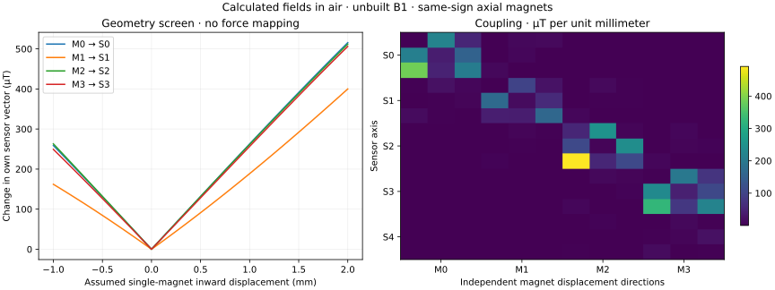

# B1: decide how much bending is useful

The first comparison is **unmodified ENPIRE versus B1 at the same print process**, with R1 and L1 retained for their original purposes. Do not make a stiffer B1 by default: first measure whether its additional internal bosses change bending, return position or object access.

No physical B1 data are published. The proposed tests below are a reproducible plan, not passed acceptance results.

## Establish mechanics before fitting force

Use an external calibrated compression-force reference and a displacement gauge or calibrated camera. Record reference uncertainty, probe size, alignment, temperature and complete specimen identity. Use a fixture before energizing the robot gripper.

1. Photograph and measure the assembled finger, magnet seating, sensor gap, actual screw heads, cable bundle and adhesive fillets.
2. At M0–M3 and the hard nail, measure displacement under normal, transverse and insertion-direction loads. Record the load direction and the actual point of contact; force magnitude alone is insufficient.
3. Begin at 0, 0.2, 0.5, 1, 2 and 5 N. Inspect return position and clearances. Progress through 10, 15 and **20 N per finger** only while the fixture, attachment and finger remain stable.
4. Repeat at least three complete loading/unloading cycles per location. Record pauses, creep during 30-second holds, unloaded recovery after 60 seconds, and whether a wire or board limits travel.
5. Repeat the same trials on the unmodified control with the same probe and mounting.

Record both contact-point motion and hard-nail motion. A finger can conform locally yet still have unacceptable insertion deflection or residual tip shift. Use the actual precision task's tolerance to set the allowed tip displacement **before** choosing a stiffness variant.

Recheck plug retention, visible pocket damage, board bonding and fastener seating after each stage. Magnet supplier “holding force” is not the plug's retention capacity. Measure retention on a spare printed pocket/plug assembly and document the method; do not infer it from the catalog.

## Nominal field screen

The supplied [field-screen JSON](../release/b1/field_screen.json) evaluates four uniformly magnetized finite cylinders in air at the actual CAD sensor positions. It checks the numerical integration against the on-axis closed form and a finer quadrature.

The displacement and tilt sweeps are hypothetical independent magnet motions. They do **not** predict motion under 20 N, structural stress, permitted travel, force accuracy or contact threshold. The model omits steel, the drive motor, a second jaw, adhesive, magnet-lot variation and viscoelastic mechanics. Die position is a nominal allowance within package tolerances.

Use the calculated coupling matrix to understand why a single channel cannot be assumed to correspond to one independent contact force. Keep all five vectors in the dataset.

## Separate contact from field interference

Capture 30-second unloaded records in each relevant pose, with the motor off, enabled and moving without contact. Repeat with the second finger present, several jaw openings, steel objects approaching without touching, and nonmagnetic objects. Record cable motion and warm-up.

Capture independent 0.2 N contact presentations at each intended contact area and at its borders. Include partial contacts and the spaces between magnets. Test the hard nail separately with its optional R1 cells. Preserve missed detections, false events, sensor faults and rejected trials.

Split by complete presentation/session, not by neighboring frames. Use training records to select features and thresholds, freeze them, and evaluate new physical presentations. Start with 20 per label/location for a pilot; use the [contact reliability protocol](CONTACT.md) for the larger confirmation counts and interpretation of error bounds.

The existing R1/L1 contact commands **do not accept B1 packets**. B1 supplies raw acquisition and a validation plan. Add a B1 feature/threshold adapter only after selecting and checking the measured magnetic representation. Do not relabel magnetic counts as R1 conductance to reuse a detector.

Reference subtraction is an experiment, not a guarantee. Rotate each head into the same native frame first; subtracting unrotated local axes is incorrect. Compare raw and reference-adjusted models on held-out motor/pose/steel conditions. S4 also observes the embedded magnets, and one reference cannot remove arbitrary spatial field gradients.

## Force calibration through 20 N

Capture synchronized external force and B1 raw data during the mechanical cycles. Retain reference uncertainty, exact contact position/direction and loading/unloading state. Do not use commanded motor current as force ground truth.

Train a model on entire training cycles using the magnetic vectors and optional nail channels. Hold out complete cycles, contact locations, sessions and replacement inserts as appropriate to the intended claim. Report low-force error separately from the 10–20 N region, alongside hysteresis, creep, drift, cross-contact confusion, unavailable readings and uncertainty. A model trained at four single-point contacts does not qualify distributed multi-contact grasps.

No force coefficients or automatic tare are shipped. If absolute whole-finger force is needed before a magnetic model is established, use the separately qualified [L1 load-path approach](BUILD_L1.md) or the external bench reference; B1 adds spatial/contact information.

## Choose bending from task evidence

Compare the original control, B1, and only then a deliberately firmer insert if needed. Keep task speed, approach, object, force limit and sensing treatment fixed during each comparison.

| Task | Record |
|---|---|
| Thin-edge pickup / object undercut | Minimum gap reached, missed pickups, damage |
| Pinch of small rigid parts | Position repeatability, slip, contact detection |
| Connector or peg insertion | Alignment success, insertion force, tip deflection |
| Fragile object grasp | Peak force, settling, visible deformation |
| Regrasp / contact transition | Event timing, false events, lost object |
| Sustained 20 N bench hold | Creep, residual displacement, sensor drift, retention |

For deciding whether to keep bending, favor the least compliance that reliably accommodates your alignment and object variability while meeting the task's tip-position and force tolerances. Keep the thin nail and backbone stiff enough for insertion. If high precision degrades, change a declared mechanical variable and compare it against the retained baseline.

Publish actual build photographs, raw files, frozen configuration, trial plan, exclusions and analysis together. A 20 N force target, a finite-field calculation and successful software tests remain distinct from a qualified robotic gripper.
