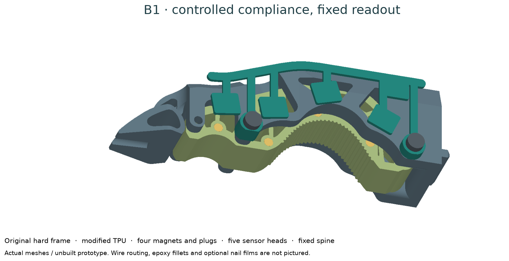
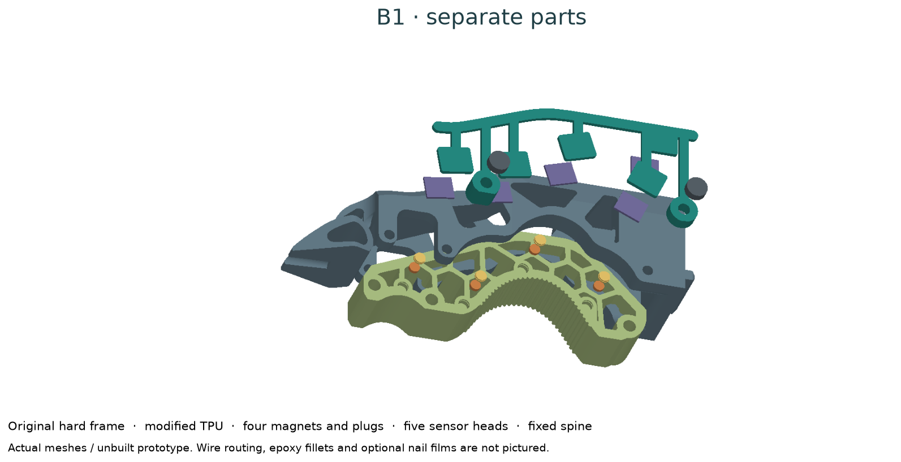
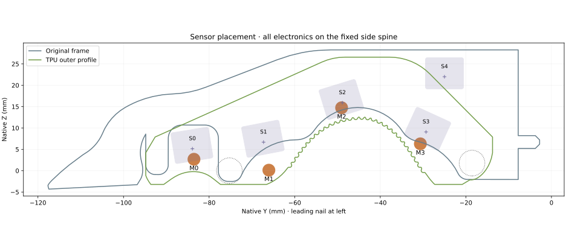

# B1: keep controlled bending, keep a precise tip

B1 is a **separate magnetic insert prototype**. Keep R1 and L1 as comparison builds. The design decision is to retain compliance in the TPU contact region and retain the original hard frame and thin nail. Do not deliberately soften the whole frame to make a sensor work.

**Start with [the exact sensor choice and placement map](SENSORS.md).** For your precision-task prototype, use **five MLX90393SLW-ABA-011 heads**, **four 3 × 1 mm magnets in the TPU**, and **two N0 pressure-film pads on the object-facing nail prongs**. The labeled map shows S0–S4, M0–M3 and T0/T1, with distances from the nail tip and downloadable coordinates.

This is a buildable digital design with checked CAD and PCB files. **No B1 has been assembled or tested. 20 N per finger is the requested test target, not an established rating.**

## What moves, and what stays fixed

Four 3 × 1 mm magnets sit in side-entry pockets in the TPU. Five small magnetic sensor heads attach to a rigid side spine: four observe deformation and the fifth records common-field changes. The TPU carries neither a sensing laminate nor moving wires.

The magnetic heads measure field, which changes with magnet translation and rotation. They do not inherently measure normal force. The fifth head also sees the embedded magnets. Mechanical characterization and physical calibration remain necessary.

The bare hard nail has no intentional compliance for this readout. Add the **two existing R1 N0 nail cells** when you need nail-contact coverage. Magnetic insert sensing alone leaves that region uninstrumented.

## Preserved geometry and changed packaging

| Feature | B1 decision |
|---|---|
| Original hard frame, nail, root mount | Unchanged |
| TPU external contact profile and three attachment bores | Retained |
| TPU internal material | Four magnet bosses and pockets; local stiffness changes |
| Reach | No added reach |
| Side spine | Adds 3.65 mm to the original global width before fastener heads |
| Reserved fastener heads | Global width addition becomes 6.05 mm; cable routing and glue excluded |
| Thin leading nail | Original 22.84 mm extension beyond the TPU retained |
| Sensing coverage | Four soft regions; optional two R1 nail cells |

The original TPU is reconstructed from the recovered source mesh. Reconstruction volume agrees numerically with the source; this does not establish printed fit. The B1 insert adds about 113.29 mm³ internally and removes about 42.11 mm³. Neither volume nor unchanged outside geometry establishes unchanged compliance.

## Download and prepare

- [Bill of materials](../b1_bom.csv): quantities are per finger.
- [Dimension and assembly review PDF](../release/b1/b1_review_drawings.pdf).
- [Modified TPU STEP](../release/b1/cad/b1_magnetic_tpu_insert.step) / [STL](../release/b1/cad/b1_magnetic_tpu_insert.stl).
- [Fixed spine STEP](../release/b1/cad/b1_fixed_sensor_spine.step) / [STL](../release/b1/cad/b1_fixed_sensor_spine.stl).
- [Flush plug STEP](../release/b1/cad/b1_flush_magnet_plug.step) / [STL](../release/b1/cad/b1_flush_magnet_plug.stl).
- [Checked PCB fabrication ZIP](../release/b1/pcb/b1_head_fabrication.zip).
- [Specimen record](../templates/b1_specimen.json).

The magnet and PCB STEP/STL files are purchased/component **reference envelopes**. Do not print them as functional electronics.

Use the same TPU grade, lot and slicer settings as the original control. A nominal “85A” or “90A” label alone is insufficient for reproducing compliance. If the original process is unknown, record a complete new process and print an unmodified control with it. Obtain reflow assembly for the QFN boards if the student cannot reliably assemble that package.

For an initial print orientation, put the insert's flat **X = −15 mm** side on the bed with the magnet-pocket openings upward. Put the spine's flat outer backing face on the bed with its mounting posts upward. Print plug axes vertically. Inspect unsupported internal additions and the retaining groove in the slicer preview. These are starting orientations; keep the matched control and record every process adjustment.

## Assembly sequence

1. **Print a control and one B1 insert.** Match orientation, layer height, walls, infill, conditioning and temperature. Inspect cavity bridges and the three attachment bores. Print the PETG spine and four 95A TPU plugs separately. Do not use a scaled STL to fix one tight feature.
2. **Gauge the pockets before installing magnets.** Nominal pocket diameter is 3.15 mm and depth 2.15 mm; magnet supplier tolerance is ±0.1 mm. The small clearance makes printer compensation important. If the pocket is tight, adjust the parameter, regenerate and document it before printing the full set. Avoid forcing or chipping a magnet.
3. **Check polarity.** Label M0 through M3 from distal to proximal. All north faces point toward +native X, the sensor-spine side. Confirm the purchased lot with a known magnetic reference; a magnet that merely attracts steel is not a polarity check. Keep magnets out of the hot print/reflow process.
4. **Seat and retain magnets.** Put each magnet against the pocket floor. Press a flush plug into its retaining groove; its outer face should be at the original TPU side plane. Record the actual seating depth and polarity. Inspect whether a small amount of compatible room-temperature adhesive is needed after testing the printed retention fit. Do not fill nearby flex cavities with glue.
5. **Assemble and test the electronics off the finger.** Follow [B1 electronics](B1_ELECTRONICS.md). Confirm all five branches, supply voltage, pin 1 and field sign before bonding boards to the spine.
6. **Bond the heads in their modeled poses.** The component face points toward the magnets, with the PCB back against 0.10 mm transfer tape on the spine. Use small epoxy fillets at the two wire-end corners. Align each board to the generated placement view; do not substitute a common board angle. Record adhesive and cure conditions. Check bond retention after cure.
7. **Attach the fixed spine.** It uses the middle and proximal original side attachment axes, preserving all three TPU bores. The spine has 3.4 mm M3 clearance holes. Measure the original assembly and the new stack to choose nonmagnetic screw lengths. Preserve the original finger clamping; no thread length or tightening torque is assumed from an STL. Verify that the actual head fits the reserved 6 mm diameter × 2.4 mm envelope.
8. **Route fixed wiring.** Keep wires, solder joints and fillets on the fixed spine/back. Anchor the wire bundle before it exits toward the wrist. Start with branch lengths at or below 150 mm and measure bus behavior. Wires must not enter a TPU flex cavity or cross the thin leading edge.
9. **Check travel manually.** With the drive disabled, inspect both jaw orientations and their entire opening range. Compress the TPU with a fixture while watching side clearance. Check that no moving TPU rubs a board, wire or screw, and that a released insert returns without sticking. Do not assume the field-model displacement sweep is mechanically permitted travel.
10. **Record the build and bench results.** Photograph the bare board, magnet placement, bonding, wire routing and completed finger. Follow [B1 testing](B1_TESTING.md) before attempting robot tasks.

## Why retain some bending?

We are choosing moderate contact compliance and a predictable structural path. Hartisch and Haninger study direction-dependent compliance for connector insertion: lower transverse stiffness assists alignment while higher insertion stiffness supports assembly force. That motivates the design direction; their results do not validate this ENPIRE modification.

If the original insert proves too compliant for your tasks, first change one controlled variable—such as the printed insert's material/process or a later local rib modification—and repeat the same measurements. **No stiffer insert or new frame is being silently substituted in B1.** Keep the original and B1 controls.

## Sources and attribution

- Original finger: Wenli Xiao / NVIDIA ENPIRE; [user-specified MakerWorld model](https://makerworld.com/en/models/2984746-gripper-finger-for-robot-arm#profileId-3349177). See [geometry provenance](GEOMETRY.md) for the pinned recovered meshes and limitations.
- Bending concept: [Hartisch and Haninger, structured compliance](https://arxiv.org/abs/2307.15589).
- Magnetic TPU concept precedent: [eFlesh project and source](https://github.com/notvenky/eFlesh). B1 is new geometry and electronics, not a reproduction of eFlesh's measured performance.
- [Melexis MLX90393](https://www.melexis.com/en/product/MLX90393/triaxis-micropower-magnetometer) and [magnet specification](https://www.supermagnete.de/eng/data_sheet_S-03-01-N.pdf).

The release preserves all R1/L1 geometry and their source hashes. B1 changes, measurements, limitations and build files are separate.
