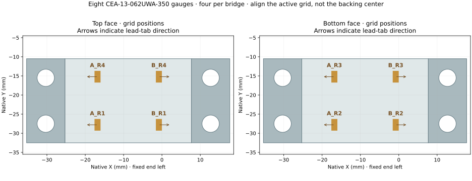
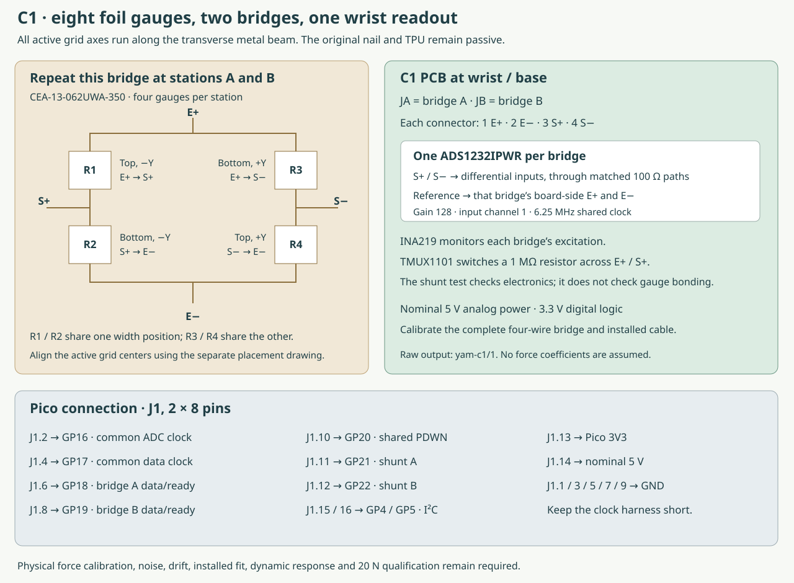

# Build C1: strain-based force at the root

C1.1 puts the original ENPIRE finger on a separate metal force path. Eight foil
gauges form two strain bridges on a transverse beam. The original nail and TPU
remain passive and retain their contact geometry.

**Status:** this is a digital prototype package. Assembly, force accuracy,
contact reliability, durability and robot-task performance still require
physical measurements. The calculated response uses ideal bonded joints.

[Bill of materials](../prototypes/c1/c1_bom.csv) · [PCB fabrication ZIP](../prototypes/c1/pcb/c1_readout_fabrication.zip) · [Pico firmware](../prototypes/c1/c1_firmware.zip) · [Mechanical drawings](../prototypes/c1/c1_review_drawings.pdf) · [Wiring diagram](../prototypes/c1/c1-wiring.svg) · [Separate C1 page and CAD](https://geyan21.github.io/yam-tactile-kit/c1.html)

## Sensors and exact locations

| Component | Selection | Location |
|---|---|---|
| Strain gauges | Eight Micro-Measurements CEA-13-062UWA-350 | Four gauges at each of two stations on the metal root beam |
| Bridge A | A_R1 through A_R4 | Grid centers 8.5 mm from the active beam's fixed boundary |
| Bridge B | B_R1 through B_R4 | Grid centers 24.5 mm from that boundary |
| Gauges on each face | Two per station | At native Y offsets −6.29 and +6.29 mm from the beam center |
| Bridge conversion | Two ADS1232IPWR | Fixed readout PCB at the wrist/base |
| Excitation monitoring | Two INA219AIDR | One in each bridge's E+ feed on the PCB |
| Electrical test | Two TMUX1101DBVR switches and 1 MΩ resistors | On the PCB; each temporarily shunts one bridge arm |
| Controller | Raspberry Pi Pico RP2040 | Near the readout, with a short documented J1 harness |



The active grid is **1.57 × 3.05 mm**; the whole gauge backing is **7.9 × 4.8 mm**.
Align the grid center, not the center of the asymmetric backing. The larger
keepout in the design is an assembly allowance, not a larger sensor.

All strain-sensitive grid axes run along native X, the transverse beam axis. Point A's
lead tabs toward the fixed end and B's toward the floating end. Two gauges sit
on each face at each station. Both drawing panels use the same native XY
coordinates; the bottom face is projected through the beam without mirroring.

## Mechanical build

The active beam is **33 × 22 × 14 mm**, with two 10 mm clamp ends. It is
deliberately separate from the earlier 18 mm longitudinal coupon study.
Use the supplied C1.1 parts together.

The adapter adds **18 mm reach** and **21.4 mm to the overall width**, making
the root **53 mm wide**. It extends the back by about **24.2 mm including
reserved hardware**. Actual drive fit and cable clearances remain unverified.
The leading nail surface receives no added sensing film.

1. Print the beam and carrier witnesses and check the actual jaw, original finger, root key, bolts and full opening range. Select the fixed carrier that matches the mating jaw.
2. Machine the beam, carriers, clamp caps and force-bearing bench fixtures from certified 6061-T6 aluminum. Printed witnesses are not force parts.
3. Check beam dimensions, hole locations, flat clamp faces and the open active section. Remove burrs; do not engrave, scratch or machine gauge pockets into the active beam.
4. Prepare the gauge surfaces and bond using the current Micro-Measurements instructions for M-Bond 200. Record the purchased gauge factor, lot, preparation, adhesive, temperature, cure and photographs. This initial laboratory process has not established lifetime.
5. Use the removable stencil to mark the eight active-grid centers. Bond the top and bottom gauges at the specified stations and width positions, then remove all tooling from the sensing region.
6. Wire the two complete bridges and check their resistance and insulation. Apply the chosen protective coating according to its instructions, record it, and characterize the complete coated specimen.
7. Mount the fixed carrier first. Its clearance variant needs 90-degree M3 flat heads of at most 6.0 mm head diameter, seated flush. The tap-drill variant requires M3 threads and the appropriate mating-jaw fasteners.
8. Clamp the beam ends with the two caps and four M4 × 25 screws. Use two approximately 0.5 mm small-OD DIN 433 washers per screw for the 1.0 mm stack in the drawings. Verify engagement and no bottoming; record tightening procedure and actual values.
9. Attach the original finger to the floating carrier. Keep its rear hardware within the 7 mm diameter and 4.5 mm projection allowances. Check the relief pockets and all fixed-to-floating clearances.
10. Route fine, flexible leads with slack and strain relief on the inactive structure. Wires, coating, covers and cable ties must not create a parallel load path or touch the active beam during motion.

Inspect the installed device under low force before progressing to the larger
loads. The structural model assumes bonded clamp interfaces; it does not
establish actual bolt preload, friction, slip, fatigue or load capacity.

## Bridge wiring

Repeat the following at both stations. “−Y” and “+Y” denote the two offsets
relative to the beam center.

| Bridge arm | Gauge position | Electrical connection |
|---|---|---|
| R1 | Top, −Y | E+ to S+ |
| R2 | Bottom, −Y | S+ to E− |
| R3 | Bottom, +Y | E+ to S− |
| R4 | Top, +Y | S− to E− |

JA receives bridge A and JB receives bridge B. Each connector is **1 E+,
2 E−, 3 S+, 4 S−**. Use twisted excitation and signal pairs. Measure the
excitation-loop cable resistance and keep it below 2 Ω. Calibrate with the
complete installed cable; its resistance and temperature response are part of
the assembly.



The readout uses the corresponding board-side excitation for each ADC's
reference. It is a four-wire bridge interface. The two current monitors check
excitation; weak input bias helps expose open signal leads.

## PCB, power and first electrical test

Populate the checked C1 board from its BOM and assembly artwork. The selected
INA219 is **SOIC-8**, whose pinout differs from the SOT-23 version. Use the
specified ADS1232 and TMUX packages and inspect every pin-1 orientation.

The ADC analog supplies are nominal 5 V through the documented filters.
Digital logic is 3.3 V. Use one power source at a time: for a board-only
current-limited supply check, disconnect the Pico and USB; then remove the
bench supplies before using Pico/USB power through J1.

For an initial electronics-only check, two dummy bridges made from four matched
348 Ω or 350 Ω resistors each can replace the bonded gauges. That checks the
readout and shunt-test path; record it with `--source-kind electrical_dummy`.
It is not a tactile specimen or force-calibration dataset.

Install the real bridges before force measurements. Verify the shared clock,
data-ready alignment, shunt-test response, current-monitor readings and the
specified lead faults. A passed electrical shunt test does not prove gauge
bonding or correct mechanical sensitivity.

## Firmware and raw capture

Copy all three files from `c1_firmware.zip` to a dedicated RP2040 Pico. The
firmware uses a common configured 6.25 MHz clock, giving about 101.7
conversions/s. Actual rate, noise, timing and waveform quality remain bench
checks. The digital filter's response time differs from the output interval.

Keep the assembly stationary during startup electrical tests. The firmware
does not tare an external force and never substitutes calculated force
coefficients for a measured calibration.

```sh
/usr/bin/python3 engineering/software/c1_record.py \
  --port /dev/ttyACM0 --specimen C1-01 --condition center-static \
  --seconds 3 --output results/C1-01/recordings/center-01.jsonl
```

Choose the actual port. The recorder preserves raw frames, faults, geometry
identity and a file-hash receipt. Its initial buffer synchronization is
recorded explicitly. It never commands an actuator.

## Force calibration and qualification

Follow [the C1 test procedure](C1_TESTING.md). Calibrate using different force
levels and independent left/right lever positions, then freeze the model before
collecting validation runs.

The supplied force fitter evaluates **means of stationary holds**. It does not
qualify dynamic force accuracy or contact confidence. The full task comparison
also needs motor/pose/steel/cable tests, tip motion, durability and actual
precision tasks. A root sensor sees weight and inertia as well as contact;
moving-robot use needs explicit compensation and validation.
