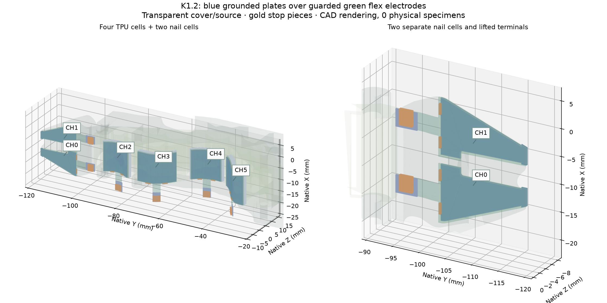
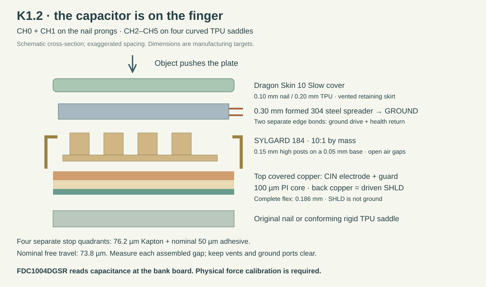
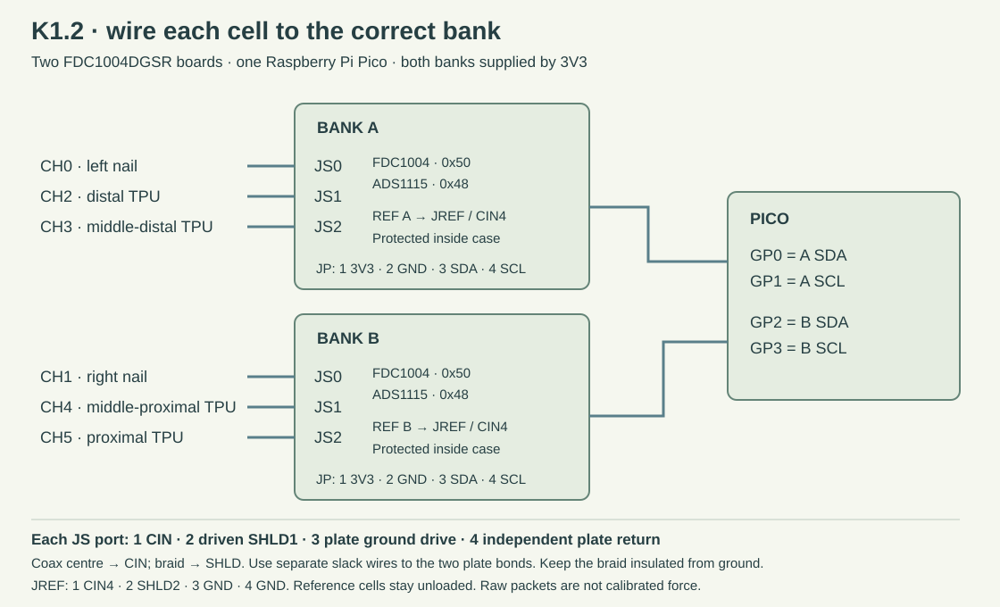

# K1.2: build the six-cell capacitive finger

**The tactile sensor is a custom compression capacitor at each contact region.**
Buy **TI FDC1004DGSR** for its readout, **Dow SYLGARD 184** for the patterned
dielectric, and the specified two-layer flexible electrodes. An FDC1004 board
alone is not a tactile sensor.

The new [K1.2 package](../prototypes/capacitive/README.md) contains the formed
electrodes, retained plates, stops, casting and bonding tools, bank enclosures,
checked electrical artwork and raw/force-calibration software.
**Physical specimens tested: 0. No measured 20 N pass or contact winner exists.**
The [earlier K1 module](../development/capacitive/k1/README.md) remains available.



## Sensors and placement

| Position on the finger | What to assemble | Connection |
| --- | --- | --- |
| Left nail prong, CH0 | Left shaped flex, post sheet, steel plate and thin silicone cover | Bank A, JS0 |
| Right nail prong, CH1 | Separate right shaped cell; keep the fork notch open | Bank B, JS0 |
| Distal TPU region, CH2 | Curved cell on its conforming rigid saddle | Bank A, JS1 |
| Middle-distal TPU, CH3 | Separate curved cell and saddle | Bank A, JS2 |
| Middle-proximal TPU, CH4 | Separate curved cell and saddle | Bank B, JS1 |
| Proximal TPU, CH5 | Separate curved cell and saddle | Bank B, JS2 |
| Two protected references | Build REF twice; one inside each bank case, away from external force | Respective JREF / CIN4 |
| Two bank boards | FDC1004DGSR plus ADS1115IDGSR health monitor | Separate Pico I²C buses |



Nominal flex thickness is **0.186 mm**: 100 µm polyimide core, 18 µm copper
on each side, and 25 µm coverlay including adhesive on each face.
The post sheet has a **50 µm base and 150 µm high, 600 µm diameter posts**.
The grounded plate is **0.30 mm annealed 304 stainless**.

Nominal nail addition is **0.836 mm**. The **1.786 mm TPU stack height is above
the R1 smoothed-saddle datum**; the fitting base is below that datum.
It is not the total addition to bare TPU. The TPU between saddles remains
compliant, but each saddle locally stiffens its contact region. Measure the
resulting access and bending behavior against the bare finger.

## Order and fabricate

Use the [bill of materials](../prototypes/capacitive/bom.csv),
[part table](../prototypes/capacitive/parts.csv) and
[file index](https://geyan21.github.io/yam-tactile-kit/assets/prototypes/capacitive/file-index.html).
`reference_only` CAD files describe fit envelopes; they are not items to print.

1. **Order the flex set.** Use the seven native KiCad designs and their checked
   Gerber/drill ZIPs under `flex/`. Order CH0–CH5 once and REF twice per finger.
   Keep the terminal labels: **1 = CIN, 2 = driven SHLD**. Only those top lands
   are opened. The guarded sensing copper stays under coverlay. Require the
   fabricator to confirm the 0.186 mm material stack and the requested core
   thickness; a generic rigid-board service is unsuitable.
2. **Make the rigid supports and tools.** Print and fit the four conforming
   saddles on the real TPU. Make the seven post stencils and backing spacers,
   six spreader forms, seven pairs of cover-mold halves, and four pairs of
   curved stiffener bonding forms. The mold's 50–100 µm features need a
   qualified precision process; an ordinary coarse FDM print does not prove
   those dimensions.
3. **Cut the metal plates and stop quadrants.** Use the current plate/stop SVGs
   in millimetres. Deburr the 0.30 mm plates and form them with the matching
   tooling. The current plate outline reserves space for the retaining skirt
   while retaining the first 1 mm of the leading nail outline.
4. **Build two readout boards.** Use the retained, checked four-layer
   `readout/` artwork and its component list. Each board has 23 components.
   Supply it from the Pico's 3V3 rail. Build the electronics first with measured
   fixed capacitors, labeling those records as electronics tests.

## Assemble the contact cells

1. **Mold the post sheets.** Mix
   [SYLGARD 184](https://www.dow.com/en-us/pdp.sylgard-184-silicone-elastomer-kit.01064291z.html)
   at 10:1 by mass. Use the 150 µm stencil and 50 µm backing spacer with smooth,
   release-treated plates. The candidate cure is 100 °C for 35 minutes after
   the part reaches temperature; follow the current material instructions and
   verify tool compatibility. Measure the finished base, post height, diameter
   and missing/merged posts. The supplied flat post-sheet geometry is the
   manufacturing master; curved meshes illustrate the installed form.
2. **Prepare the flex terminals.** Use the separate 0.20 mm polyimide
   stiffener cutting patterns, with the fabricator-approved 0.05 mm bond.
   The curved patterns are developed at the stiffener's own neutral plane.
   Hold the TPU terminals on the supplied forms during bonding. Polyimide is
   not assumed to retain a heat-formed shape. The nail terminal has a
   length-preserving 4 mm bend followed by a flat stiffener; keep its free bend
   unbonded and retain the specified 0.4 mm outward lift.
3. **Mold the retained cover around its plate.** Use
   [Dragon Skin 10 Slow](https://www.smooth-on.com/products/dragon-skin-10-slow/)
   at 1A:1B by mass or volume. Test cure compatibility first. Wet the open
   cavities with degassed material, locate the formed plate, register the
   halves with two 3 × 8 mm pins and close the four M3 fasteners evenly.
   The foot-level overflow channels let excess material escape. Follow the
   current cure instructions, demold carefully, and trim flash without cutting
   the retaining lip, four vents or two ground-bond access ports.
4. **Laminate the stops.** Use DuPont Kapton 300HN with 3M 467MP on its lower
   face. Nominal film plus adhesive height is **0.1262 mm**, leaving
   **0.0738 mm** nominal travel above the flex. The model exposes early
   bottoming in some thick-adhesive cases. Measure the bonded height and the
   assembled free gap for every cell; a nominal material label is insufficient.
   Place all four separate stop quadrants without filling their vent gaps.
5. **Stack and retain.** Mount the flex on the nail or matching saddle with
   the specified bond thickness. Place the post sheet over the active
   electrode, align its pattern, and install the retained plate/cover.
   Bond only the designated cover feet with
   [Sil-Poxy](https://www.smooth-on.com/products/sil-poxy/), after qualifying
   the actual silicone-to-coverlay joint. Do not fill the air cavity, bond
   the moving plate to the base, or bridge the open vents.
6. **Make two separate plate bonds.** After the cover has cured, use
   [MG 8331D](https://mgchemicals.com/products/adhesives/electrically-conductive-adhesives/silver-epoxy/)
   in the two exposed edge-bond envelopes. Follow its current mixing/cure
   instructions. Attach independent fine stranded wires, one to ground drive
   and one to the health return. Keep a slack loop at each moving plate.
   Measure continuity through the plate. The driven shield must remain separate.

The nominal lip-to-stop check passes for all seven cell shapes. Its minimum
ground-bond clearance at full nominal stop is 0.0762 mm. These are CAD values;
flash, adhesive, plate shape, tolerances and wear can change the real result.

## Wire and protect the electronics



| Port | Pin order |
| --- | --- |
| JP | 1 = 3V3, 2 = GND, 3 = SDA, 4 = SCL |
| JS0, JS1, JS2 | 1 = CIN, 2 = SHLD1, 3 = plate ground drive, 4 = separate plate return |
| JREF | 1 = CIN4, 2 = SHLD2, 3 = GND, 4 = GND |

Use **Taoglas 300815C010000A 0.81 mm micro-coax** for each CIN/shield pair:
centre to CIN, braid to SHLD. The
[manufacturer specification](https://www.taoglas.com/specifications/300815C010000A_Taoglas.pdf)
gives 96 ± 3 pF/m and a 5 mm minimum bend radius; this design reserves a
10 mm bend radius. Finished pressure-cell leads must be at most 150 mm and
reference leads at most 25 mm. Keep the exposed centre conductor at each
termination at most 2 mm and insulate the shield braid.

Use the supplied harness plan for jacket anchoring and plate-wire slack.
Pass each cell's coax and two ground leads through its numbered case port and secure only
its insulated jackets using the adjacent tie slots. Do not crush the coax.
Print two bank cases, lids and reference supports. The 0.5 mm support places
REF in the PCB's reserved 14 × 12 mm area; the lid must not load its plate.
Keep the Pico and USB in a separate insulated holder on the bench.

Bank A uses Pico **GP0 SDA / GP1 SCL**. Bank B uses **GP2 SDA / GP3 SCL**.
Each bank has FDC1004 address **0x50** and ADS1115 address **0x48**, so the
buses must stay separate. The case's M3 tabs provide a mounting interface;
the unidentified YAM drive still needs a measured bracket and a full
jaw-motion clearance check.

The conservative complete-foil/cable screen gives about **349 pF for A and
373 pF for B** in the declared thin-core/high-permittivity case, below the
400 pF planning limit. Confirm actual shield loading and operation. The
[FDC1004 data sheet](https://www.ti.com/lit/ds/symlink/fdc1004.pdf) defines
the converter's electrical limits; those limits do not establish force accuracy.

## Record and evaluate

Copy all four files from `engineering/firmware/capacitive/` to the dedicated
Pico. Use the [K1 test guide](CAPACITIVE_TESTING.md) for commands, fixed-capacitor
bring-up, held-out force evaluation and contact trials.

The new protocol preserves boot identity, repeated startup configuration,
raw capacitance words, timestamps, supply checks and separate plate-return
health signals. The force fitter requires physical training data and separate
evaluation sessions. No calibrated physical model or contact rule is bundled.

## Reproduce the digital files

Prepare the same project-local CAD, KiCad and Gmsh tools used by the existing
K1 module. The new package's `provenance/source_runs.json` identifies every
input and result; commands print fresh result directories rather than replacing
old evidence. Run the generators in this order:

```sh
build/engineering/tools/cad-venv/bin/python engineering/scripts/design_capacitive_foils.py
build/engineering/tools/cad-venv/bin/python engineering/scripts/build_capacitive_k1_parts.py --reference
build/engineering/tools/cad-venv/bin/python engineering/scripts/build_capacitive_saddles.py CELLS
build/engineering/tools/cad-venv/bin/python engineering/scripts/build_capacitive_foil_fit.py FOILS
build/engineering/tools/cad-venv/bin/python engineering/scripts/build_capacitive_cell_mechanics.py
build/engineering/tools/cad-venv/bin/python engineering/scripts/check_capacitive_cell_clearances.py MECHANICS
build/engineering/tools/cad-venv/bin/python engineering/scripts/build_capacitive_cover_molds.py MECHANICS
build/engineering/tools/cad-venv/bin/python engineering/scripts/build_capacitive_stiffener_tools.py FOILS
build/engineering/tools/cad-venv/bin/python engineering/scripts/build_capacitive_enclosure.py MECHANICS FOILS
build/engineering/tools/cad-venv/bin/python engineering/scripts/check_capacitive_assembly.py MECHANICS FOIL_FIT
build/engineering/tools/cad-venv/bin/python engineering/scripts/screen_capacitive_assembly.py FOILS
```

The flex fabrication step uses `write_capacitive_foils.py` and
`check_capacitive_foils.py` under the supplied KiCad environment. Read their
`--help` and the saved commands in the execution records; do not send an
unchecked intermediate board to fabrication.
