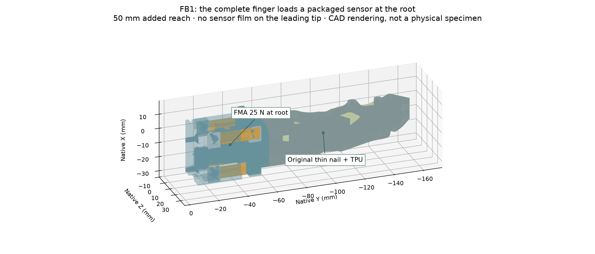
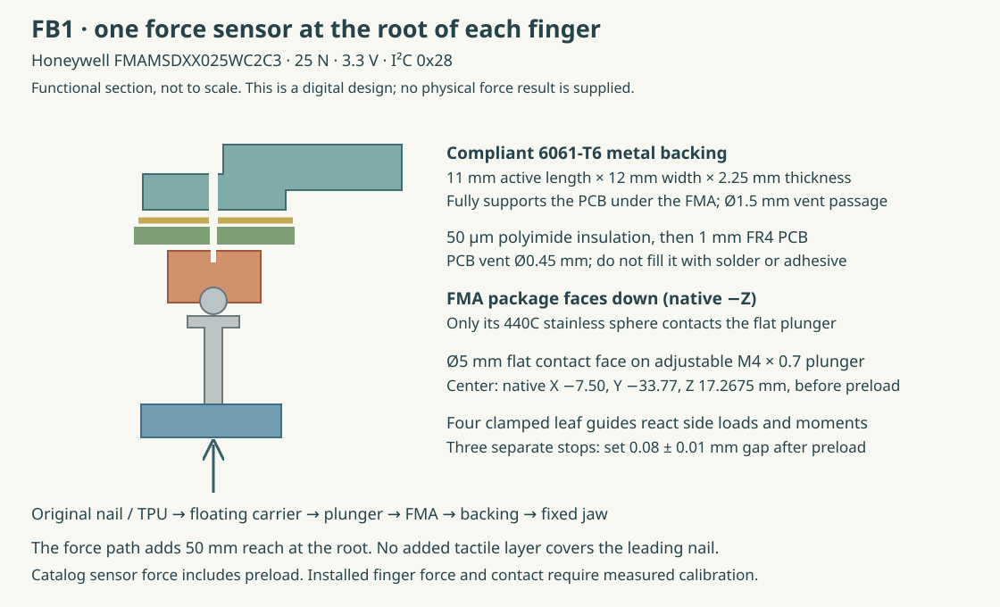
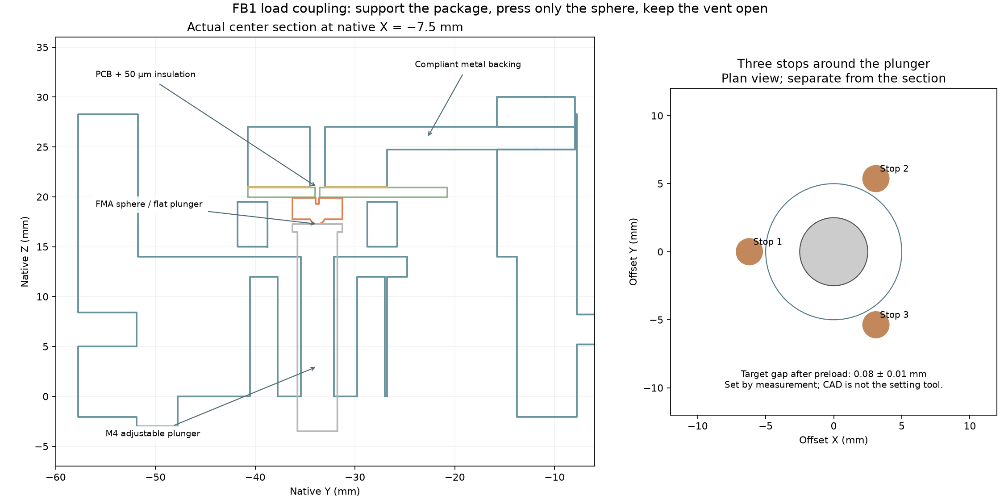
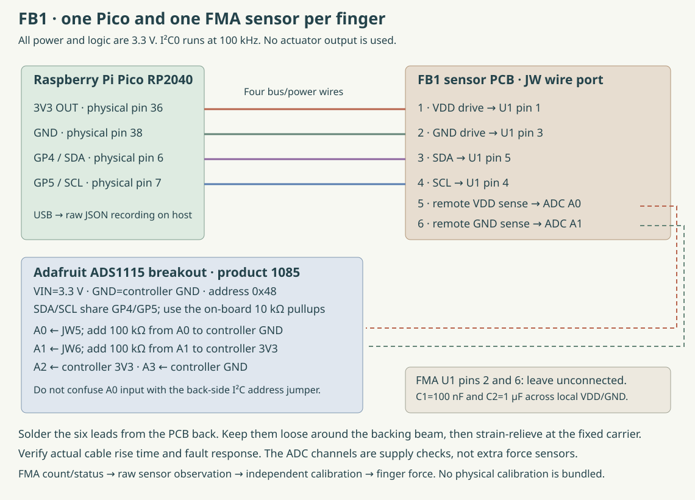

# FB1: build the force-button root adapter

**Sensor: Honeywell FMAMSDXX025WC2C3, one per finger.**
It is a 25 N, 3.3 V, I²C device at address `0x28`. It sits at the **root**,
on a small downward-facing PCB. An adjustable flat plunger presses its
stainless sphere. The original thin nail and compliant TPU keep their
contact surfaces.

This design is a prototype for the **20 N per-finger** comparison. No
physical FB1 specimen, contact reliability or force calibration is supplied.
Its 50 mm added reach and many small mechanical parts are disadvantages to
measure alongside L1 and C1.



## Get the correct files

Use the [FB1 file index](https://geyan21.github.io/yam-tactile-kit/assets/prototypes/force_button/file-index.html),
[bill of materials](../prototypes/force_button/bom.csv),
[review drawings](../prototypes/force_button/visuals/fb1_review_drawings.pdf)
and [package manifest](../prototypes/force_button/prototype_snapshot.json).
The archive separates machined/cut parts, purchased-part envelopes, electronics,
firmware and checks. A purchased-part envelope is not a printable sensor.

The complete source archive includes the editable configurations
`engineering/designs/force_button_fb1.json` and
`engineering/designs/force_button_electronics.json`. The old R1, L1, B1, B2,
C1, N1, B3, F1 and K1 files are retained.

## What goes where



| Part | Exact role and location |
|---|---|
| FMA U1 | Downward-facing component at the force axis: native X −7.50, Y −33.77 mm. Its nominal sphere/plunger contact is Z 17.2675 mm before preload. |
| Sensor PCB | 14 × 20 × 1 mm. The central 14 × 14 mm region is supported; the extra tab carries six soldered wires. |
| Insulation | Flat 0.05 mm polyimide between PCB back and metal. Keep the PCB, film and metal vent openings aligned. |
| Plunger | M4 × 0.7 adjustable shaft with a polished Ø5 mm flat head. It touches the sphere only. |
| Backing beam | 6061-T6, 11 × 12 × 2.25 mm active section. Its compliance gives the stop adjustment usable travel. |
| Four guides | 0.50 mm spring-steel leaves with 20 mm active spans. They connect the fixed and floating carriers and react moments/side loads. |
| Three stops | Flat-point M3 screws around the plunger. Set their gaps after preload; they react against the fixed carrier. |
| Original finger | Mounted to the floating carrier, translated −50 mm along native Y. No wire or surrounding part may restrain that carrier. |
| Controller | One Pico and one ADS1115 health breakout per finger, at the fixed base. The ADC monitors supply wiring; the FMA itself measures the coupled load. |



The nominal stop gap is **0.08 ± 0.01 mm after preload**. This is a design
setting to verify on the assembled specimen, not a tolerance that ordinary
3D printing will establish. Stops may engage beyond the sensor's normal
25 N span. They are not a calibrated 20 N force limiter.

## Fabricate and inspect

1. Print the carriers as fit witnesses and compare the root key, 21 mm bolt
   pitch and full passive travel with the actual installed jaw. The drive
   model and its housing remain unconfirmed. The source mesh does not
   establish thread size, usable engagement or the original bolt-head stack.
2. Machine the carriers, backing beam and caps from 6061-T6 aluminum.
   Keep the leaf seats and PCB support flat. Preserve the thin backing
   section and all clearance pockets. Printed force-bearing copies are
   not substitutes for the metal design.
3. Cut four 0.50 mm AISI 301 full-hard spring leaves to the supplied patterns.
   The moving-end holes are shifted 1.25 mm toward the free span to clear
   the finger-retention nuts. Do not center both hole rows by eye.
   Measure actual thickness, retain the supplier temper record and deburr
   without scratching the active spans.
4. Tap M2 × 0.4, M3 × 0.5 and M4 × 0.7 pilot holes as called out in the
   CAD/parts list. The files show pilot/clearance geometry; helical threads
   are not modeled. Inspect engagement and bottoming with the purchased
   fasteners. Tightening torque needs to be established and recorded for
   the real material and hardware.
5. Machine the plunger's flat contact head and its 1 mm wide, 1.5 mm deep
   bottom adjustment slot.
   Inspect perpendicularity, surface finish and the absence of burrs.
   A rounded screw end or second ball is not the intended contact.
6. Order the **two-layer, 1 mm** sensor PCB from its checked artwork.
   The Ø0.45 mm reference vent is an unplated hole. Populate U1, C1 and C2,
   inspect all six separate sensor lands, and remove process residue without
   obstructing the vent.

The 3D checks include the selected hardware envelopes. Check actual screw
heads, nuts and capacitors against those envelopes before assembly.

## Assemble the load path

1. Secure the common bench receiver to a rigid stand. Attach the fixed
   carrier using the two M3 × 12 countersunk bench screws. The installed
   jaw may require different lengths or a different threading arrangement.
2. Fit the backing beam and its cap with the two M3 × 10 screws. Clamp its
   root only; leave the active section free.
3. Place the flat polyimide film under the PCB. Align the film's Ø1.5 mm
   opening, PCB's Ø0.45 mm vent and backing's Ø1.5 mm opening. Tighten the
   two PCB M2 × 6 screws evenly so the supported area seats flat. Avoid
   adhesive lumps, trapped wires or a bent board under the sensor.
4. With the floating carrier absent, inspect the sphere through the stop
   frame's center bore. A flat reference probe up to Ø5 mm can approach
   it along native +Z. Use this access to check the FMA's direct-load
   response against the independent force reference before trusting a
   preload estimate. Keep the sensor support and board mounting unchanged.
5. Attach the original hard frame/TPU to the floating carrier using compatible
   M3 through fasteners, washers and nuts. Measure the real stack to choose
   bolt length. Keep the rear projection inside its reliefs.
6. Install the four leaves and eight clamp caps. Tighten progressively while
   keeping the carriers square. The leaves must remain flat through their
   active spans; a visible buckle, rubbing edge or forced mismatch requires
   rework.
7. Install the plunger and its M4 jam nut. Approach first contact gradually,
   observing the raw sensor and reference measurement. The mechanical
   model assumes **2 N sensor preload**; factory nominal counts alone
   do not establish that actual force. Record the independently checked
   preload and unloaded finger position before locking the nut.
8. Set all three stops to the measured 0.08 ± 0.01 mm gap in this preloaded,
   externally unloaded state. Lock and remeasure each gap. Verify that the
   locks, probe and cables do not change the unloaded reading.
9. Route the six PCB wires as a loose service loop before strain relief at
   the fixed carrier. Keep the loop clear of the leaves, floating carrier,
   stops and source finger. A taut wire can alter the force path; its
   effect is part of the physical test.

Do not treat an in-range electrical reading as proof that the mechanical
load path is correct. Check for housing contact, open coupling, slipping
clamps and premature stop engagement.

## Wire the readout



The table is for **one finger**. Use another complete set for the other
finger in the first pilot; two fixed-address FMA sensors cannot share this
same I²C bus directly.

| Connection | Destination |
|---|---|
| Pico 3V3 OUT, physical pin 36 | JW1 and ADS1115 VIN |
| Pico GND, physical pin 38 | JW2 and ADS1115 GND |
| Pico GP4 / SDA, physical pin 6 | JW3 and ADS1115 SDA |
| Pico GP5 / SCL, physical pin 7 | JW4 and ADS1115 SCL |
| JW5, separate VDD-sense wire | ADS1115 A0; 100 kΩ from A0 to controller ground |
| JW6, separate GND-sense wire | ADS1115 A1; 100 kΩ from A1 to controller 3V3 |
| ADS1115 A2 | Controller 3V3 |
| ADS1115 A3 | Controller ground |

Use the Adafruit 1085 breakout's default `0x48` address and 10 kΩ I²C
pullups. Keep the first cable short and verify rise time at the configured
100 kHz. Solder JW leads from the PCB back; a tall connector on the component
face is not reserved. Do not confuse the ADC's A0 input with its address
jumper. FMA pins 2 and 6 stay unconnected.

The decoder checks remote supply, ground return, ADC configuration, FMA
status, sequence and timing. These checks do not cover every wiring or
mechanical fault. Disconnect each sense/drive lead separately during
bring-up and retain the observations.

## Run and record

Copy these four files from `engineering/firmware/force_button/` to the root
of a Pico running MicroPython: `main.py`, `config.json`, `fma.py` and
`health_adc.py`. Keep the supplied configuration. The device emits an FB1
identity and repeated raw sample packets over USB.

The nominal FMA transfer is:

```text
sensor_N = ((raw_14_bit_counts / 16384 - 0.20) / 0.60) * 25
```

This is a catalog sensor conversion, including preload. It is not calibrated
whole-finger force. Nonzero FMA status codes are preserved as command-mode,
stale or diagnostic observations. The firmware does not silently reuse a
previous good sample.

From the **complete source repository**, create an isolated capture environment:

```bash
/usr/bin/python3 -m venv build/fb1-capture-venv
./build/fb1-capture-venv/bin/python -m pip install pyserial==3.5
./build/fb1-capture-venv/bin/python engineering/software/force_button_record.py \
  --port /dev/ttyACM0 --specimen FB1-A --session bench-A \
  --condition left_nail_axial \
  --geometry engineering/prototypes/force_button/force_button_manifest.json \
  --seconds 15 --output measurements/fb1-a/recordings/hold-001.jsonl
```

Replace the example port, specimen, session and condition with the actual
ones. The recorder reads only the specified USB port, retains raw lines,
and refuses to overwrite a recording. It sends no actuator commands.
Use the full repository because the recorder imports the shared execution
record helper.

## Calibrate and compare

Follow [FB1 tests](FORCE_BUTTON_TESTING.md) and the common
[all-design campaign](BUILD_ALL.md). Fit a specimen-specific mapping from
raw FMA counts to independently measured **finger** force. Freeze that
mapping before new sessions, positions and objects are evaluated.

Honeywell's published maximum total-error figure is not a guarantee of
this project's 0.5 N force-error target or 0.2 N contact target. Mounting,
preload, bypass stiffness and the operating conditions matter. FB1 earns
a recommendation only after the complete finger meets the same tests
as the other designs.

## Primary component references

- [Honeywell FMA catalog and ordering codes](https://automation.honeywell.com/us/en/products/sensing-solutions/sensors/force-sensors/fma-series-microforce-sensor).
- [FMA data sheet](https://prod-edam.honeywell.com/content/dam/honeywell-edam/sps/siot/fr-ca/products/sensors/force-sensors/microforce-fma-series/documents/hon-ia-hss-force-fma-series-datasheet-32347833-ciid-181799.pdf).
- [Honeywell coupling guide](https://prod-edam.honeywell.com/content/dam/honeywell-edam/sps/siot/en-us/products/sensors/force-sensors/microforce-fma-series/documents/sps-siot-coupling-tech-note-008333-ciid-181807.pdf).
- [Honeywell overforce guide](https://prod-edam.honeywell.com/content/dam/honeywell-edam/sps/siot/en-us/products/sensors/force-sensors/microforce-fma-series/documents/sps-siot-overforce-tech-note-008334-ciid-181806.pdf).
- [Adafruit ADS1115 breakout pinout](https://learn.adafruit.com/adafruit-4-channel-adc-breakouts/pinouts).
- [Mark-10 Series 5 reference-gauge specifications](https://www.mark-10.com/downloads/product-downloads/DataSheetSeries5.pdf).
