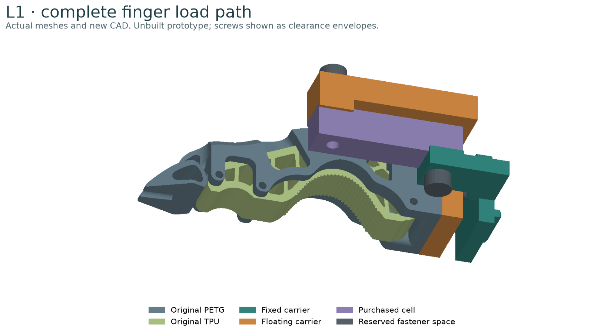
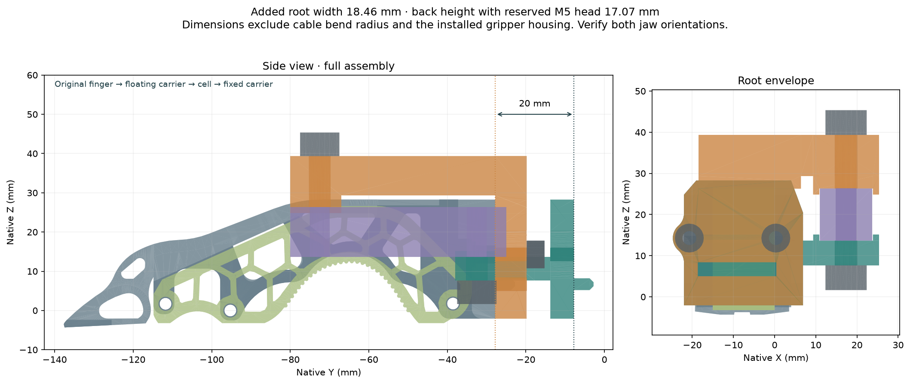

# Build L1: force through the complete finger mount

[L1 design page: load path, sensor, 3D view and files](https://geyan21.github.io/yam-tactile-kit/l1.html).

**L1 is the second physical prototype to build.** It adds a purchased strain-gauge load cell between the original ENPIRE finger and the YAM jaw. A normal contact on the nail or TPU should pass through that cell. The target is 0–20 N per finger. Actual force accuracy, moment sensitivity and durability are unmeasured.

R1 and L1 answer different questions. [R1](BUILD_R1.md) tests local contact coverage with a thin, replaceable skin. L1 tests aggregate normal force while leaving the original contact surfaces intact. Neither has yet passed the physical comparison.

## Obtain the complete build packet

Use the [L1 bill of materials](../l1_bom.csv), [review drawings PDF](../release/l1/l1_review_drawings.pdf), editable `engineering/designs/l1.json`, and STEP/STL files in `engineering/release/l1/cad`. The [specimen record](../templates/l1_specimen.json) travels with the cell through all fixtures. The website's individual-parts table links every STEP and STL.

For one finger obtain one TAL220B 5 kg cell, one NAU7802 board, one Pico, one bidirectional I²C level shifter and one INA219 board. The shared bench fixture requires a fixed shoe, live spacer, combined load plate, center cap and an independent calibrated force reference. The two long test bars are optional.

The selected [SparkFun SEN-14729 cell](https://www.sparkfun.com/load-cell-5kg-straight-bar-tal220b.html) uses the [TAL220B drawing](https://cdn.sparkfun.com/assets/e/5/f/5/6/TAL220B.pdf): 55 × 12.7 × 12.7 mm, two M5 mounting axes 40 mm apart. The wire-end axis is 7.5 mm from the end. Measure the purchased part before fabrication; similar-looking TAL220 cells are different sizes.

## Understand the load path

The original finger bolts to the orange floating carrier. Its return rail connects only to the distal, live end of the purple cell. The green fixed carrier supports only the wire end and attaches to the original jaw. Each cell end has a 13 mm support land. The middle of the cell, its gauge coating and its cable exit stay clear.

There must be no other connection between the moving and fixed sides. A tight cable, a projecting screw, adhesive across the gap or contact with the housing can bypass the force sensor. Route the cell cable from its fixed wire end to the fixed jaw with strain relief.

The original root outline, 21 mm bolt pitch and locating feature come from the retrieved ENPIRE/YAM mesh documented in [Geometry](GEOMETRY.md). The mount plane is native Y = −7.77 mm. The adapted finger is translated −20 mm along native Y. Native +Z is the measured force direction into the contact side.

## Fit before machining

The CAD adds 20 mm of reach and 18.46 mm of total width near the root. The carrier alone adds 11.07 mm behind the original finger; reserving a 6 mm M5 head/washer envelope makes the added back height 17.07 mm. These dimensions exclude cables and the actual drive housing.

1. Print the fixed and floating carrier STLs in PETG as fit witnesses. Print both fixed variants if the jaw's fastening direction is unknown. Keep them labeled “FIT ONLY”.
2. Compare the copied locating key and 21 mm hole pitch with the actual finger and jaw. The source description says M3 installation screws; the mesh bores are about 4.6 mm. Inspect actual fasteners and counterbores instead of deriving thread size from mesh bore diameter alone.
3. Use `l1_fixed_carrier_m3_clearance` when the jaw has M3 threads. Use `l1_fixed_carrier_m3_tap_drill` only when threads belong in the adapter; tap the 2.5 mm pilot bores M3 × 0.5 after machining. Do not put two threaded parts in series.
4. Fit both jaw orientations. Check the complete passive travel with the drive disabled using the robot's normal service procedure. Record the drive model, minimum housing gap, opposing-jaw gap, cable bend space and bolt access.
5. Check the reach change against the intended task and robot tool-center definition. Record the measured new tip location before any later robot test. This packet does not update the robot's TCP.

A fit failure is useful evidence. Change the adapter parameters and regenerate it before ordering aluminum. The MakerWorld finger link alone does not identify which drive housing is installed.

## Fabricate the load-path parts

Use CNC-machined **6061-T6 aluminum** for the fixed carrier, floating carrier and loaded bench tooling. The printable STLs of these parts are inspection aids. This design has no validated printed-plastic load path.

The floating root plate is 8 mm thick and its return rail is 10 mm thick. The original 4 mm rail / 5 mm plate was rejected by the [analytical stiffness screen](../release/l1/stiffness_screen.svg). Under the screen's assumptions, that thin version contributed about 1.79 mm of tip movement; the selected carrier contributes about 0.19 mm. This estimate excludes the load cell, joints, fixed carrier, original finger and dynamic effects. It is not a measured assembly deflection or a strength rating.

Provide the STEP masters and review PDF to the machinist. Suggested inspection targets for this prototype are ±0.10 mm on cell-seat position and ≤0.05 mm seat flatness; record actual results. Inspect the copied key separately against the physical jaw. Remove burrs and sharp cable edges. Do not machine, drill, sand or clamp the cell's active middle section.

## Select fasteners from the measured stack

| Attachment | Stack before engagement | What to record |
|---|---|---|
| Fixed carrier to jaw | 6 mm carrier plus any washer | Which part has M3 threads, usable engagement, bolt length and head access |
| Original finger to floating carrier | Actual finger stack plus 8 mm carrier | Original compatible screw head; M3 nut/washer on rear of clearance bore |
| Fixed carrier to cell wire end | 6 mm carrier plus washer | M5 engagement in actual cell; no protruding tip touching the floating rail |
| Floating carrier to cell live end | 10 mm rail + 3 mm spacer land + washer | M5 engagement, head/washer envelope and clearance |

At each floating M3 attachment, combined rear washer, nut and bolt projection must be ≤4.5 mm. This leaves a modeled 1.5 mm gap to the fixed plate. Check it again under load. The M5 head/washer reservation is Ø10 × 6 mm; use actual hardware that fits or revise the envelope.

The cell drawing does not establish a fastening torque or a guaranteed usable thread depth for the purchased specimen. Measure the threads and record the chosen engagement and torque. A screw must clamp its intended solid end without bottoming, stripping or contacting another part. Do not publish a universal bolt length or torque based on this CAD alone.

## Assembly order

1. Build and test the cell in the independent bench fixture first, using [L1 electronics](L1_ELECTRONICS.md) and [L1 testing](L1_TESTING.md). This can reject unsuitable moment behavior before machining the gripper adapter.
2. After the printed fit check and cell tests, machine and inspect the two aluminum carriers.
3. Attach the original finger to the floating carrier off the robot. Seat its rear plane flat; the copied locating feature enters the clearance opening. Tighten and record the two M3 attachments.
4. Attach the fixed carrier to the stationary jaw or a rigid bench replica of that interface.
5. Install the cell wire end on the fixed 13 mm seat, then attach the floating carrier to its live-end seat. Preserve the 3 mm gap above the active beam. Check that the locating walls contact only the solid ends.
6. Route the cable, record unloaded readings and check low loads with an independent reference. Advance through the staged 20 N protocol only while hardware remains seated and zero returns.

The cell's scalar capacity is not a published long-finger moment rating. At 20 N, the modeled original hard-frame envelope can apply about 1.44 N·m at the cell's live-end axis. The extended finger applies about 2.60 N·m about the original robot mount at its distal bound. These are different reference points and are test demands, not qualified capacities.

## Scaling to a full gripper

Build and qualify each finger separately. Two opposing 20 N contact forces should be reported as per-finger measurements with their directions; do not relabel their sum as a 40 N object load.

For the first two-finger build, use two dedicated Pico/readout sets and preserve separate serial records. Two NAU7802 boards have the same 0x2A address, so they cannot simply share this bus. A later shared controller requires separate buses or a deliberately tested multiplexer. Synchronization, gravity compensation and closed-loop robot behavior are outside this initial firmware.

If combining R1 and L1, leave flexible service loops for the skin wires across the moving interface. Repeat the integrated force tests with that full harness installed; cable forces can invalidate the bare-finger calibration.
