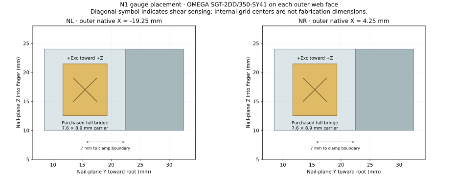
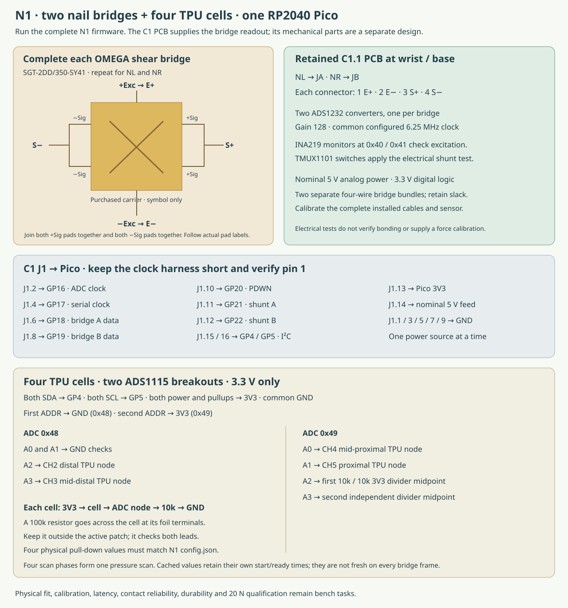

# Build N1: a bare sensing nail

N1 replaces the original hard nail with a thin steel fork. **Two OMEGA
SGT-2DD/350-SY41 full shear bridges bond to vertical webs behind the nail.**
Four retained R1 pressure-film cells cover the TPU contact regions.

The metal nail and its two carriers are separate from the revised PETG frame.
The original TPU shape and three attachment regions are retained. Compare
actual bending and contact behavior with an unmodified control.

**Status:** digital prototype package. Physical fit, assembly, force
accuracy, contact reliability, wear and robot tasks still require measurements.
The structural model assumes bonded metal joints and fixed support faces.

[Read the N1 digital engineering review](NAIL_ANALYSIS.md) for the convergence
check and the limits of its calculated tip motion.

[Separate N1 page and CAD](https://geyan21.github.io/yam-tactile-kit/rigid-nail.html) · [BOM](../prototypes/nail/nail_bom.csv) · [Drawings](../prototypes/nail/nail_review_drawings.pdf) · [Firmware](../prototypes/nail/nail_firmware.zip) · [Specimen record](../templates/nail_specimen.json) · [Physical tests](NAIL_TESTING.md)

## Exact sensors and placement

All quantities are per finger.

| Label | Sensor | Location |
|---|---|---|
| NL | OMEGA SGT-2DD/350-SY41, 350 Ω full shear bridge | Outer face of the left steel web, native X = −19.25 mm |
| NR | A second identical full bridge | Outer face of the right web, native X = +4.25 mm |
| Both foil carriers | 7.6 × 8.9 mm carrier | Center at nail-plane Y = 15.5 mm, Z = 17 mm; 7 mm forward of the fixed clamp boundary |
| CH2 | Retained R1 pressure-film cell and conformal saddle | Distal TPU region |
| CH3 | Retained R1 pressure-film cell and saddle | Mid-distal TPU region |
| CH4 | Retained R1 pressure-film cell and saddle | Mid-proximal TPU region |
| CH5 | Retained R1 pressure-film cell and saddle | Proximal TPU region |
| Nail readout | Retained C1.1 dual-ADS1232 PCB | Fixed at the wrist/base |
| TPU readout | Two Adafruit 1085 ADS1115 breakouts | At the wrist/base with the same RP2040 Pico |



The foil gauges measure strain in the steel webs. The original TPU remains a
separate compliant element. Keep the leading metal nail bare.

The drawing uses nail-plane coordinates: Y increases toward the root, and Z
points into the finger. Orient each gauge's **+Exc end toward +nail-plane Z**.
Use the manufacturer's pad labels for wiring. The diagonal drawing symbol
indicates shear sensing; it does not specify internal grid-center coordinates.

## Mechanical parts

The fork's leading thickness is **1.35 mm** in this design. Each active web is
**1.5 mm thick × 14 mm tall × 14 mm long**. Thicker inactive ends receive the
clamp screws. The carriers include complete pads around their countersinks.

The modeled assembly is about **38.7 mm wide before free screw ends**. The
proposed M3 × 40 side screws extend that envelope to approximately **40 mm**.
The original frame is about 31.6 mm wide. Measure real fasteners, coatings and
cable routing before deciding whether the installed geometry fits the task.

1. Print fit witnesses for the three metal parts and the revised PETG frame. Check the actual finger, jaw housing, full opening range and both jaw orientations.
2. Inspect the source-matched attachment regions and the 0.6 mm web-clearance pockets. The new frame is a separate derivative; preserve the original control.
3. Machine the fork and two carriers from the specified wrought 17-4PH H900 candidate material. Obtain the material certificate and record actual dimensions. Printed witnesses are not force-bearing substitutes.
4. Finish and inspect the active webs, leading edges, mating faces and holes. Cut M3 threads in the indicated 2.5 mm tap drills. Do not machine gauge recesses into the thin webs.
5. Bond both gauges using the selected laboratory adhesive process. M-Bond 200 and M-Coat A are the starting bonding/protection candidates in the BOM. Follow the gauge and material instructions; record preparation, lot, placement, cure and coating.
6. Attach the fork's inactive ends to the carriers. Use two M3 × 8 flat heads on the left and two M3 × 6 on the right, with measured head diameter at most 6.0 mm. Verify engagement and seating.
7. Attach the carriers at the original middle and proximal side axes. The proposed M3 × 40 flat-head screws enter from the right and engage the threaded left carrier. Confirm the real stack and preserve the original TPU retention.
8. Build and attach the four R1 TPU cells using the CH2–CH5 tooling, cut patterns and recipes in [BUILD_R1.md](BUILD_R1.md). Record their actual cover and adhesive thickness.
9. Route both bridge bundles and the four cell lead pairs with slack and strain relief. Keep wire loops, coatings and connectors clear of the sensing webs and TPU cavities.
10. Check unloaded clearance, then use low reference loads to inspect movement, rubbing, screw seating and return position before progressing toward 20 N.

The frame generator removes the original nail and a small loose distal
crescent, then adds clearance pockets. It verifies a single valid frame and
preservation of the central material and all three attachment regions.
These are geometry checks; they do not establish printed strength or unchanged
compliance.

## Complete each shear bridge

The selected gauge has two half bridges on one carrier. Complete both
signal-node connections:

| Gauge pad labels | Connection |
|---|---|
| +Exc | E+ |
| −Exc | E− |
| Both +Sig pads | Join together, then connect S+ |
| Both −Sig pads | Join together, then connect S− |

Connect NL to C1's **JA** and NR to **JB**. Each connector is **1 E+,
2 E−, 3 S+, 4 S−**. Use twisted excitation and signal pairs. Keep the
excitation-loop resistance below 2 Ω and calibrate the installed cable.



Populate the retained C1.1 board using its checked fabrication files and the
**C1 PCB electronics** rows in the N1 BOM. The exact ADS1232, INA219 and TMUX
packages remain the ones in [the C1 build guide](BUILD_C1.md).

## Add the four TPU inputs

Use one Pico for the C1 board and both ADS1115 breakouts. All digital logic,
breakout power and I²C pullups use **3.3 V**. The C1 analog supply alone uses the
nominal 5 V feed. Use one power source at a time as described in the C1 guide.

| Connection | Destination |
|---|---|
| Pico GP4 / GP5 | SDA / SCL on C1 J1 and both ADS1115 boards |
| First ADS1115 ADDR | GND, address 0x48 |
| Second ADS1115 ADDR | 3V3, address 0x49 |
| 0x48 A0 and A1 | GND checks |
| 0x48 A2 | CH2 measurement node |
| 0x48 A3 | CH3 measurement node |
| 0x49 A0 | CH4 measurement node |
| 0x49 A1 | CH5 measurement node |
| 0x49 A2 | Midpoint of a separate 10 kΩ / 10 kΩ 3V3 divider |
| 0x49 A3 | Midpoint of another independent 10 kΩ / 10 kΩ divider |

Each cell uses **3V3 → cell → measurement node → 10 kΩ → GND**. Place a
100 kΩ continuity resistor across each cell's foil terminals, outside its
active area. Eight 10 kΩ resistors are used in total: four pull-downs and four
reference-divider resistors.

The reported conductance includes the continuity resistor. If a cell saturates
during measured high-force tests, follow the R1 range procedure: change that
physical pull-down, update N1's four-entry `config.json`, and start a new
calibration.

## Firmware, checks and recording

Copy **all six program/configuration files** from `nail_firmware.zip` to a
dedicated RP2040 Pico. The two shared bridge drivers are packaged with the
N1-specific program and pressure scanner.

The two nail bridges produce a calculated nominal 101.7 conversions/s with
the configured clock. A full pressure scan spans four bridge frames, about
25.4 scans/s. Pressure values retain their own acquisition intervals; they are
not new measurements on every bridge frame. Converter filtering adds response
time beyond the output interval. Measure rate, noise, sample age and latency
on the assembled device.

First test the bridge and pressure electronics with resistor dummies and
`--source-kind electrical_dummy`. Verify every actual sensing element and all
specified lead faults before collecting force data. Electrical shunt tests
do not prove gauge bonding.

```sh
/usr/bin/python3 engineering/software/nail_record.py \
  --port /dev/ttyACM0 --specimen N1-01 --condition nail-left-tip \
  --seconds 3 --output results/N1-01/recordings/left-tip-01.jsonl
```

Choose the actual port. The recorder saves raw frames, per-input timing,
faults, geometry identity and a hash receipt. Interrupted captures keep an
incomplete receipt. No force coefficients or actuator commands are embedded.

Follow [NAIL_TESTING.md](NAIL_TESTING.md) to create a physical calibration and
held-out static report. Contact on the fixed frame or carriers can bypass the
nail and local cells; tangential contact and moving-arm behavior need separate
tests. No normal-force calibration establishes those capabilities automatically.

## Primary references

- [OMEGA full shear-bridge pattern and pad labels](https://assets.dwyeromega.com/pdf/test-and-measurement-equipment/strain-gauges/SGT_Full-Bridge_Shear.pdf).
- [ATI 17-4 material data](https://www.atimaterials.com/Products/Documents/datasheets/stainless-specialty-steel/precipitationhardening/ati_17-4_tds_en_v2.pdf).
- [M-Bond 200 information](https://micro-measurements.com/node/418).
- [Adafruit ADS1115 breakout](https://www.adafruit.com/product/1085).
- Original finger provenance and attribution: [GEOMETRY.md](GEOMETRY.md).
