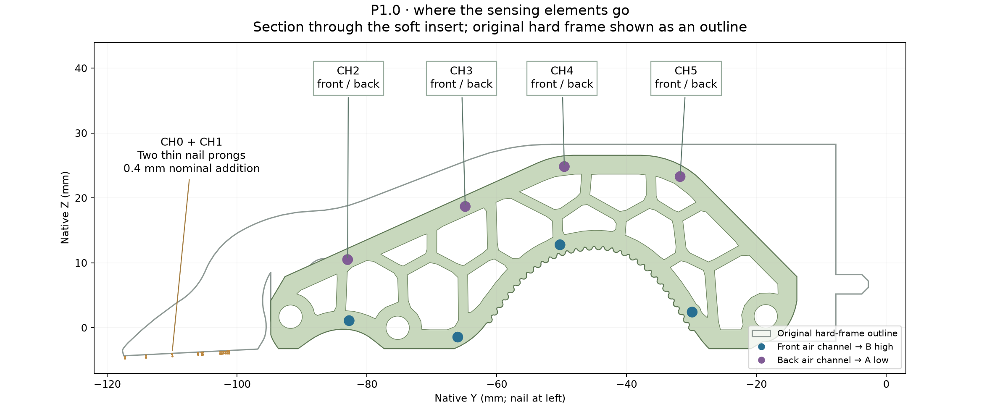
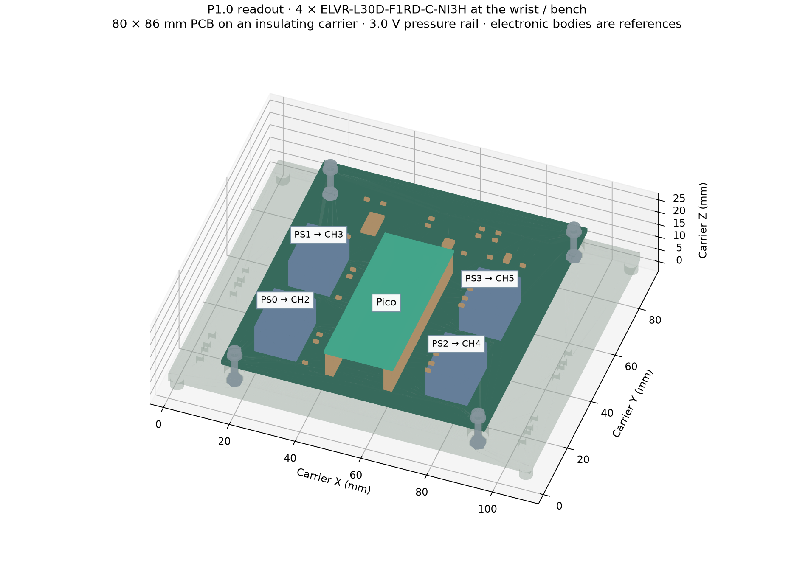

# Build P1: internal air channels and a thin sensing nail

**Use four ELVR-L30D-F1RD-C-NI3H differential pressure transducers on the remote board, plus two R1 N0 resistive cells on the nail.** Eight sealed air channels are built into a replacement soft insert. The original rigid ENPIRE frame stays in place. P1 is a digital bench package; no physical specimen or 20 N rating has been established.

The front and back channels both deform. Each transducer measures their pressure difference. This arrangement keeps electronics off the soft contact surface, but pressure is not a direct force measurement. The nail uses separate thin cells because an air channel in the soft body does not cover nail-only contacts.

## Files and materials

Use [the P1 file index](../prototypes/pneumatic/file-index.html), [parts list](../prototypes/pneumatic/parts.csv), [BOM](../prototypes/pneumatic/bom.csv) and [port cut/hose map](../prototypes/pneumatic/port_cut_and_hose_map.csv). Obtain the PCB and its complete component list from `electronics/readout/` in the package. The separate [electrical guide](PNEUMATIC_ELECTRONICS.md) gives the exact wiring.

`cad/p1_ported_insert.step` and its STL are the replacement insert. Print `p1_bench_carrier` for the remote board. The ten plug solids are closure parts. Gas volumes, adhesive volumes, purchased tubes, electronic bodies and nail laminates are **references**, not substitutes for working sensors.

Flexible 80A resin, Sil-Poxy and 1/16-inch-ID × 1/8-inch-OD PVC tube follow the [FORTE hardware reference](https://merge-lab.github.io/FORTE-Finger/). That reference does not qualify this new geometry or a 20 N ENPIRE finger. Confirm the selected pressure-sensor option and stock before ordering; manufacturer drawing dimensions do not establish a ready-made tube fit.

## Print and inspect the insert

Use the resin-specific workflow for the actual printer. Keep the eight transverse holes open during washing and post-cure. Each nominal main channel is 1.5 mm in diameter across the 15 mm insert width. Local support changes reserve a nominal 0.6 mm wall in the channel-layout screen. The external soft-contact outline is retained; material and bending stiffness still require physical comparison.

Inspect every channel and branch for uncured resin, debris and unintended connections before closing the ends. Do not clear a blocked branch by drilling through the contact wall. Check the unsealed insert in the actual rigid frame without forcing it. The exact installed YAM drive and loaded clearances remain unqualified.

The nominal printed hole is only 0.05 mm larger than a 1.45 mm plug. Measure the actual fit before choosing the plug and bond gap. Print/cut fit coupons or adjust the parametric dimensions for the measured process, then regenerate the checks. Preserve the as-built dimensions and material/cure record.

## Fit tubes and plugs

| Connection | Metal tube | Installation |
|---|---|---|
| CH2 front/back, CH3 front/back, CH4 back, CH5 front | OD 1.6 / ID 1.0 / length 6 mm | Seat 2.5 mm in its socket |
| CH5 back | OD 1.6 / ID 1.0 / length 8 mm | Longer rear fitting; do not substitute the 6 mm stem |
| CH4 front | OD 1.2 / ID 0.8 / length 15 mm | Embed 3 mm; leave 12 mm outside |
| CH4 front sleeve | OD 1.6 / ID 1.3 / length 3 mm | Bond over the last 3 mm of the slim stem |

Deburr the metal and keep the bores open. Apply the qualified adhesive around the joint without filling the channel. Follow its full cure instructions before testing. The CH4 sleeve-to-stem annulus also needs a seal.

All selected exits are on native negative X. CH2 back and CH5 back use angled branches: plug **both** original X ends. The other six channels need one flush plug at X = 0. This makes ten plugs. The CSV gives the exact outlet coordinates and placement for every connection.

The local CAD includes 3 mm hose engagement and 5 mm straight departure at each fitting, with a 0.15 mm radial clearance guard. The remainder of each hose needs a measured slack loop. Do not treat the short modeled segment as the whole hose route. Support the lines at the bench carrier without squeezing them or transferring hose pull into the sensing insert.

## Retain the thin nail

Build only CH0 and CH1 from the [R1 nail cut sheet](../release/r1/r1_cut_sheet.svg) and [R1 construction instructions](BUILD_R1.md). Use separate film islands and insulated outer faces. Place the 100 kΩ continuity resistor across each cell at its proximal joint, outside contact. Run four flexible leads with protected joints and slack.

The N0 nominal addition is 0.4 mm, including the 0.1 mm mounting layer and 0.3 mm laminate envelope. Measure the actual stack; the CAD envelope does not guarantee the thickness of purchased adhesive or hand-assembled film. Keep the notch open. Use the P1 electrical guide and firmware for this board.

## Assemble the remote board

The board is 80 × 86 × 1.6 mm. The printed carrier has 6 mm standoffs, underside nut pockets and feet. Fit the four M2 nuts, then the PCB, washers and M2 × 12 screws. Verify the actual fastener and socket dimensions against the reference envelopes. Keep solder joints clear of the carrier.

The carrier is an open bench fixture. Final wrist mounting, hose routing through robot motion and connector protection need a separate fit check. Finish the [electrical checks](PNEUMATIC_ELECTRONICS.md) and [physical tests](PNEUMATIC_TESTING.md) before connecting the finger to an actuated task.
