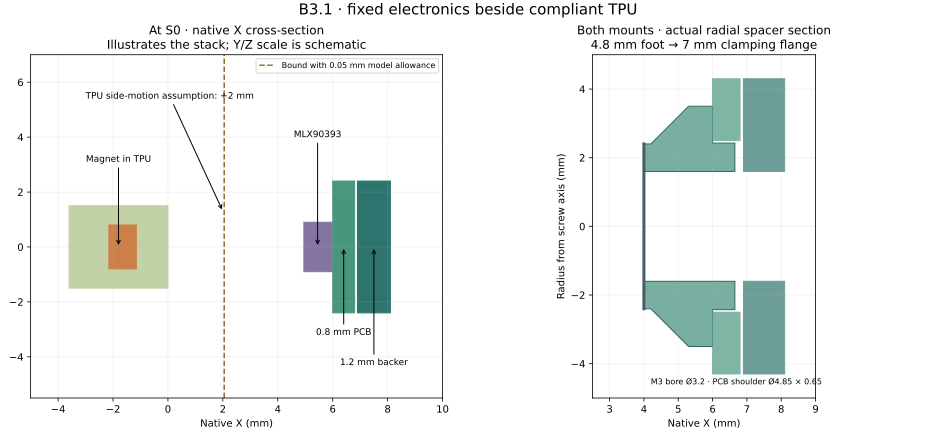

# Build B3: a recessed magnetic board

B3.1 uses a separately modified ENPIRE hard frame to move the B2 board inward
by 2.439 mm. It retains the B1 compliant TPU cartridge, its four magnets and
the two thin N0 nail pads. The electronics stay rigid; the TPU moves.

The package has checked digital geometry, the retained checked B2 circuit,
gain-5 firmware and raw acquisition. Physical assembly, frame stiffness,
20 N capability and contact/force accuracy have not been established.

[B3 page and CAD](https://geyan21.github.io/yam-tactile-kit/recessed-magnetic.html) · [BOM](../prototypes/recessed/recessed_bom.csv) · [Assembly drawings](../prototypes/recessed/recessed_review_drawings.pdf) · [Wiring](../prototypes/recessed/recessed-wiring.svg) · [Sensor coordinates](../prototypes/recessed/recessed_sensor_placement.csv) · [Results and limits](RECESSED_ANALYSIS.md)

## Exact sensors and their locations

| Label | Use this part | Place it here |
|---|---|---|
| S0–S3 / U1–U4 | Four MLX90393SLW-ABA-011 ICs | Retained B2 board positions beside the four TPU magnet pockets; component face at native X = 6.00 mm |
| S4 / U5 | One identical MLX90393 | Board's proximal reference position; it also sees the TPU magnets |
| M0–M3 | Four S-03-01-N, N48, 3 × 1 mm axial discs | Retained B1 TPU pockets; north toward native +X |
| T0 / T1 | Two R1 N0 pressure-film laminates | Object-facing surfaces of the two hard nail prongs; keep the central notch open |
| U10 | TCA9548ARGER | Retained B2 board's base bay; one magnetic branch at a time |
| U11 | ADS1115IDGSR | Same bay; two nail channels plus two reference checks |
| Controller | Raspberry Pi Pico RP2040 | Wrist or bench; B3 five-file firmware |




The downloadable CSV gives die centers and rotation matrices. Positions use
the original source's native millimeters. Both PCB Y/Z positions and component
orientations remain those of B2; only native X changes. The board itself
does not bend with the TPU. Nail films have separate leads and approximately
0.40 mm nominal mounted thickness, as in the retained R1 N0 recipe.

## Print and inspect the mechanical parts

Use the four fabricated-part files: one `recessed_hard_frame`, one
`recessed_removable_backer`, and both `recessed_locating_spacer` files. The two
spacers are identical shapes placed at their assembly coordinates; print two.
The `recessed_pcb_fit_reference` is a fit witness for the purchased PCB.

The frame is a checked faceted derivative of the pinned source STL. Preserve
the source part and print the derivative separately. Record PETG grade, print
orientation, layers, walls, infill and postprocessing. Use the same frame
process for the original/B2 control. Preserve the same TPU grade and print
process across the magnetic comparison. No print recipe has yet been
qualified for this recess.

| Feature | Nominal dimension |
|---|---|
| Common recess floor | Native X = 4.45 mm |
| Both rigid spacer seats | X = 4.00 mm |
| Spacer foot | Ø4.80 × 0.20 mm |
| Taper to board-clamping flange | Length 1.10 mm; final OD 7.00 mm |
| Full-width flange | Length 0.70 mm |
| PCB locating shoulder | Ø4.85 × 0.65 mm |
| Through clearance | Ø3.20 mm |
| PCB hole / thickness | Ø5.00 / 0.80 mm |
| Insulating seat film / backer | 0.10 / 1.20 mm |
| Backer outer face | X = 8.10 mm |

1. Print and measure the frame, spacers, backer and PCB witness. Inspect the thin spacer foot and locating shoulder; reject split, warped or poorly fused prints.
2. Confirm that the actual finger's root, nail and three TPU attachments match the pinned geometry. Check the installed drive and both jaw orientations.
3. Seat each Ø4.8 mm foot on its matching rigid land. The smaller foot must bear fully; the Ø7 mm flange faces the board. The taper clears the narrower middle land.
4. Fit the board holes over both locating shoulders. Add the measured 0.10 mm insulating film and backer, keeping copper, wires and adhesive out of the bearing annuli.
5. Select nonmagnetic M3 screw lengths from the measured assembly. Preserve the original TPU retention and thread engagement. The drawing reserves Ø6 × 2.4 mm for each head including any washer; it does not prescribe a torque or establish clamp strength.
6. Check that the board stays flat and all electronics remain clear of the frame. The modeled minimum package/front-solder clearance is 0.50 mm. Inspect actual solder and package height rather than relying on nominal CAD.
7. Route the actual leads through the open backer exits and attach strain relief to rigid structure. Check the entire opening/closing range and access to both nail prongs. Record cable, housing and opposite-jaw clearance.

The CAD adds 1.211 mm global width before heads or **3.611 mm with reserved
heads**, excluding wires; B2 adds 6.05 mm with those heads. It adds no reach.
Neither number includes an unknown installed drive or a cable loop.

## PCB, wiring and gain setting

Fabricate and populate the unchanged **B2.1 four-layer 0.8 mm PCB** using its
[checked Gerbers/drills](../prototypes/b2/pcb/b2_main_fabrication.zip),
[assembly drawing](../prototypes/b2/pcb/b2_assembly.svg) and complete
[B2 electronics instructions](BUILD_B2.md). Use the RGE-QFN mux and
DGS-VSSOP ADC packages listed above. Keep the exposed-pad assembly process
and pin/net checks from that guide.

| Connection | Mapping |
|---|---|
| J1.1 / J1.2 | Pico 3V3 / GND |
| J1.3 / J1.4 | Pico GP5 SCL / GP4 SDA |
| J2.1 / J2.2 | T0 excitation / T0 sense |
| J2.3 / J2.4 | T1 excitation / T1 sense |
| Remote continuity | 100 kΩ across each nail pad at the fingertip |
| Nail pull-downs | 10 kΩ each; configuration must match installed values |

The magnetic ICs use **GAIN_SEL = 5, RES = 1, HALLCONF = 0xC, DIG_FILT = 2,
OSR = 2, temperature compensation off**. Nominal 25°C conversion is
0.501 µT/count on X/Y and 0.807 µT/count on Z. These settings retain signed
16-bit XYZ output. The values and encoding follow Melexis rev012 Tables
17 and 21. [Manufacturer datasheet](https://media.melexis.com/-/media/files/documents/datasheets/mlx90393-datasheet-melexis.pdf)

The recessed field calculation motivates the lower gain. Check actual raw
headroom with the purchased magnets, motor, steel tools, temperature and
maximum measured TPU deformation. Subtracting S4 later cannot recover a
saturated head. Firmware verifies volatile register configuration before
each acquisition and does not program nonvolatile settings.

## Install the B3 firmware and record

[Download all five Pico files](../prototypes/recessed/recessed_firmware.zip).
Copy `main.py`, `config.json`, `magnetic_main.py`, `mlx90393.py` and
`mlx90393_base.py` together. Both nail cells are required. The identity is
`yam-b3/1`; the retained B2 firmware uses a different magnetic gain and scale.

To regenerate the package:

```sh
/usr/bin/python3 engineering/scripts/prepare_recessed_firmware.py
```

After power, I2C waveform and fault checks, select the actual serial port:

```sh
/usr/bin/python3 engineering/software/recessed_record.py \
  --port /dev/ttyACM0 --specimen B3-01 \
  --condition unloaded-motor-off --seconds 30 \
  --output results/B3-01/unloaded-motor-off.jsonl
```

The recorder preserves raw words, gain settings, per-head acquisition times,
nail readings, malformed messages and faults. It records the geometry hash
and writes an incomplete receipt if interrupted. It controls no actuators.
Its field and conductance observations are not calibrated force.

Complete the [specimen record](../templates/recessed_specimen.json), then use
the [B3 test plan](RECESSED_TESTING.md). The [common campaign](BUILD_ALL.md)
defines the comparison and physical acceptance requirements.
