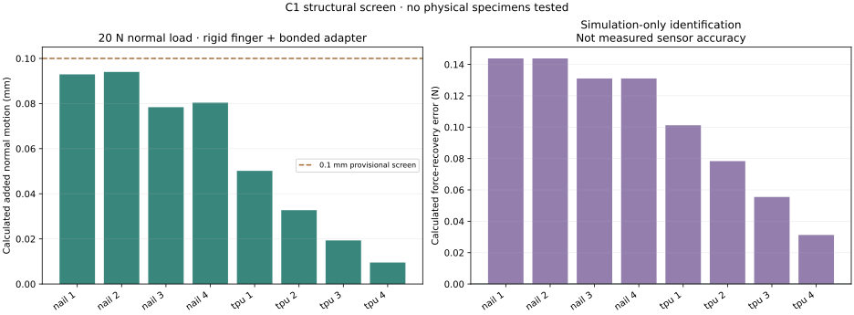

# C1 digital engineering results

**C1.1 passed the declared CAD, electrical-rule and numerical checks. No
physical specimen has been tested.** These results support making the first
metal prototype; they do not establish force accuracy or a 20 N hardware rating.

[Build C1](BUILD_C1.md) · [Physical test procedure](C1_TESTING.md) · [Structural result JSON](../prototypes/c1/c1_structural_review.json) · [Tolerance scenarios](../prototypes/c1/c1_tolerance_scenarios.json) · [Reproducible structural inputs](../prototypes/c1/c1_structural_inputs.zip)

## What changed during development

The earlier longitudinal coupon remains in `engineering/concepts`. C1.1 uses
a separate transverse beam, fixed and floating carriers, end caps, a gauge
alignment stencil and two force-bearing bench fixtures.

Thin initial carrier links dominated the calculated tip motion. Increasing
only beam stiffness would not have fixed that load path. The preserved
development runs led to deeper carriers, thicker end supports and the current
14 mm beam.

| Structural iteration | Calculated maximum added normal motion at 20 N |
|---|---|
| Initial thin carrier links | 2.190 mm |
| Deepened carrier links | 0.169 mm |
| 12 mm end supports, 10 mm beam | 0.126 mm |
| Current 14 mm beam, locally refined model | 0.0940 mm |

All rows are linear simulations of ideal bonded metal assemblies. They are
not physical measurements or strength tests. The current result is only
0.006 mm below the **provisional 0.1 mm added-motion screen**. Actual bolted
interfaces, wire restraint and finger motion may consume that margin.

## Model and numerical checks

The model uses the actual C1.1 metal geometry, a fixed original-jaw contact
face, a rigid floating finger interface and bonded beam/carrier/cap joints.
It assumes aluminum modulus 69 GPa and Poisson ratio 0.33. It omits bolt
preload, friction, slip, adhesive layers, gauge backing, thermal effects and
the original finger's own bending.

Six independent force/moment loads recover the linear response. The analysis
then applies 20 N normal loads at eight source-matched nail and TPU contact
sites. Gauge signals are area averages over the eight actual active-grid
locations, sampled from quadratic-element displacement gradients.

The fine mesh has **118,080 nodes and 74,189 quadratic tetrahedra**. All
elements passed the positive-Jacobian check. A separate affine-displacement
verification checks the mesh export, solver output interpretation and strain
calculation.

| Comparison of 0.7 and 0.5 mm local gauge meshes | Result | Declared limit |
|---|---|---|
| Maximum gauge-strain change over the stated loads | 2.23 × 10⁻⁸ | 1 × 10⁻⁷ |
| Maximum equivalent-force change | 0.0175 N | 0.05 N |
| Maximum normal-motion change | 0.0000312 mm | 1% relative |
| Relative normal-motion change | 0.0331% | 1% |

Mesh convergence bounds only this comparison and load set. It does not account
for omitted physical behavior. The solver tools are
[Gmsh](https://gmsh.info/) and [CalculiX](https://www.dhondt.de/); their version
and download hashes are retained with the run inputs.

## What the force calculation says

Using ideal beam weights gives a maximum 0.441 N force-recovery error for the
eight modeled 20 N normal contacts. Identifying the two gains from simulated
normal-force and transverse-moment loads reduces that maximum to **0.144 N**.
These are model-recovery errors, not measured sensor errors. No simulated
weights are supplied for use as physical calibration coefficients.

The calculated maximum integration-point von Mises stress is about 28.3 MPa
for these normal-contact cases. Local mesh stress, ideal joints and a nominal
elastic modulus do not establish bolt, bond, fatigue or material allowables.

## Assembly-variation scenarios

The fine-mesh strain fields were sampled again after independently moving
each gauge grid and imposing small gain variations. Each placement bound has
16 deterministic scenarios, with individual gauge and station gains varied
within ±0.1%. These are imposed assumptions, not measured production tolerances.

| Assumed grid-placement bound | Largest normal-contact error with nominal gains | Largest error after simulated per-unit identification |
|---|---|---|
| ±0.10 mm in each surface direction | 0.347 N | 0.344 N |
| ±0.25 mm in each surface direction | 0.511 N | 0.433 N |

A small finite scenario set does not establish yield or a worst-case bound.
The result supports careful active-grid alignment and calibration of each
assembled unit. It also shows that two fitted gains do not remove all effects
of imperfect gauge placement.

## Decision for the student

Proceed with one fit witness and a carefully documented metal bench assembly,
then expand to three independent specimens if it survives the initial checks.
Measure actual tip motion, clamp repeatability, stationary low-force noise,
force and lever response before running moving-arm tests.

C1 is a candidate for whole-finger force feedback when preserving the bare
nail is valuable. Its larger root and eight bonded gauges may make it less
practical than another design. That comparison remains open until the same
physical contact, force, access, assembly-time and task tests have been run.
