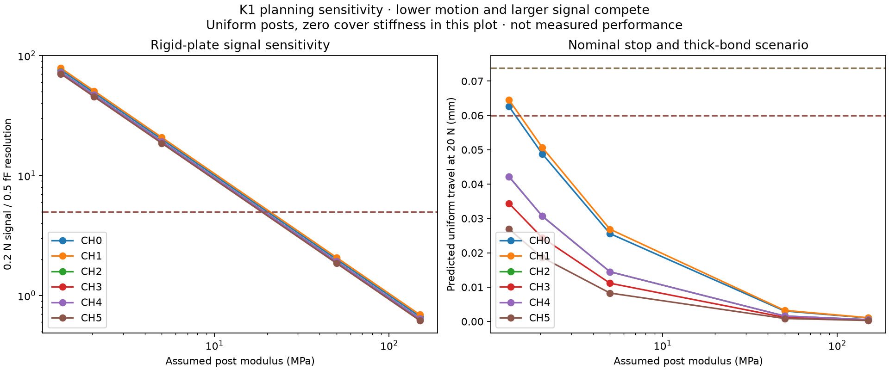

# K1: distinguish a working capacitor from a good tactile finger

**K1 has no physical measurements yet.** Start with electrical bring-up, then
measure contact and force on assembled specimens. Preserve failed builds and
raw data. The [all-design campaign](BUILD_ALL.md) defines the common comparison.

## Before applying force

Record the specimen, material lots, cure, post dimensions, actual stop height,
free plate travel, formed-plate curvature, cable lengths, bank/foil revisions,
reference identity and photos. Check the two plate bonds independently.
Measure the unloaded reference gap after closing each case. Confirm that
the fingers and harnesses clear the actual drive throughout jaw travel.

Substitute measured fixed capacitors for each input and its reference to verify
channel mapping, polarity, timestamps and range. Test every disconnected CIN,
shield and plate-ground lead, supply change, reset and serial gap. A plausible
capacitance is not proof that every cable fault has been detected. Mark these
records **electronics**, never tactile force measurements.

## Capture raw data

Use a new recording path for each session. Install pyserial only in the
project-local environment:

```sh
/usr/bin/python3 -m venv build/engineering/tools/k1-capture-venv
build/engineering/tools/k1-capture-venv/bin/python -m pip install pyserial==3.5
build/engineering/tools/k1-capture-venv/bin/python engineering/software/capacitive_record.py \
  --port PORT --specimen K1-001 --session K1-001-S01 \
  --condition unloaded_bench --kind physical \
  --geometry engineering/prototypes/capacitive/capacitive_manifest.json \
  --seconds 30 --output NEW_RECORDING.jsonl
```

Use `--kind electronics` for fixed-capacitor records. The stable geometry
manifest is the recording identity. Protocol `yam-k1/2` repeats its boot
configuration and preserves a new boot identity across resets. Duplicate,
stale, missing or faulted readings are unavailable; the recorder does not
issue gripper commands or invent force values.

## First mechanical experiment

Test one nail cell and one curved cell before assembling three full specimens.
Include 0, 0.2, 0.5, 1, 2, 5 and then controlled steps to 10, 15 and 20 N
after checking the fixture, visible motion and available travel at each step.
Use centre, small-area and edge probes. Record both loading and unloading,
holds, recovery and any bottoming or bond motion.



The uniform-post study exposes two unresolved risks. Some soft-post/
thick-adhesive scenarios bottom the nail before 20 N. At assumed moduli of
50 and 150 MPa, the modeled 0.2 N signals fail the illustrative five-resolution-
step screen. Those moduli and the cover stiffness are not measured material
properties. The graph is a reason to measure the assembled cell, not a
calibration or a contact-probability estimate.

Also measure no-contact finger bending, cable motion, motor operation, gravity
poses, temperature and repeated replacement. A changing capacitance caused
by bending must not be mistaken for object contact.

## Fit force without mixing training and evaluation

Copy the [unmeasured trial template](../templates/capacitive_force_trials.json)
and fill it from real recordings and an independent calibrated force
reference. Change `evidence_kind` to `physical` only for actual specimen data.
Record the reference ID, uncertainty, recording hashes and force measured
before and after each stationary hold.

Declare **one common gripper-force axis** as a unit vector in the original
finger's native CAD frame, with the sign giving force on the finger. Reference
readings must be force components along that same axis for every cell.
Do not sum six differently oriented local normal-force magnitudes and label
the result gripping force. The fitter freezes this axis for held-out evaluation;
record probe orientation and shear loading as separate test conditions.

Train each of CH0–CH5 separately at **0, 0.2, 0.5, 1, 2, 5, 10, 15 and actual
at least 20 N**, with at least three independent holds per level. A 19.8 N
measurement does not satisfy the required 20 N endpoint. Use windows beginning
at least 1.5 seconds after capture start, lasting at least four seconds and
containing at least 200 healthy frames; ten-second windows are convenient.
The complete raw capture and its footer must be present.

```sh
/usr/bin/python3 engineering/software/capacitive_force.py fit \
  --trials TRAIN_TRIALS.json --output NEW_FORCE_MODEL.json
/usr/bin/python3 engineering/software/capacitive_force.py evaluate \
  --trials HELD_OUT_TRIALS.json --model NEW_FORCE_MODEL.json \
  --output NEW_HELD_OUT_REPORT.json
```

Evaluation must use new recording files and a different bench session. Keep
all six individual cells, both leading nail edges/notch, all TPU regions and
mixed contacts in the required conditions. Mixed tests must include both
nails, at least two TPU cells, and a nail-plus-TPU combination. Test every
declared probe shape and environmental condition, not only the best one.

The program fits monotone local static curves and sums the six calibrated
cell estimates only when all are available. It checks force coverage, off-cell
response and frozen data identities. It does not clip negative predictions
into apparent success. The initial static targets are RMSE ≤0.5 N and each
error, including reference uncertainty, ≤max(0.5 N, 10% of reference force).

This is a stationary-hold evaluation. It does not establish dynamic force
control, shear sensing, force outside the tested range, or contact reliability.

## Decide whether K1 is good

Measure contact misses at 0.2 N and false contacts with no load using
independent object presentations and a threshold frozen before evaluation.
Use the same regions and conditions as the other designs. At least 300
independent presentations per label and condition form the proposed
confirmation stage; adjacent frames are not independent trials.
The generic R1/L1 contact recorder does not yet accept K1 raw packets.
Preserve K1 raw sessions and independent trial labels for the campaign adapter.

Compare measured force error, drift, unavailable readings, hysteresis, added
tip movement, precision-task success, wear, assembly time and replacement.
Repeat three independently built specimens. A K1 recommendation requires
those physical results; passing CAD/PCB checks or the converter's range cannot
fill a missing physical-results cell.
