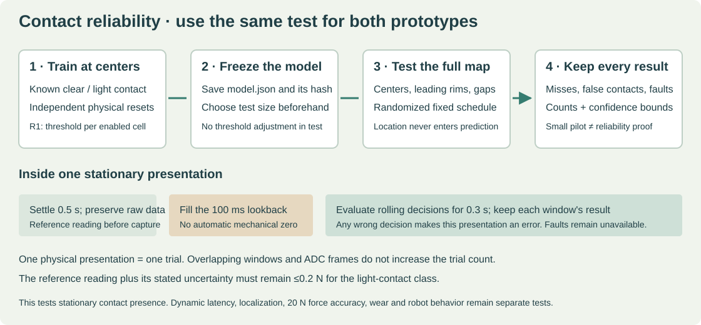

# Measure reliable contact on R1 and L1

**Use one definition of success for both prototypes.** Train on center contacts, freeze the thresholds, and evaluate a separate fixed schedule that includes leading rims, cover borders and gaps. Changing the material or reinstalling a skin must not silently change the decision rule.

This test measures stationary contact presence at a force bounded above by 0.2 N. It does not qualify 20 N force accuracy, localization, slip detection or dynamic response. Continue to use the separate [R1 force tests](TESTING.md) and [L1 force/moment tests](L1_TESTING.md).



## What the software actually does

R1 uses a separate fixed conductance threshold for each enabled cell, then reports contact if any enabled cell crosses its threshold. L1 uses one signed raw-count threshold for the root cell. A prediction never uses the requested region, reference force or ground-truth label.

Both use the same 100 ms rolling median in the analyzer and live monitor. The window needs at least four samples spanning at least 60 ms, with no gap above 40 ms. The decision is updated when a valid frame arrives; achieved cadence must be measured. These are processing settings, not a measured sensor response time.

The recorder allows 0.5 s to settle and records a further 0.6 s. After filling the lookback, the analyzer checks rolling decisions over a fixed 0.3 s interval. One wrong decision during that interval counts as an episode error. Overlapping windows and ADC frames are **not independent trials**.

## Freeze the specimen and fixture first

Build and electrically check [R1](ELECTRONICS.md) or [L1](L1_ELECTRONICS.md). Use a separate calibrated force reference and a rigid, stationary fixture. Lift the probe clear and reset to the documented starting position before **every** presentation, including consecutive presentations with the same label.

Use the assembled finger for this contact map. The bare L1 cell/plate fixture supports its earlier force characterization; it does not establish contact coverage on an ENPIRE finger.

The [case file](../templates/contact_cases.json) defines six center regions for training and twelve regions for the default evaluation. Leading rims, a bridging object and inter-pad gaps stay out of threshold training. Use the [L1 contact map](../release/l1/l1_test_map.svg) and R1 layer drawings to locate the center regions. Record the actual probe dimensions, contact positions, pose and photographs in a fixture record before evaluation.

L1's native coordinates include its 20 mm reach extension. R1's corresponding native Y coordinates are 20 mm greater. Use the actual assembled finger's landmarks and record the physical probe locations.

The cases describe closing-face normal contact along native +Z. A side or back contact requires a separately declared experiment. Passing a subset must not be reported as full-finger coverage.

Use a reference with documented uncertainty ≤0.05 N. For a loaded trial, the maximum of the before/after readings **plus that uncertainty** must not exceed 0.2 N; the lower bound must remain above zero. For example, with 0.01 N uncertainty, 0.18 N is a suitable nominal setting. A reading of 0.20 ±0.05 N cannot establish detection below 0.20 N. Static readings also cannot establish a dynamic force waveform.

## Save the setup once

Copy and fill [contact_setup.json](../templates/contact_setup.json). Keep the completed copy in the specimen's results folder. Set `sensor` to `R1` or `L1`, identify the specimen and material/assembly variant, and record the actual pose, operator, reference, uncertainty and fixture record. Enter the explicitly selected dedicated Pico port; never use a robot-control port.

Run commands from the repository root, or the complete kit's extracted `source` directory.

```sh
/usr/bin/mkdir -p results/L1-001
/usr/bin/cp engineering/templates/contact_setup.json results/L1-001/contact_setup.json
```

Leave `channels` null for all six R1 cells or the single L1 channel. For an initial R1 nail-only pilot, use `"channels": "0,1"` and explicitly select the five nail regions during evaluation. Its report remains a subset result.

Unused R1 inputs still need the documented electrical reference resistors. Selecting fewer contact channels does not disable the readout's electrical health checks.

Use the existing host environment with `pyserial` installed. The following commands use the L1 host environment created in [L1 electronics](L1_ELECTRONICS.md); it also reads R1 packets.

## Preview and collect training

```sh
build/l1-host/bin/python engineering/software/contact_bench.py \
  --setup results/L1-001/contact_setup.json --phase train \
  --repeats 20 --output results/L1-001/contact-training-plan --plan-only

build/l1-host/bin/python engineering/software/contact_bench.py \
  --setup results/L1-001/contact_setup.json --phase train \
  --repeats 20 --output results/L1-001/contact-training-01

/usr/bin/python3 engineering/software/contact_report.py fit \
  results/L1-001/contact-training-01 \
  --output results/L1-001/contact-model.json
```

The preview opens no serial port and creates no measurements. The actual recorder asks for reference readings before and after each hold. It preserves raw packets, configuration, timestamps, the randomized plan, the setup and case files. Predictions are withheld during collection.

Training must separate all observed clear and contact windows on each enabled channel. The fitter refuses overlapping training signals rather than removing inconvenient windows. Investigate low signal, noise, preloading, wiring, cover thickness and hysteresis before changing a sensor or repeating the experiment.

## Evaluate without refitting

Choose the number of repetitions before starting. The default pilot has 20 contacts and 20 clear presentations per selected region. The complete twelve-region pilot is 480 presentations; the six-center training run is 240. These counts are deliberately visible so the student can plan the work.

```sh
build/l1-host/bin/python engineering/software/contact_bench.py \
  --setup results/L1-001/contact_setup.json --phase test \
  --model results/L1-001/contact-model.json \
  --repeats 20 --seed 27183 --output results/L1-001/contact-evaluation-01

/usr/bin/python3 engineering/software/contact_report.py evaluate \
  results/L1-001/contact-evaluation-01 \
  --output results/L1-001/contact-report.json
```

The model is copied and hashed before the first evaluation capture. The analyzer recomputes features from the raw files and checks the model, labels, plan, configuration and device-time progression. A replayed interval, gain/resistor change, missing frame or invalid reference cannot become an unloaded “no contact” result.

A readout or reference problem stops collection after preserving the attempted presentation. Evaluate the incomplete session to inspect what happened. Repair the issue and start a separately named run; keep the failed run. Do not remove failures, append trials until the score passes, or choose only a successful subset.

The small browser report contains counts and bounds per region. A separate `contact-report-events.jsonl` preserves every evaluated decision and failure; its hash is included in the report. Keep it with the raw session. These integrity checks do not replace photographs, a reference calibration record or review of the physical experiment.

## Read the result honestly

The shared observed-rate screen requires ≥99% successful contact presentations and ≤1% false-contact presentations in every tested region, a completed plan and no unavailable trials. For a 20-per-label pilot this means no errors. A clean short pilot is not a qualification by itself.

The report separately calculates a one-sided exact 95% upper bound on each error probability, using the [NIST binomial-confidence method](https://www.itl.nist.gov/div898/software/dataplot/refman2/auxillar/exacbino.htm). With zero errors, the bound is `1 − 0.05^(1/n)`.

| Independent presentations of one class in one region | Zero observed errors | Upper error bound |
|---|---|---|
| 20 | Useful short pilot | About 13.9% |
| 100 | More evidence, still insufficient for a 1% bound | About 2.95% |
| 300 | Supports a bound below 1% for that metric under the stated assumptions | About 0.994% |

The confidence bounds assume independent, representative presentations. They apply separately to each region/outcome, **not simultaneously to every metric or every future robot task**. Unavailable trials are listed separately and counted as errors in the conservative calculation. A stopped plan or absent class cannot pass.

For a larger confirmatory run, choose `--repeats 300` before collection and retain the frozen model. That is 7,200 presentations for the complete map. Use the pilot to reject clear failures first. If an automated fixture is later used, validate its force reference, reset motion and independence; this package issues no fixture or robot commands.

## Compare materials and replacement

First compare sensor/material instances under the same case map, force reference, pose and probe. Each independently calibrated instance gets its own training and evaluation record.

Then test replacement and pose robustness with the original thresholds retained. Change `variant` or `pose_id` in a separate setup copy and pass `--transfer-experiment`. The recorder explicitly identifies the changed condition, preserves the old model and never retunes a threshold or mechanical zero.

Useful transfer conditions are cover replacement, five removal/reinstallation cycles, measured temperature changes, and the post-wear state. Repeat across independently built specimens. Do not pool different specimens, poses or materially different contact fixtures into one unsupported reliability claim.

## Use the same detector live

```sh
build/l1-host/bin/python engineering/software/contact_monitor.py \
  --port /dev/ttyACM0 --model results/L1-001/contact-model.json \
  --specimen L1-001 --variant original --pose-id finger-W-up \
  --seconds 60 --output results/L1-001/contact-live-01.jsonl
```

Use the actual identifiers from the saved model. Contact is `true`, `false` or unavailable (`null`). A warm-up, timeout, clock discontinuity or readout fault gives no contact decision. The output includes active R1 channels, the original frames and flags. It does not output calibrated force or command an actuator.

Open the contact report in the website's measured-report inspector. It stays local to the browser and does not alter the published specimen count. Physical builds, 20 N force qualification, dynamic behavior, wear and dexterity remain unverified until those experiments are performed.
