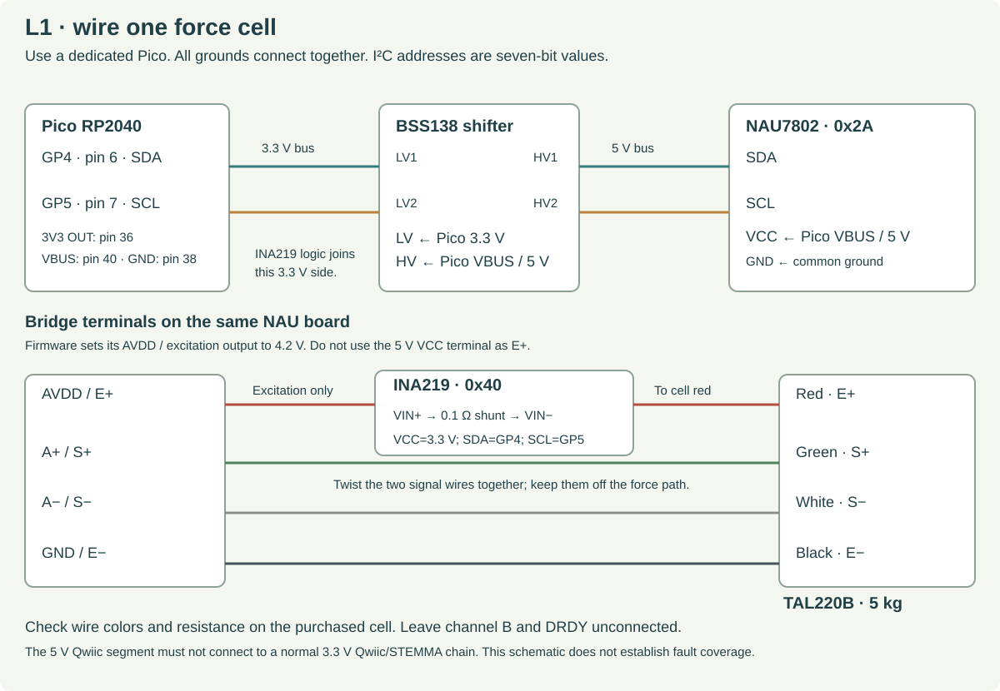

# L1 electronics and raw-force software

**Build one readout off the robot.** This wiring uses a 5 V NAU7802 domain and a 3.3 V Pico/INA219 domain. Keep them separated by the bidirectional level shifter. The firmware produces raw counts and health fields; force appears only after a physical calibration is supplied to the host.



## Parts and electrical choices

Use the [L1 BOM](../l1_bom.csv). The [SparkFun NAU7802 schematic](https://cdn.sparkfun.com/assets/6/a/5/9/d/Qwiic_Scale.pdf) permits a 5 V board supply but explicitly cautions against applying that voltage to a normal 3.3 V Qwiic bus. Use breakout wires for this isolated segment; do not daisy-chain it to R1 or other Qwiic devices.

The firmware requests 4.2 V bridge excitation, gain 128 and 80 samples/s. The [NAU7802 datasheet](https://cdn.sparkfun.com/assets/e/c/8/7/6/NAU7802_Data_Sheet_V1.7.pdf), sections 7.2, 9.2 and 11, defines the supply headroom, high-gain common-mode window and registers used. The 5 V / 4.2 V choice leaves more common-mode margin than 3.3 V excitation. It does not establish delivered frame rate or force accuracy.

The [INA219 board](https://www.adafruit.com/product/904) must have its 0.1 Ω shunt. It monitors only bridge excitation current. Firmware uses raw shunt and bus-voltage registers from the [TI datasheet](https://www.ti.com/lit/ds/symlink/ina219.pdf); it does not rely on a preloaded current-calibration register.

## Exact wiring

Disconnect power while assembling. Physical pin numbers below are for the original Pico RP2040; compare with the [official Pico pinout](https://pip-assets.raspberrypi.com/categories/610-raspberry-pi-pico/documents/RP-008309-DS-1-Pico-R3-A4-Pinout.pdf?disposition=inline).

| From | To |
|---|---|
| Pico GP4, physical pin 6 | Level shifter LV1 and INA219 SDA |
| Pico GP5, physical pin 7 | Level shifter LV2 and INA219 SCL |
| Level shifter HV1 | NAU7802 SDA |
| Level shifter HV2 | NAU7802 SCL |
| Pico 3V3 OUT, pin 36 | Level shifter LV and INA219 VCC |
| Pico VBUS, pin 40, USB-powered | Level shifter HV and NAU7802 VCC |
| Pico GND, pin 38 | NAU7802 GND, shifter GND and INA219 GND |
| NAU7802 AVDD / bridge excitation output | INA219 VIN+ |
| INA219 VIN− | TAL220B red E+ lead |
| TAL220B black E− lead | NAU7802 GND |
| TAL220B green S+ lead | NAU7802 A+ |
| TAL220B white S− lead | NAU7802 A− |

Leave channel B and DRDY unconnected. Use the shifter's normal open-drain I²C topology; a unidirectional UART divider is unsuitable. Keep this bench I²C wiring short and record its length. If communication is unreliable, inspect supply levels, pull-up loading and rise times before changing the firmware.

The cell wire colors come from the selected supplier listing. Verify them on the purchased specimen. With the cell disconnected from electronics, record excitation-pair and signal-pair resistance; the TAL220B sheet lists about 1000 Ω input and 1090 Ω output. Look for shorts to the aluminum body. Do not measure resistance on powered electronics.

## Firmware installation

Use a dedicated Pico for L1. Preserve any existing controller's files before programming it.

1. Install an official RP2040 Pico MicroPython UF2 from the [Pico download page](https://micropython.org/download/RPI_PICO/). Version 1.29.0 is the proposed starting runtime as checked on 2026-10-10; it has not been verified on our physical hardware. Record the actual version and UF2 hash.
2. Create a separate host environment and install the two host tools. `pyserial` reads the USB stream; `mpremote` copies files over the explicitly selected local serial port.
3. Copy `nau7802.py`, `ina219.py` and `main.py` from `engineering/firmware/l1` to the Pico root. Close other programs using that port.

```sh
/usr/bin/python3 -m venv build/l1-host
build/l1-host/bin/python -m pip install pyserial==3.5 mpremote

build/l1-host/bin/python -m mpremote connect /dev/ttyACM0 fs cp engineering/firmware/l1/nau7802.py :nau7802.py
build/l1-host/bin/python -m mpremote connect /dev/ttyACM0 fs cp engineering/firmware/l1/ina219.py :ina219.py
build/l1-host/bin/python -m mpremote connect /dev/ttyACM0 fs cp engineering/firmware/l1/main.py :main.py
```

`/dev/ttyACM0` is an example. Select the actual dedicated Pico's port; do not probe robot serial ports. The [mpremote documentation](https://docs.micropython.org/en/latest/reference/mpremote.html) explains explicit port selection and file copy. Record installed host versions with `build/l1-host/bin/python -m pip freeze` in the specimen's bench notes.

Power-cycle the dedicated Pico with the stationary fixture connected. Initial firmware setup calibrates the ADC's internal offset; it does not mechanically tare the load cell. Startup also applies and removes the ADC's diagnostic current source. No force estimate is emitted during this check.

## First electrical check

Measure the 5 V, 3.3 V and excitation rails with a multimeter. The excitation should be near 4.2 V after initialization. With roughly 1000 Ω bridge input resistance, expected current is approximately 4.2 mA. The firmware's provisional health bands are 3.9–4.5 V and 2.0–6.5 mA. These bands are fault-screening choices, not calibrated current accuracy.

```sh
build/l1-host/bin/python engineering/software/l1_monitor.py \
  --port /dev/ttyACM0 --seconds 60 \
  --specimen L1-001 --pose-id bench-W-up --fixture combined_load_plate \
  --output results/L1-001/electrical-01.jsonl
```

Healthy packets use `yam-l1/1`, signed `raw_counts`, device timestamps, sequence numbers, voltage/current fields and `startup_check_passed`. Force remains uncalibrated. A rail, missing conversion, malformed frame, changed gain or failed excitation check must produce an invalid reading or explicit error, not a zero force.

The startup signal test's resistance band is provisional. Its response must be checked on the real cell, board and wiring. Do not widen a band merely to make a failed build start; inspect the recorded diagnostic counts and wiring first.

## Known fault coverage

| Fault to inject on the bench | Intended response | What is still unverified |
|---|---|---|
| Open E+ or E− | Excitation-current fault | Actual thresholds, timing and all cable locations |
| Open A+ or A− before boot | Startup diagnostic or ADC-rail failure | Both leads must be tested physically |
| A+ shorted to A− before boot | Diagnostic response falls outside the provisional band | Actual board behavior |
| A+ shorted to A− after startup | May look like a plausible force reading | **Not continuously detected by this firmware** |
| ADC reset, gain change or loss of conversions | Register check or conversion-timeout error | Physical reset and recovery timing |
| USB interruption | Host reports no fresh frame; no force available | End-to-end application response |

Make fault connections with power removed, then observe the next boot. Test runtime interruptions with a prepared switch harness. Preserve fault logs. This is an experimental readout with incomplete analog fault coverage; it must not be the sole protective input to an actuator.

## After calibration

Use [the two-stage test protocol](L1_TESTING.md). The cell/plate report and integrated-finger report bind the model to a specimen, fixture and pose. The live monitor rejects a mismatched model. It never changes the mechanical zero automatically.

```sh
build/l1-host/bin/python engineering/software/l1_monitor.py \
  --port /dev/ttyACM0 --seconds 60 \
  --specimen L1-001 --pose-id finger-W-up --fixture integrated_enpire_l1 \
  --calibration results/L1-001/finger-report.json \
  --output results/L1-001/force-live-01.jsonl
```

Only a report that met its stated static bench criterion is accepted for force display. Even then, every output retains `robot_gripper_qualified: false` and `closed_loop_validated: false`. Motion, pose changes and contact direction changes need additional characterization.
