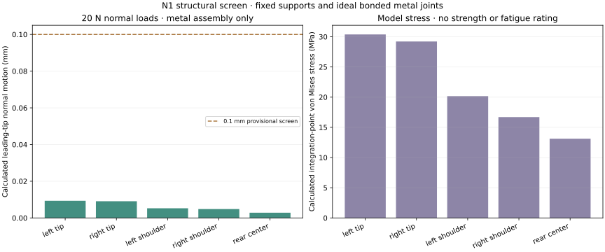

# N1 digital engineering review

**The checked metal model predicts about 0.0094 mm maximum leading-tip normal
motion at 20 N.** No physical N1 specimen has been tested. Real bolted joints,
the printed frame, gauge bonding and force accuracy remain experimental work.

[Build N1](BUILD_NAIL.md) · [Physical tests](NAIL_TESTING.md) · [Structural result JSON](../prototypes/nail/nail_structural_review.json) · [Solver inputs](../prototypes/nail/nail_structural_inputs.zip) · [Fastener geometry checks](../prototypes/nail/fastener_checks.json)

## What the geometry checks establish

The package contains four new checked solids: the steel sensing fork, left
and right fixed carriers, and a revised PETG frame. STEP round trips and closed
STL exports passed. The assembled rigid parts clear the frame and original
TPU in the modeled positions.

The source frame was recovered as a faceted solid from the pinned mesh.
Removing the original nail left a small loose distal crescent; that fragment
was identified and removed within a bounded distal strip. The clearance
pockets preserve the central frame material and all three TPU attachment
regions. This does not establish unchanged printed compliance.

Visual inspection prompted explicit checks of material around every carrier
countersink and threaded mounting region. The final carriers include complete
front clamp pads and side-mount bosses. All eight fastener-surround checks
passed. Thread engagement, tightening and repeatability still need physical
inspection and testing.

## Structural model and convergence

The model includes the actual metal leading prongs, webs and both carriers.
It assumes nominal modulus **196 GPa**, Poisson ratio **0.27**, fixed support
faces at the source attachment pads and ideal bonded metal interfaces.

Five 20 N normal loads use finite circular contact patches on the nail. The
same physical pressure patches are applied in both meshes through quadratic
surface interpolation; force and moment balance are checked. Additional
5 N transverse-load and equal/opposite tip-force scenarios are included as
modeling cases, not hardware ratings.

| Numerical check | Result |
|---|---|
| Coarse mesh | 72,731 nodes, 40,046 quadratic tetrahedra |
| Fine mesh | 124,407 nodes, 72,168 quadratic tetrahedra |
| Largest relative change in leading-tip normal motion | About 0.337% |
| Largest relative change in checked patch motion | About 0.337% |
| Declared convergence limit | 1% |
| Largest modeled leading-tip normal motion at 20 N | 0.0093646 mm |
| Provisional motion screen | 0.1 mm |

All accepted elements have positive Jacobians. An earlier fine-mesh attempt
failed during direct high-order mesh optimization, before a structural solve.
The final workflow isolates the mesher, preserves its stages, and uses elastic
smoothing followed by direct optimization. Acceptance limits were retained.
This comparison does not bound every possible numerical or modeling error.

The solver inputs, material assumptions and reported cases accompany the
packet. Gmsh produces the mesh and CalculiX solves the linear model. The
large working visualization meshes and raw solver outputs remain preserved
locally and can be regenerated from the supplied code.

## What this does not establish

The calculated motion excludes deformation of the printed support frame and
real bolted interfaces. It is not the complete installed finger's measured
motion. Model stress peaks do not establish bolt preload, fatigue life or
material allowables.

This study does not infer the purchased gauge's internal grid centers from a
catalog illustration and does not supply simulated voltage-to-force
coefficients. N1 needs physical bridge calibration, TPU-cell calibration and
held-out mixed-contact tests.

The two nail bridges and four TPU cells also have different update timing.
The recorder preserves those times; output frequency alone does not establish
response latency or control bandwidth.

## Decision supported by the current evidence

N1 is ready for a carefully documented first prototype build and bench
evaluation. Its bare leading nail is useful to test against R1/B1/B2 surface
pads. Its steel parts, side carriers, gauge bonding and four local TPU cells
add manufacturing and calibration work.

Compare physical contact reliability, force error, tip access, whole-finger
motion, assembly time, replacement and wear. Contacts on fixed structure can
bypass the sensing paths. No measured winner has been selected.
