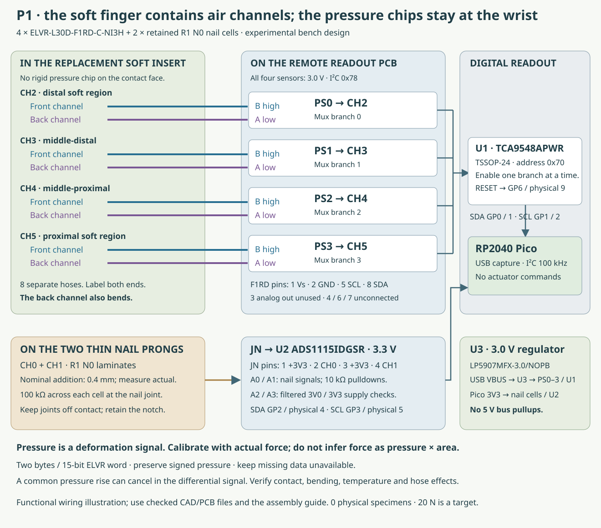
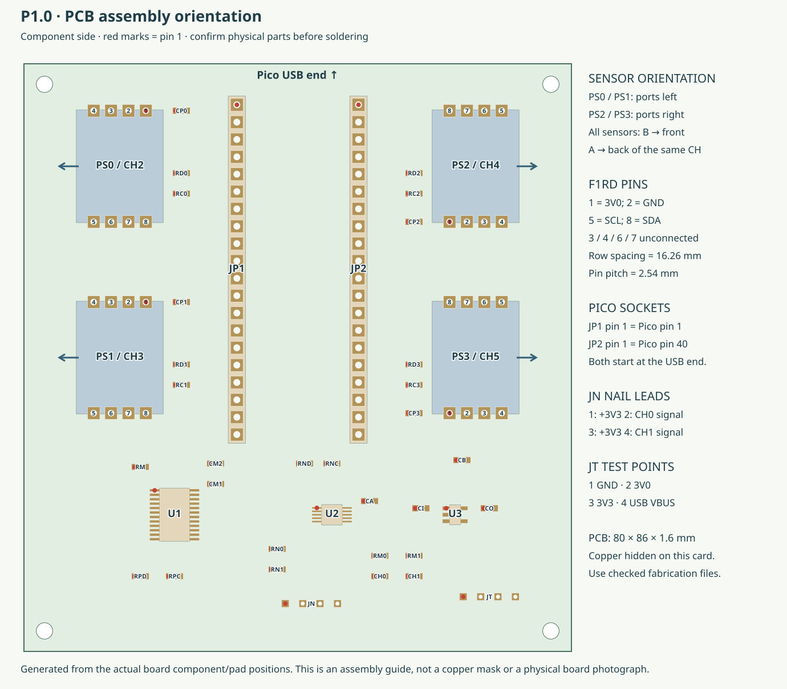

# P1 sensors, hose map and raw capture

**The four pressure sensors go on the remote PCB, not on the bending insert.** The eight air channels are the soft sensing interface. Two separate resistive cells remain on the nail.



| Finger region | PCB sensor / mux branch | High port B | Low port A |
|---|---|---|---|
| CH2 distal soft region | PS0 / 0 | CH2 front channel | CH2 back channel |
| CH3 middle-distal | PS1 / 1 | CH3 front channel | CH3 back channel |
| CH4 middle-proximal | PS2 / 2 | CH4 front channel | CH4 back channel |
| CH5 proximal | PS3 / 3 | CH5 front channel | CH5 back channel |

The back channel is mechanically active. It is not an unloaded pressure reference. Swapping A/B reverses the sign. Label both ends of all eight hoses and record actual lengths. Inspect the purchased sensor's port markings and tube seating; do not infer an internal bore from an exterior drawing callout.

## PCB and power

Use the checked fabrication ZIP, embedded footprints, pin/net CSV and component list in `electronics/readout/`. The supplied board has passed native KiCad copper/connectivity checks; this does not establish soldering, sensor orientation or physical performance.



Use the original RP2040 Pico with USB power. JP1 runs from Pico physical pin 1 to 20, starting at the USB end. JP2 runs from physical pin 40 to 21 in that same direction. Both socket pin-1 positions are at the USB end.

| Function | Pico GPIO / physical pin |
|---|---|
| Pressure bus SDA / SCL | GP0 / pin 1; GP1 / pin 2 |
| Nail ADC SDA / SCL | GP2 / pin 4; GP3 / pin 5 |
| Multiplexer reset | GP6 / pin 9; driven low, then released to the external pullup |
| Logic supply | 3V3 OUT / pin 36 |
| Regulator input | USB VBUS / pin 40 |

U3 is **LP5907MFX-3.0/NOPB**, not a 3.3 V variant. It powers the four pressure sensors and U1 at 3.0 V. The Pico and ADS1115 use 3.3 V. U3 input/output capacitors are 2.2 µF with at least 1 µF effective capacitance at the operating voltage. No bus pullup connects to 5 V.

U1 is **TCA9548APWR, TSSOP-24**, address `0x70`. Its pin map differs from the QFN variant. Host pullups are 4.7 kΩ to 3V3; each selected pressure branch has 2.2 kΩ pullups to 3V0. This follows the [TI voltage-translation guidance](https://www.ti.com/lit/ds/symlink/tca9548a.pdf). Measure rise time at the actual sensor; the P1 acceptance target is ≤300 ns, even though capture uses 100 kHz.

Each **ELVR-L30D-F1RD-C-NI3H** uses the [F1RD/PAD-27 drawing](https://428059.fs1.hubspotusercontent-na1.net/hubfs/428059/Product-Data-Sheets/DS-0375.pdf): 2.54 mm pin pitch, **16.26 mm row spacing**, and 0.89–1.00 mm finished holes. This is not a standard narrow DIP-8 footprint.

| F1RD pin | P1 connection |
|---|---|
| 1 / 2 | 3V0 / ground |
| 5 / 8 | Selected branch SCL / SDA |
| 3 | Analog output left unconnected |
| 4 / 6 / 7 | Leave unconnected |

The selected sensor is the 3.0 V, ±30 inH₂O, high-resolution I²C option at `0x78`. The driver reads two bytes directly, high byte first, as a 15-bit word. Generic bus scans can skip this address. The firmware verifies one-hot mux selection before each read and disconnects branches after the pressure scan.

## Nail connector and supply checks

JN pins 1–4 are **3V3, CH0 signal, 3V3, CH1 signal**. U2 A0/A1 read the two nail signals through their 10 kΩ pulldowns. Each physical nail cell has its separate 100 kΩ continuity resistor at the nail end. U2 A2/A3 monitor 3V0/3V3 through 1 kΩ / 10 nF filters.

JT pins 1–4 are **ground, 3V0, 3V3, USB VBUS**. Before fitting the expensive transducers, inspect polarity and shorts, power from USB and measure the rails. For an electronics-only capture, 100 kΩ dummy resistors across each JN pair emulate an unloaded connected nail. Mark that recording as `electronics`; it cannot enter tactile calibration.

After checking the actual parts and assembly, copy all three Python files and `config.json` from `engineering/firmware/pneumatic/` to the Pico. Keep their configuration together. No firmware in this package controls an actuator.

## Record the selected sensor port

Create a host environment with `pyserial`:

```sh
/usr/bin/python3 -m venv build/p1-host
build/p1-host/bin/python -m pip install pyserial==3.5
build/p1-host/bin/python engineering/software/pneumatic_record.py \
  --port /dev/ttyACM0 --specimen P1-001 --session day1 \
  --condition ch2-center-1N-hold1 --kind physical \
  --geometry results/P1-001/as-built.json \
  --seconds 30 --output results/P1-001/day1/ch2-center-1N-hold1.jsonl
```

Use the actual dedicated Pico port and actual identifiers. The recorder preserves raw bytes, timestamps, configuration, decoder failures and a checksum receipt. Reboots, missing frames, supply faults and nominal sensor-range limits remain visible. No raw reading is reported as calibrated force or contact.

The target frame interval is 20 ms; achieved cadence must be measured. Channels are read sequentially. Factory nominal pressure scaling is for inspection only: pressure offset, span, temperature, hose behavior and force response all need physical characterization.
