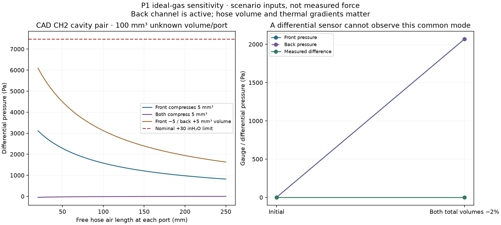

# Test P1 before choosing it

**No P1 has been assembled or measured yet.** Its fit checks and ideal-gas study justify a bench experiment, not selection as the best gripper sensor. The requested endpoint is 20 N per finger.



The study uses actual nominal cavity volumes and explicitly assumed hose/dead volumes. It has 3,888 scenarios; 26 exceed the selected nominal differential range. Its largest zero-deformation thermal signal is about 660 Pa under the stated temperature scenarios. These are model results, not force accuracy or observed noise.

Equal fractional compression of both sealed systems can raise both pressures while leaving the measured difference unchanged. This is a limitation of the measurement, not evidence that the real finger necessarily follows that deformation mode. Test distributed contacts, bending and hose motion; never equate zero differential pressure with no contact.

## Student bench sequence

1. Record the actual resin/print/cure, channel and plug dimensions, nail thickness, board identity, transducer labels, hose lengths and photographs in an as-built record.
2. Complete the separate electrical bring-up, including dummy-nail capture marked as electronics only.
3. Test each air line independently before final paired connection. Temporarily use the transducer's B port on that line and A open to clean ambient air, with a calibrated low-pressure reference and appropriate temporary fittings. Start around 500 Pa. After temperature settles, the initial engineering target is less than 5% pressure loss in 60 seconds. This is a proposed leak screen, not a measured property. Record the pressure history and repeat after bending.
4. Return all channels to the same ambient pressure before making the final front/back connections. Label every connection. Allow warm-up and check unloaded drift before loading.
5. Progress through 0.2, 0.5, 1, 2 and 5 N, then 10, 15 and 20 N only if the earlier holds recover without leakage, blocked channels, damage, bottoming or lost sensor headroom. Twenty newtons is total per-finger reference force, not 20 N at every simultaneous contact.

Use the actual assembled frame and insert. Apply reference force along one declared common native-frame axis. A local sloped-surface normal is not interchangeable with the closing-axis force. Use a calibrated reference with documented uncertainty ≤0.05 N and record before/after readings around each stationary window.

## Stationary force baseline

Copy [the empty trial template](../templates/pneumatic_force_trials.json). Record the same hose set, pose, electronics/material process and temperature band for a calibration and its evaluation. Each hold needs a separate raw file and receipt; do not turn ADC frames into independent repetitions.

Train each of CH0–CH5 separately at 0, 0.2, 0.5, 1, 2, 5, 10, 15 and 20 N, with at least three independent holds per level. This is at least 162 holds. Each selected window must last at least ten seconds, contain at least 100 valid frames and have no acquisition gap above 100 ms. Preserve failed attempts.

```sh
/usr/bin/python3 engineering/software/pneumatic_force.py fit \
  --trials results/P1-001/day1/trials.json \
  --output results/P1-001/model-day1.json
/usr/bin/python3 engineering/software/pneumatic_force.py evaluate \
  --trials results/P1-001/day2/trials.json \
  --model results/P1-001/model-day1.json \
  --output results/P1-001/report-day2.json
```

The tool independently decodes the raw bytes and verifies capture receipts. It fits a fixed linear ridge baseline using two nail conductances and four **signed** pressure signals. It does not assume that the four pressures are independent local forces. It does not clip negative or excessive force estimates.

Evaluate new files in a new session without refitting. Include all six physical regions—left nail, right nail, nail rims/notch, distal TPU, middle TPU, proximal TPU—and nail/nail, pad/pad and nail/pad mixtures. Total reference force remains within the requested 20 N range.

The initial stationary screen requires complete coverage, no unavailable holds, RMSE ≤0.5 N, and each error plus its reference bound within `max(0.5 N, 10% of reference force)`. A fit that cannot meet this criterion is retained as a failed baseline. A passing stationary report is still not a contact-reliability, arbitrary-object or robot qualification.

## Contact, bending and transfer

Use the [common contact-test definitions](CONTACT.md): independently reset clear and loaded presentations, a reference-bounded contact force ≤0.2 N, and a fixed held-out schedule including rims, gaps and bridging objects. **The R1/L1 contact recorder is not a P1 decoder.** P1 raw capture is supplied; a validated P1 contact decision rule and dynamic detector remain to be established from measurements.

Compare unloaded and loaded signal distributions before accepting a contact threshold. Any overlap, dropout, saturation or common-mode ambiguity is a failure to investigate. Include free bending without object contact, object contact at multiple bends, hose movement, grasp orientation, measured temperature changes, reinstallation and post-wear tests.

The supplied stationary estimator is tied to one declared context and refuses an unannounced context change. Save changed-condition experiments separately; do not disguise a new hose set or pose as the original calibration. Report calibration effort and transfer failures alongside accuracy.

Use the same fixtures and scoring across all designs. P1 should win a place in the shortlist only if measured contact/force performance, thin-tip access, assembly yield and maintenance justify its eight hoses and sealing work.
