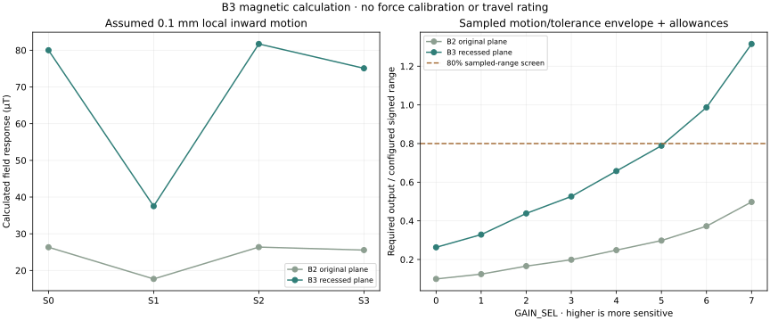

# B3 digital results and their limits

B3.1 supplies five checked CAD solids, gain-5 firmware, a raw recorder and the
retained B2 PCB. It is ready for an initial fabrication and fit experiment.
No assembled B3, force accuracy, lifetime or precision-task result exists.

## Geometric findings

| Check | Digital result |
|---|---|
| CAD exports | Five single solids; STEP round trips and watertight STL exports pass |
| Component face | Native X = 6.000 mm; inward shift 2.439 mm from B2 |
| Source material removed | 4.3426% of the hard frame's volume |
| Protected geometry | Nail, central material, mating face/key, jaw-bolt regions and inner TPU attachments preserved within numerical tolerance |
| Spacer feet | Both Ø4.8 mm bearing annuli fully seat in nominal CAD |
| Rigid part/package intersections | Zero in the checked nominal assembly |
| Package/front solder clearance | Minimum 0.500 mm |
| Additional hardware checks | 42 head/rear-solder overlap checks; all zero |
| Added global width with reserved heads | 3.611 mm, compared with B2's 6.050 mm; wires excluded |
| Added reach | 0 mm |

The recess has one common floor to produce a valid connected frame. The
spacer's narrow foot matches the source mounting land, then widens to support
the PCB. The original frame remains available as the B2/control option.

The checks establish geometric relationships, not printed stiffness,
thread retention or a 20 N mechanical rating. B3 has no structural force
prediction in this package. The actual print, mounting joint and changed
frame require the paired tests.

[CAD manifest](../prototypes/recessed/recessed_manifest.json) · [Clearance review](../prototypes/recessed/recessed_clearance_review.json)

## Magnetic calculation

The model uses four uniformly magnetized cylinders and the retained sensor
orientations. It samples side shifts of 0/1/2 mm, inward shifts of
0/0.5/1/2/3 mm and magnet-axis tilts of ±10° about two axes. Independent-source
intervals include combinations of these sampled states.

The explicit assumptions include magnet and sensor placement errors of
±0.25 mm each, dimension tolerances ±0.10 mm, remanence ±2%, sensor-axis error
4°, external native-axis fields bounded by 1 mT, electrical scale allowance
10% and output-offset allowance 250 µT. These assumptions require hardware
confirmation. They do not cover every continuous deformation or nearby
ferromagnetic object.

| Result under those assumptions | B2 plane | B3 recessed plane |
|---|---|---|
| Highest gain meeting the 80% signed-output screen | 7 | 5 |
| Required maximum fraction at the selected gain | 49.77% | 78.89% |
| Conservative sampled physical-vector bound including external field | 7.67 mT | 21.18 mT |
| Nominal field change for 0.1 mm local inward magnet movement | 17.7–26.4 µT | 37.5–81.7 µT |

At the recessed plane, gain 7 exceeds the modeled signed output range and
gain 6 exceeds the chosen 80% limit. B3 therefore uses gain 5. The separate
physical-field screen uses 80% of the standard-IMC part's documented 50 mT
saturation onset; both planes pass that assumed screen.
[Melexis rev012](https://media.melexis.com/-/media/files/documents/datasheets/mlx90393-datasheet-melexis.pdf)

Refining the cylinder quadrature at the sampled extrema changed the largest
component by less than 0.000001 µT, below the declared 0.05 µT numerical
limit. This only checks numerical integration. It does not validate the
material model, assumed motion, assembled magnet placement or force accuracy.

[Full field study with assumptions and source hashes](../prototypes/recessed/recessed_magnetic_review.json)

## What this supports

B3 is a narrower **candidate** for the magnetic experiment. The calculated
field change is larger at the closer board, but the required gain is lower.
Noise, usable force resolution, interference and calibration transfer remain
physical questions. Use the [paired test plan](RECESSED_TESTING.md) before
calling it better than B2.
