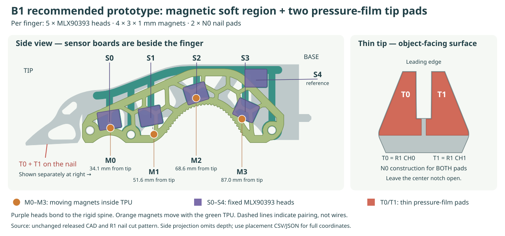
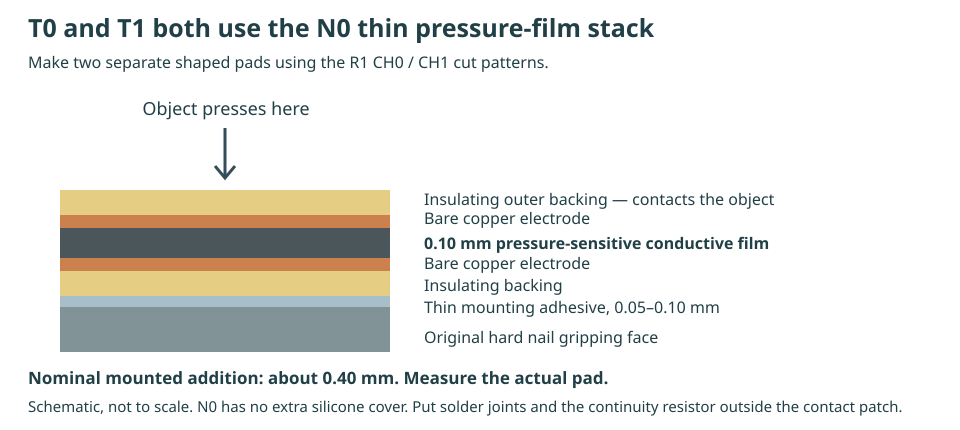

# Which sensors to use, and exactly where they go

For one page per design, use [the design directory](https://geyan21.github.io/yam-tactile-kit/designs.html). The [B1 page](https://geyan21.github.io/yam-tactile-kit/b1.html) gathers its sensor list, diagrams, assembly links and files in one place.

**For the new B1 prototype, build five MLX90393 magnetic heads, install four magnets in the soft TPU, and add two thin N0 pressure-film pads on the hard nail. All quantities below are per finger.**

This is the concrete prototype recommendation for your thin-tip, dexterous gripper. B1 is still awaiting physical validation and force calibration through the requested 20 N per finger range.

**For the consolidated version, use [B2.1's complete build guide](BUILD_B2.md).** It places these same five magnetic sensors on one checked PCB, with the mux and nail ADC on that board. The tables below describe the five-board B1 pilot. **C1 uses eight CEA-13-062UWA-350 gauges on a metal root beam, with no added nail layer:** see [its separate build and placement guide](BUILD_C1.md). Follow [the all-design campaign](BUILD_ALL.md) and [the architecture comparison](ARCHITECTURE.md) for the current status and planned measurements.

[Open the full-size placement drawing](../web/sensor-placement.svg) · [Exact placement CSV](../web/sensor-placement.csv) · [Full positions and orientations JSON](../web/sensor-placement.json)

## Order and make these sensing elements

| What | Exact choice | Quantity | Where to put it |
|---|---|---|---|
| Soft-region sensing electronics | **Melexis MLX90393SLW-ABA-011**, QFN-16, one on each custom B1 8 × 6.4 mm PCB | 5 heads | S0–S3 on the rigid side spine beside the soft contact regions; S4 toward the base |
| Moving magnetic targets | **supermagnete S-03-01-N**, N48, axially magnetized disc, 3 mm diameter × 1 mm thick | 4 | M0–M3 inside the four side-entry pockets in the TPU |
| Hard-tip contact sensors | **Two R1 N0 pressure-film laminates**: 0.10 mm Velostat/Linqstat-type conductive film between copper electrodes and insulating backing | 2 pads | T0 and T1 on the object-facing surfaces of the two hard nail prongs |
| Magnetic readout | TCA9548A multiplexer + Pico | 1 each | At the wrist/base; wires run on the fixed spine |
| Nail-pad readout | ADS1115 at 0x48, with the documented resistor circuits | 1 | At the wrist/base with the Pico |

Order **five assembled custom B1 heads** using the supplied [PCB fabrication files](../release/b1/pcb/b1_head_fabrication.zip), or assemble them from the listed IC and passives. MLX90393 is the sensor IC; it is not itself a complete tactile fingertip. The provided spine is sized for our custom PCB. Check dimensions before substituting a commercial breakout.

“N0” is our thin nail-pad construction, **not a product number**. Both T0 and T1 use N0. Adafruit **1361** is the pressure-sensitive conductive-sheet reference; it is material you cut into two separate shapes, not a finished sensor. Preserve the 0.10 mm film specification and record the actual supplier and lot if substituting. The [R1 cut sheet](../release/r1/r1_cut_sheet.pdf) supplies the CH0 and CH1 shapes.

## How the soft-region tactile sensor works

**Object presses TPU → TPU deforms → embedded magnet moves → fixed MLX90393 measures the field change.**

The complete tactile element is the combination of **TPU + magnet + magnetic sensor**. Keep the sensor PCB rigidly attached to the side spine, with its component face toward the magnets. Only the magnets move with the soft part. Route electronics and wiring on the fixed structure.

S0–S3 are paired with M0–M3 for identifying their primary sensing regions. Each head also responds to neighboring magnets; this is not a claim of four independent force channels.

S4 is the fifth, identical MLX90393 head near the base. Its job is to observe field changes that may help identify motor/ambient interference. It also sees the embedded magnets, so reference subtraction needs testing.

## Positions along this exact finger

Read the side drawing from **tip at left to base at right**. The distances below run along the CAD's length direction from the very end of the hard nail; they are not distances along the curved TPU surface.

| Soft region | Magnet in TPU | Fixed sensor head | Center separation |
|---|---|---|---|
| Distal soft region | M0: 34.1 mm from tip | S0: 33.7 mm from tip | 9.9 mm |
| Second soft region | M1: 51.6 mm from tip | S1: 50.4 mm from tip | 11.7 mm |
| Raised middle region | M2: 68.6 mm from tip | S2: 68.8 mm from tip | 9.7 mm |
| Proximal soft region | M3: 87.0 mm from tip | S3: 88.3 mm from tip | 10.1 mm |

**S4 reference:** 92.6 mm from the nail tip, on the upper/base portion of the fixed side spine.

The sensor and magnet positions are offset in both length and height; they are not glued together. The center separations above include the side gap. Use the printed B1 spine and the full coordinate/orientation JSON to locate the boards. Do not move a board directly onto the soft contact face to match a simplified sketch.

The existing [B1 placement CAD](../release/b1/b1_layout.svg) and [dimensioned review PDF](../release/b1/b1_review_drawings.pdf) provide the original coordinate system. This guide re-labels that same design; it does not change its geometry.

## Put real contact pads on the thin nail

The magnetic soft-region sensor does not reliably cover contact that occurs only on the rigid nail. **For your precision tasks, include T0 and T1 in the first complete prototype.**

- T0 is the CH0 cut pattern on one prong.
- T1 is the CH1 cut pattern on the other prong.
- Both attach to the **object-facing gripping surface**, not the back or side of the nail.
- Keep the center notch open; do not span it with a continuous conductive sheet.
- Use the N0 stack: sealed insulating laminate with no extra silicone cover. Its nominal mounted thickness is about **0.40 mm**; measure the actual thickness and resulting object access.

Follow [the exact N0 assembly recipe](BUILD_R1.md) for electrodes, insulation, the 100 kΩ continuity resistor, lead routing and mounting film. The sensor must touch the object through its insulating cover; bare copper is not the contact surface.

For this recommended complete B1 configuration, install the [nail electronics](B1_ELECTRONICS.md) and set `"nail_cells": true` in `engineering/firmware/b1/config.json`. The shipped false setting supports magnetic-only bench bring-up. It does not provide nail-contact coverage. “Optional” in the B1 hardware documents means the subsystem can be omitted—not that it is unnecessary for your thin-tip tasks.

## How this relates to R1 and L1

| Design | Sensor and location | Role |
|---|---|---|
| **B1 + two N0 pads — recommended new prototype** | Four magnet/TPU regions read by five fixed MLX90393 heads, plus two nail pressure-film pads | Preserve soft-region bending and sense thin-tip contacts |
| R1 — retained original tactile build | Six pressure-film cells: two nail pads and four cells on conformal TPU saddles | Alternative local tactile approach |
| L1 — retained separate force experiment | Purchased TAL220B load cell in the finger's root load path | Measure aggregate normal load after the documented force/moment checks |

The MLX90393 heads do not output newtons without a physical calibration. The N0 pads also need calibration and drift testing. L1's root load cell is a different measurement from local tactile contact; placing a load cell at the root does not identify which small contact patch touched an object.

## Sources, files and next action

- [MLX90393 manufacturer specification](https://www.melexis.com/en/product/MLX90393/triaxis-micropower-magnetometer).
- [S-03-01-N magnet specification](https://www.supermagnete.de/eng/data_sheet_S-03-01-N.pdf).
- [Pressure-sensitive conductive sheet, Adafruit 1361](https://www.adafruit.com/product/1361).
- [B1 BOM](../b1_bom.csv), [build steps](BUILD_B1.md), [wiring/firmware](B1_ELECTRONICS.md), and [physical tests](B1_TESTING.md).

The student's first complete build should therefore contain **four moving magnets, five fixed magnetic heads, and two thin nail pads**. Check each location individually with a probe before collecting force-calibration data.
