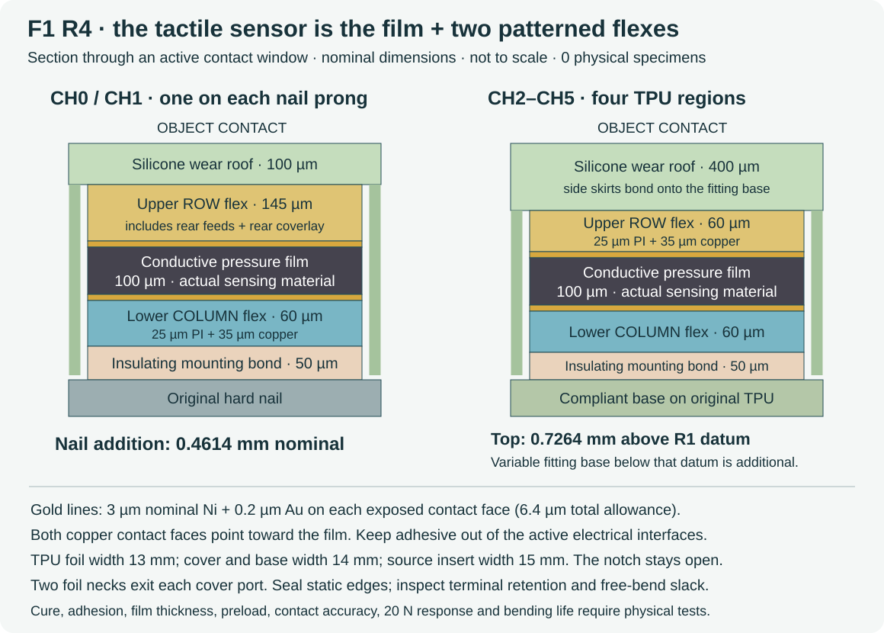
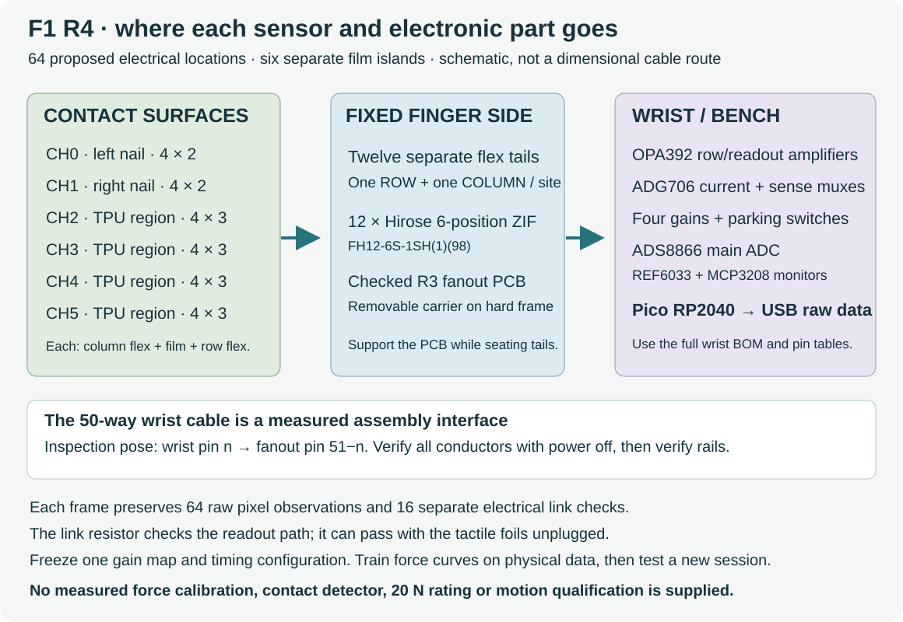

# F1.1 R4: build the dense resistive matrix

**F1 is a digital bench-assembly design; no physical specimen has been tested.**
The tactile sensor is a 0.10 mm pressure-sensitive conductive film between
two custom flexible electrode sheets. The film and electrodes belong on the
contact surfaces. The amplifiers, ADC and Pico belong on separate fixed
electronics.

Use the current R4 parts together. The earlier development modules remain
available for history; their terminal assumptions and 13 mm cover attempt
are not the current assembly.

## Which sensor, and where

| Location | Exact sensing construction | Electrical locations |
|---|---|---:|
| CH0, one nail prong | One film island between four row and two column electrodes | 8 |
| CH1, other nail prong | A second independent film island and flex pair | 8 |
| CH2–CH5, four TPU regions | Four separate film islands, each between four rows and three columns | 12 each |
| Fixed finger side | R3 fanout PCB with twelve Hirose FH12-6S-1SH(1)(98) connectors | Connects the twelve foils |
| Wrist or fixed bench | OPA392 amplifiers, ADG706 current/sense multiplexers, switched gains, ADS8866 ADC, reference and Pico | Reads the 64-location allocation |

The film reference is the R1 material class, exemplified by
[Adafruit 1361](https://www.adafruit.com/product/1361). Record the actual
supplier, lot and thickness. A generic conductive bag is not an identified
equivalent. The pressure response and lateral conduction remain to be measured.

The two nail row foils use rear feeds; the other ten foils have one physical
copper layer. Both F.Cu sensing faces point toward the film. The notch stays
open. TPU foils are 13 mm wide, with 14 mm covers and fitting bases inside
the 15 mm source insert.

Nominal nail addition is **0.4614 mm**. The TPU top is **0.7264 mm above the
R1 smoothed fitting datum**; the variable base below it is additional.
These are uncompressed geometry values, not measured tip deflection or wear
ratings. The original TPU remains compliant; actual tail slack during its
motion requires inspection.

## Get the matching files

| File or guide | Use |
|---|---|
| [Manufacturing and assembly](F1_MANUFACTURING.md) | Film/flex construction, materials, terminal coupons, covers, molds, bonds and cable acceptance |
| [Wiring and raw capture](F1_WRIST_CAPTURE.md) | Exact parts, GPIO, ADC sequencing, gain selection and recorder |
| [Physical testing](F1_TESTING.md) | Stationary-force training/evaluation and the remaining contact experiments |
| [Digital reproduction](F1_REPRODUCE.md) | Rebuild geometry, native foil checks, diagrams and packaged evidence |
| [Current package overview](../README.md) | Scope, directories and remaining physical work |
| [Per-finger materials](../bom.csv) | Mechanical/material purchasing list; use both full electronics component lists too |
| [Part index](../parts.csv) | Distinguishes fabricated parts, tools and reference envelopes |
| [Taxel map](../taxels.csv) | All 64 row/column locations and source coordinates |

`cad/` contains retained covers and bases, complete foil envelopes, PI/adhesive
terminal pieces, forming tools, twenty mold halves and the carrier/PCB fit
reference. `patterns/` contains the six developed film cuts and terminal
piece outlines. A printed electrode or connector envelope is not a working
electrical component.

`flex/` contains twelve distinct native designs, independent copper/
connectivity checks and development Gerber/drill sets. Use the complete
manufacturing contract and terminal coupons before a larger order.
`electronics/fanout/` and `electronics/wrist/` contain the matching checked
boards and their full component lists. Use the package's four-file firmware;
run host tools from the complete repository.

## What the digital checks establish

All twelve R4 flex designs pass the declared native copper/connectivity
checks. The two rear-coverlay windows retain at least 0.200 mm nominal
clearance to back copper including plated annuli; delivered registration and
material thickness still require acceptance checks.

The full static assembly screen covers **5,638 comparisons across 68
material parts**, against the source finger, carrier, board, component and
fastener envelopes, and one another. It finds no overlap above the declared
0.001 mm³ tolerance. It checks nonpenetration, not a minimum clearance.
**The twelve actual connector mating cavities remain unqualified**, represented
by forty explicit part-to-connector exclusions. No invented clearance holes
are used.

All ten cover/base mold pairs have passing cavity, registration and overflow
geometry checks. The original 13 mm TPU cover attempt failed because it
lacked side skirts; current covers and bases are 14 mm wide.

The actual routed-network DC model passes its provisional 1% electrical
interaction screen; its worst modeled interaction is **0.9253%**. It assumes
ideal feedback, independent resistor taxels and stated contact/spreading
allowances. It omits continuous-film lateral conduction, physical material
response, offsets/leakage and complete coupled dynamics. This is not a
force-accuracy or contact-reliability result.

The proposed 0.3132 mm connector tongue includes PI, copper, nominal finish,
200 µm stiffener and 50 µm adhesive. The two nail-row reinforcements use
separate tip/transition pieces to accommodate the backing step.
Actual seating, cable compatibility, adhesion, cured neck seals, strain
relief, drive clearance and loaded motion remain physical acceptance tasks.

## First build and comparison

Start with the carrier, one nail-row terminal coupon and one single-layer
terminal coupon. Check the actual Hirose seating and the installed drive.
Cast a bond/cover coupon before making all six sensors. Then assemble the
full finger following the manufacturing guide.

Bring up the electronics with known loads, choose a fixed gain map, and
record physical holds through 20 N. The new force tool requires a new
evaluation session, all six sites and mixed contacts. It preserves missing
and saturated trials. No measured model or qualified contact detector is
included.

F1 is useful to compare when dense contact location justifies custom flex
manufacture, a side board and more assembly work. Check false contacts during
no-contact bending, contact-shape dependence, drift, hysteresis and wear,
then compare the same thin-tip precision tasks with the simpler designs.
No physical winner has been established.
